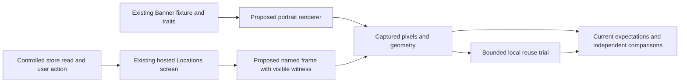

# Render requested snapshot frames

## Planning checkpoint

The user requested a plan, execution, and iteration on a greenfield frame runner for Flight Status Banner and Locations. The implementation is on `perf/snapshot-requested-frames` in [PR 540](https://github.com/kyleve/Stuff/pull/540), an independent child of PR 524. Plan 01 verified the same 20 Banner references using a single native mount and refined the Locations selection condition until the real screen matched its delayed independent control. Plan 02 verified bounded, cross-process reuse and measured the cost of opening the session. Plans 01–02 are complete. The final Locations timing trial reversed execution order and showed that the timing winner changed with the order. The supported production candidate is single-mount native capture for the verified Banner cases. [STU-121](https://linear.app/kve/issue/STU-121) tracks the measurements.

On November 18 the user requested an extension to additional views. Plan 03 extended the experiment to 72 additional images in nine suites including the original control suite. The 54 additional images that already skip timed settling all matched and took 46–55% less capture time. The six InstallerKit cards also matched; the eight hatched calendars and four Year picker images still need the existing host for exact pixels. Root verified both execution orders and published the expanded results on the same PR.

The user requested another 200 unique images and accepts limited capture-timing drift. [Plan 04](04-two-hundred-more.md) ran six comparisons on the production harness. Keeping the native host and drawing earlier saved 44 seconds in each order. The early draw matched 195 live production images exactly, shifted four by at most 2/255 per channel and captured a still-loading widget in the Flyover iPad list. The plan identifies 147 opt-in candidates across the measured selection.

The full-suite extension covered all 877 reviewed images. Keeping the measurement host reproduced all ordinary comparisons in both orders, with little change in runtime. Drawing earlier saved 126.5–128.2 seconds across matched cohorts. Four installer-site pages lost content intermittently, a Flyover widget remained on its loading indicator, and two large-text toolbar images drew an oversized icon. [Plan 05 and the per-image results](05-suite-coverage.md#measured-results)

## User stories and requirements

- US-01. A test author specifies an immutable flight state and environment and receives the ordinary production frame. R-01 measures mounts, explicit sleeps, full renders, geometry and pixels against existing references.
- US-02. A test author drives a real Locations screen through loading, data delivery and a visible selection. R-02 retains one host for the sequence, associates each frame with visible semantics, and compares it to an independent host at the same milestone. R-03 distinguishes label, layout and transition regressions.
- US-03. A reviewer can assert geometry and image content from the same output. R-04 explores reusing immutable portrait output under declared inputs while always comparing against the current expectation. Count cold renders and warm hits separately from independent lifecycle checks.
- US-04. A test author can see which additional production fixtures qualify for single-mount capture. R-05 compares identical requests in two processes, isolating the effect of skipped waits where the current policy settles.
- US-05. A reviewer can evaluate earlier capture for 200 additional references. R-06 requires 200 identities outside Plan 03, comparable timings, per-panel verdicts, and a visual explanation for material differences.
- US-06. A reviewer can identify the fidelity and cost of retaining a mount for every checked-in image. R-07 requires accounting for every reference on the same production harness, including fixed controls, annotated images, website captures and every sheet panel.

The user approved the two examples and authorized implementation and iteration on November 18. The prototype retains the production views and fixtures. X-01 keeps product behavior, capture defaults and reviewed references intact. X-02 limits reuse to experimental inputs on the local machine. Project-wide adoption, remote caching, and a virtual clock for Apple's compositor require separate decisions.

## Execution order and horizon

| Plan | Scope and owner |
| --- | --- |
| [01 — State portraits and named frames](01-state-and-scenario.md) | Root coordinates. The Banner and Locations investigators own separate probe files in the same worktree. Root runs the simulator serially, reviews results and publishes. |
| [02 — Reuse and falsification](02-frame-reuse.md) | The artifact investigator owns the offline experiment. It consumes a real frame and the verification results from 01. |
| [03 — Broader single-mount trial](03-broader-single-mount.md) | Extend 01 to real intrinsic component fixtures in WhereUI and InstallerKitUI. |
| [04 — Two hundred more](04-two-hundred-more.md) | Root runs the six-arm/pass combinations. Fixture, assertion and renderer investigators own the inventory, evidence and capture paths. |
| [05 — Full suite](05-suite-coverage.md) | Run the remaining production-harness cases in both orders, reconcile all paths with Plan 04 and inspect visible differences. |

## Reproduce

Run from the repository root on the pinned iOS simulator:

```sh
Plans/2026-11-18-requested-snapshot-frames/run-prototype
```

To run the broader component comparison, use `Plans/2026-11-18-requested-snapshot-frames/run-prototype --mount-matrix`. Both commands print their output directory. The matrix writes one report per test bundle and process, retains differing PNGs, and prints an aggregate report in `matrix-summary.txt`.

For plans 01 and 02, each pass exports Banner images and matched timings in `banner/`, Locations images and visible witnesses in `locations/`, and individual cache lookups in `frame-reuse.json`. The host-side audit compares PNG bytes first and decodes differences into premultiplied sRGB. Read `pixels.txt` for both passes. The simulator logs include the separate per-process cache setup cost.

Both `run-prototype` modes temporarily include their probes in the existing test bundles, then regenerate the normal project and rebuild those bundles through focused control tests. Run one invocation per checkout. Generated images, timings and cache stay in the printed temporary directory.

For the 200-image production-harness experiment, run `Plans/2026-11-18-requested-snapshot-frames/run-200`. It uses the checked-in test methods directly. The output directory contains six sets of PNGs, verdicts and timing logs. Read `summary-200.json` for results grouped by suite, capture policy and image type, as well as individual comparisons.

For the whole-suite result, pass the 200-image output directory to the [Plan 05 reproduction command](05-suite-coverage.md#reproduce).

## Evidence and decisions

On the #539 verification, the 22 Banner captures already performed zero settle samples. The intrinsic implementation hosts a measurement wrapper followed by a capture wrapper. The 54 Locations captures spent 35.663 seconds in final settling. These are historical suite costs. The prototype branch starts at [PR 524](https://github.com/kyleve/Stuff/pull/524), revision `e479fa140`. Its ordinary references for these subjects match merged #539. The six annotated references differ and remain owned by their native capture paths. The actual WhereUI fixtures, harness timings and Core flight tests supply the baseline.

The production Banner takes immutable review data. Locations already supports a gated first store read and exposes selectable region cards. [SwiftUI ImageRenderer](https://developer.apple.com/documentation/swiftui/imagerenderer) rasterizes SwiftUI drawing primitives and uses placeholders for some platform content. This makes the Banner a candidate for checking direct rendering. Locations retains UIKit hosting. [Compose test synchronization](https://developer.android.com/develop/ui/compose/testing/synchronization) provides precedent for controlling application events separately from native drawing. We use an explicit response gate in Locations.

## Questions and resolutions

| ID | Status | Resolution or experiment |
| --- | --- | --- |
| Q-01 | closed | The user authorized a prototype and iteration. Accepted or rejected approaches need reproducible evidence. Adoption is outside X-01. |
| Q-02 | closed | Plan 01 reproduced all 20 ordinary Banner references on one native mount. Real navigation completion and the entire target month on screen reproduced the selected Locations frame. The title alone captured mid-transition pixels. |
| Q-03 | closed | Plan 02 replayed an immutable portrait across two processes and rejected the wrong expectation. Local session setup costs more than one fresh portrait. Broader reuse remains outside X-02. |
| Q-04 | closed | The 26 widget and 28 already-immediate calendar images reproduced every reviewed PNG in four passes. Six InstallerKit cards qualified on pixels with immediate capture. Restoring final settlement on the single mount did not consistently reproduce hatched months or the Year picker. See Plan 03 for paired timings. |
| Q-05 | closed | On 200 new images, retaining the mount saved 0.5–2.0 seconds. Drawing earlier on 154 eligible native captures saved 44 seconds in each order. Keep the Flyover iPad list settled. Plan 04 records the visual checks and scope. |
| Q-06 | closed | All 877 references were compared with their native controls in both orders. A fixture-level early opt-in for 404 verified images projects 118–120 seconds saved. Plan 05 records the seven visible exceptions, the WebKit family restriction, and all per-image results. |

## Design



## Review

On 2026-11-18 the artifact investigator independently reviewed both plans against e479fa140. The review added pre/post-draw selection evidence, fresh native image controls, explicit repeat counts, and a limited cache namespace with real miss invocations and a changed-reference witness. Root checked the ordinary reference inventories, plan links and dependency order. The Mermaid flow was source-reviewed. The independent review of plans 01–02 checked the raw PNGs, native controls, changed-expectation failures and scope timings. It caught a navigation predicate that could pass with zero attached controllers and a cleanup race if a second invocation started during restoration. The corrected probe requires a real controller. The launcher holds an exclusive checkout directory through the rebuild. Injected interruptions, conflicting sources and concurrent invocations exercised the cleanup paths.

The Where investigator checked Plan 03 against the fixture declarations and checked-in references. The review distinguished the original Banner control from 54 additional already-immediate frames, and identified the planned-stay hatching, native Year picker and above-viewport Dynamic Type card as useful tests of fidelity.

The broader trial received a separate review of the complete implementation and both pairs of simulator artifacts. The reviewer checked absolute timings, restored project membership, arm order and omissions, and inspected the glass rim in the accessibility-size Year picker. Auditing a temporary report with a missing arm, a changed digest or a substituted same-size PNG failed as expected.
