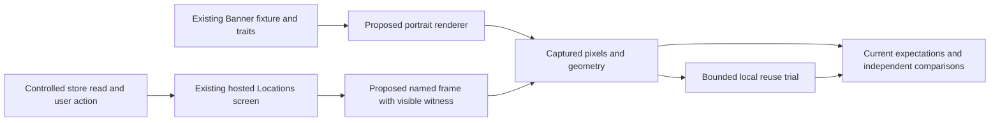

# Render requested snapshot frames

## Planning checkpoint

The user requested a plan, execution, and iteration on a greenfield frame runner for Flight Status Banner and Locations. The implementation is on `perf/snapshot-requested-frames` in [PR 540](https://github.com/kyleve/Stuff/pull/540), an independent child of PR 524. Plan 01 verified the same 20 Banner references using a single native mount and refined the Locations selection condition until the real screen matched its delayed independent control. Plan 02 verified bounded, cross-process reuse and measured the cost of opening the session. Both plans are complete. The final Locations timing trial reversed execution order and showed that the timing winner changed with the order. The supported production candidate is single-mount native capture for the verified Banner cases. [STU-121](https://linear.app/kve/issue/STU-121) tracks the measurements.

## User stories and requirements

- US-01. A test author specifies an immutable flight state and environment and receives the ordinary production frame. R-01 measures mounts, explicit sleeps, full renders, geometry and pixels against existing references.
- US-02. A test author drives a real Locations screen through loading, data delivery and a visible selection. R-02 retains one host for the sequence, associates each frame with visible semantics, and compares it to an independent host at the same milestone. R-03 distinguishes label, layout and transition regressions.
- US-03. A reviewer can assert geometry and image content from the same output. R-04 explores reusing immutable portrait output under declared inputs while always comparing against the current expectation. Count cold renders and warm hits separately from independent lifecycle checks.

The user approved the two examples and authorized implementation and iteration on November 18. The prototype retains the production views and fixtures. X-01 keeps product behavior, capture defaults and reviewed references intact. X-02 limits reuse to experimental inputs on the local machine. Project-wide adoption, remote caching, and a virtual clock for Apple's compositor require separate decisions.

## Execution order and horizon

| Plan | Scope and owner |
| --- | --- |
| [01 — State portraits and named frames](01-state-and-scenario.md) | Root coordinates. The Banner and Locations investigators own separate probe files in the same worktree. Root runs the simulator serially, reviews results and publishes. |
| [02 — Reuse and falsification](02-frame-reuse.md) | The artifact investigator owns the offline experiment. It consumes a real frame and the verification results from 01. |

## Reproduce

Run from the repository root on the pinned iOS simulator:

```sh
Plans/2026-11-18-requested-snapshot-frames/run-prototype
```

The driver prints its output directory. Each pass exports Banner images and matched timings in `banner/`, Locations images and visible witnesses in `locations/`, and individual cache lookups in `frame-reuse.json`. The host-side audit compares PNG bytes first and decodes differences into premultiplied sRGB. Read `pixels.txt` for both passes. The simulator logs include the separate per-process cache setup cost.

The runner temporarily includes the probes in the two existing test bundles, then regenerates the normal project and rebuilds those bundles through focused control tests. Run one invocation per checkout. Its generated images, timings, and cache stay in the printed temporary directory.

## Evidence and decisions

On the #539 verification, the 22 Banner captures already performed zero settle samples. The intrinsic implementation hosts a measurement wrapper followed by a capture wrapper. The 54 Locations captures spent 35.663 seconds in final settling. These are historical suite costs. The prototype branch starts at [PR 524](https://github.com/kyleve/Stuff/pull/524), revision `e479fa140`. Its ordinary references for these subjects match merged #539. The six annotated references differ and remain owned by their native capture paths. The actual WhereUI fixtures, harness timings and Core flight tests supply the baseline.

The production Banner takes immutable review data. Locations already supports a gated first store read and exposes selectable region cards. [SwiftUI ImageRenderer](https://developer.apple.com/documentation/swiftui/imagerenderer) rasterizes SwiftUI drawing primitives and uses placeholders for some platform content. This makes the Banner a candidate for checking direct rendering. Locations retains UIKit hosting. [Compose test synchronization](https://developer.android.com/develop/ui/compose/testing/synchronization) provides precedent for controlling application events separately from native drawing. We use an explicit response gate in Locations.

## Questions and resolutions

| ID | Status | Resolution or experiment |
| --- | --- | --- |
| Q-01 | closed | The user authorized a prototype and iteration. Accepted or rejected approaches need reproducible evidence. Adoption is outside X-01. |
| Q-02 | closed | Plan 01 reproduced all 20 ordinary Banner references on one native mount. Real navigation completion and the entire target month on screen reproduced the selected Locations frame. The title alone captured mid-transition pixels. |
| Q-03 | closed | Plan 02 replayed an immutable portrait across two processes and rejected the wrong expectation. Local session setup costs more than one fresh portrait. Broader reuse remains outside X-02. |

## Design



## Review

On 2026-11-18 the artifact investigator independently reviewed both plans against e479fa140. The review added pre/post-draw selection evidence, fresh native image controls, explicit repeat counts, and a limited cache namespace with real miss invocations and a changed-reference witness. Root checked the ordinary reference inventories, plan links and dependency order. The Mermaid flow was source-reviewed. The final independent review checked the raw PNGs, native controls, changed-expectation failures and scope timings. It caught a navigation predicate that could pass with zero attached controllers and a cleanup race if a second invocation started during restoration. The corrected probe requires a real controller. The launcher holds an exclusive checkout directory through the rebuild. Injected interruptions, conflicting sources and concurrent invocations exercised the cleanup paths.
