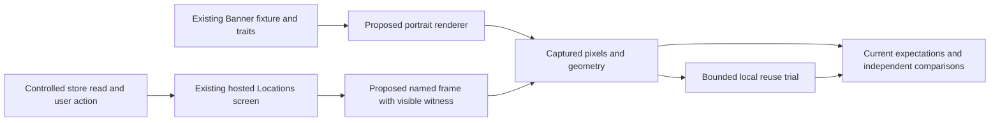

# Render requested snapshot frames

## Planning checkpoint

The user requested a plan, execution, and iteration on a greenfield frame runner for Flight Status Banner and Locations. Root owns this branch and publication above PR 524. Both experiments are reviewed. The host, artifact and rejection boundaries are defined in plans 01 and 02. Next run plan 01, followed by the reuse and falsification audit. [STU-121](https://linear.app/kve/issue/STU-121) tracks the measurements.

## User stories and requirements

- US-01. A test author specifies an immutable flight state and environment and receives the ordinary production frame. R-01 measures mounts, explicit sleeps, full renders, geometry and pixels against existing references.
- US-02. A test author drives a real Locations screen through loading, data delivery and a visible selection. R-02 retains one host for the sequence, associates each frame with visible semantics, and compares it to an independent host at the same milestone. R-03 distinguishes label, layout and transition regressions.
- US-03. A reviewer can assert geometry and image content from the same output. R-04 explores reusing immutable portrait output under declared inputs while always comparing against the current expectation. Count cold renders and warm hits separately from independent lifecycle checks.

The user selected Flight Status Banner and Locations and authorized implementation and iteration on November 18. This experiment delegates renderer and fixture choices to the implementation team. X-01 keeps product behavior, capture defaults and reviewed references intact. X-02 limits reuse to experimental inputs on the local machine. Project-wide adoption, remote caching, and a virtual clock for Apple's compositor require separate decisions.

## Execution order and horizon

| Plan | Scope and owner |
| --- | --- |
| [01 — State portraits and named frames](01-state-and-scenario.md) | Root coordinates. The Banner and Locations investigators own separate probe files in the same worktree. Root runs the simulator serially, reviews results and publishes. |
| [02 — Reuse and falsification](02-frame-reuse.md) | The artifact investigator owns the offline experiment. It consumes a real frame and the verification results from 01. |

## Evidence and decisions

On the #539 verification, the 22 Banner captures already performed zero settle samples. The intrinsic implementation hosts a measurement wrapper followed by a capture wrapper. The 54 Locations captures spent 35.663 seconds in final settling. These are historical suite costs. The prototype branch starts at [PR 524](https://github.com/kyleve/Stuff/pull/524), revision `e479fa140`. Its ordinary references for these subjects match merged #539. The six annotated references differ and remain owned by their native capture paths. The actual WhereUI fixtures, harness timings and Core flight tests supply the baseline.

The production Banner takes immutable review data. Locations already supports a gated first store read and exposes selectable region cards. [SwiftUI ImageRenderer](https://developer.apple.com/documentation/swiftui/imagerenderer) rasterizes SwiftUI drawing primitives and uses placeholders for some platform content. This makes the Banner a candidate for checking direct rendering. Locations retains UIKit hosting. [Compose test synchronization](https://developer.android.com/develop/ui/compose/testing/synchronization) provides precedent for controlling application events separately from native drawing. We use an explicit response gate in Locations.

## Questions and resolutions

| ID | Status | Resolution or experiment |
| --- | --- | --- |
| Q-01 | closed | The user authorized a prototype and iteration. Accepted or rejected approaches need reproducible evidence. Adoption is outside X-01. |
| Q-02 | open | Plan 01 tests which static frames reproduce the current pixels and when a visible Locations milestone agrees with an independent native frame. The answer determines adoption guidance, and does not block the trial. |
| Q-03 | open | Plan 02 tests cold and warm costs and rejection witnesses under its stated cache boundary. Broader cache eligibility depends on evidence about hidden inputs. |

## Design

## Plan review

On 2026-11-18 the artifact investigator independently reviewed both plans against e479fa140. The review added pre/post-draw selection evidence, fresh native image controls, explicit repeat counts, and a limited cache namespace with real miss invocations and a changed-reference witness. Root checked the ordinary reference inventories, plan links and dependency order. The Mermaid flow was source-reviewed. The approved experiments can produce negative results.
