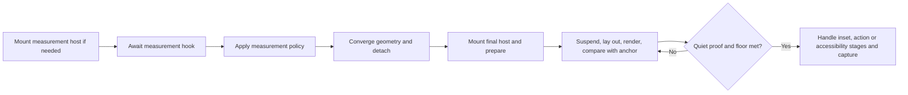

# Compare settlement clocks and explicit readiness

Status: executing. Depends on the [completed measurement baseline](../2026-11-18-comparison-sheets/README.md). See [scope and review](README.md) for R-01 through R-03 and X-01.

These stages exist. The experiments change one clock at a time. In Swift the candidates are a 10ms asynchronous poll, a temporary `window.layer.speed = 100`, and `settle: .immediate` for components whose supplied content and layout are synchronous.

1. Reconcile the PR 531 local and CI traces by reason, clock budget, passes and first/later changes. Time wall-clock floors separately from the overlapping sample work. Explain why a settled measurement host is insufficient as a general final-frame guarantee.
2. Run a bounded main-actor pump versus suspend probe and a real hosted Core Animation versus delayed Swift task probe. Compare the 10ms async cadence and 100× layer speed separately on Calendar, Settings and Root using fresh hosts, equivalent exports, ordinary references and `./test --no-generate --review --timings --record never`. Retain a global change only with repeated elapsed gains, correct delayed and animated endpoints, and stable capture behavior. A passing microbenchmark alone cannot select the shared policy.
3. Compare final immediate layout for standalone Calendar months and badges to standard and 500ms-later fresh-host controls. Retain it only with matching full pixels, geometry, test coverage and a repeated focused benefit. Keep the loading, scrolling and native chrome cases as controls. Record the headroom and missing proof for other measurement approaches. Remove temporary switches, then check affected suites, format, review and publish the supported result. Negative findings can complete either clock trial.
