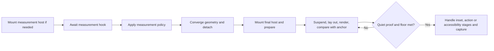

# Compare settlement clocks and explicit readiness

Status: executing. Depends on the [completed measurement baseline](../2026-11-18-comparison-sheets/README.md). See [scope and review](README.md) for R-01 through R-03 and X-01.

These stages exist. The experiments change one clock at a time. In Swift the candidates are a 10ms asynchronous poll, a temporary `window.layer.speed = 100`, and `settle: .immediate` for components whose supplied content and layout are synchronous.

1. Reconcile the PR 531 local and CI traces by reason, clock budget, passes and first/later changes. Time wall-clock floors separately from the overlapping sample work. Explain why a settled measurement host is insufficient as a general final-frame guarantee.
2. Run a bounded main-actor pump versus suspend probe and a real hosted Core Animation versus delayed Swift task probe. Compare the 10ms async cadence and 100× layer speed separately on Calendar, Settings and Root using fresh hosts, equivalent exports, ordinary references and `./test --no-generate --review --timings --record never`. Retain a global change only with repeated elapsed gains, correct delayed and animated endpoints, and stable capture behavior. A passing microbenchmark alone cannot select the shared policy.
3. Compare final immediate layout for standalone Calendar months and badges to standard and 500ms-later fresh-host controls. Retain it only with matching full pixels, geometry, test coverage and a repeated focused benefit. Keep the loading, scrolling and native chrome cases as controls. Record the headroom and missing proof for other measurement approaches. Remove temporary switches, then check affected suites, format, review and publish the supported result. Negative findings can complete either clock trial.

The traces identify 246 captures with separate sampled measurement and content waits. To investigate R-01 and R-03, also run a measurement-only prototype on Settings, Root and Resolution. Poll the existing intrinsic sizing function with the same minimum elapsed time and quiet period, then perform the ordinary final pixel check. Log initial, resized and final geometry in both arms. Exercise a fixture that paints progress before a late height change. Reject global use if the final frame can have the right color in a clipped viewport. This prototype has no production API.

## Where the time goes

The [PR 531 baseline](../2026-11-18-comparison-sheets/01-sheet-composition.md) captured 935 images on the iPhone 17 simulator. The local run took 734.851s. CI times below sum elapsed work on four workers and cannot be subtracted directly from the duration of the slowest job.

| Settle work | Local | CI, summed |
| --- | ---: | ---: |
| All calls, including immediate layout and retries | 443.204s | 618.345s |
| Draw hierarchy for stability samples | 321.405s | 501.976s |
| Actual asynchronous sleeps | 109.415s | 98.711s |
| Layout before samples | 3.952s | 5.753s |
| Normalize and compare pixels | 1.596s | 1.928s |
| Samples | 5,829 | 4,495 |

Both runs completed 1,193 sampled waits and 625 immediate waits. CI also timed out once. The minimum durations for those 1,193 waits add up to **376.750s**. Rendering and sleeping already use that time. The successful waits took 439.776s locally and 605.667s in CI. Even zero-cost samples would therefore save at most 63.026s locally and 228.917 summed CI seconds on those waits with the same floors.

| Reason, including immediate calls | Local | CI, summed |
| --- | ---: | ---: |
| Final content | 324.528s | 452.453s |
| Measurement | 82.027s | 115.369s |
| Native insets | 13.465s | 15.181s |
| After an action | 14.136s | 23.076s |
| Accessibility preparation | 9.048s | 12.266s |

### What a pass proves

1. The [settle loop](../../Shared/SnapshotKitTesting/Sources/SnapshotRenderingSupport.swift) suspends the task for 16ms, which lets other main-actor work run. On resumption it flushes layout with implicit animations disabled, then draws the visible hierarchy with pending screen updates into a bitmap at 0.25 pixels per point. An average draw took 55ms locally and 112ms in CI. The suspension adds to the draw time.
2. The [pixel check](../../Shared/SnapshotKitTesting/Sources/SnapshotPixelStability.swift) normalizes the bitmap to premultiplied sRGB. Every channel must stay within one unit of the fixed anchor for two more samples spanning at least 120ms. A different image starts a new anchor. The call also needs 250ms elapsed by default. Individual cases can declare a longer minimum. A moving view eventually times out. A slow renderer that has yet to see motion gets a bounded extension to collect evidence.
3. Intrinsic measurement mounts the content controller inside a temporary wrapper, runs its measurement hook, applies its measurement policy, then converges the viewport using fitting size and scroll extents. The renderer detaches the controller and mounts it in the final wrapper. A resize, a new appearance callback or a restarted task can change the frame again. Of 808 measurement calls, 562 already used immediate layout. The other 246 spent 78.680s locally settling before sizing and another 82.991s settling the final content. CI spent 109.492s and 113.283s on those same stages. [Renderer and sizing implementation](../../Shared/SnapshotKitTesting/Sources/SnapshotImageRendering.swift)

Only 41 successful waits locally and 45 in CI observed any changed sample. Silence during a sample interval gives limited evidence about a future update. In one local Root measurement the images met the quiet criterion after 607ms and changed again at 1.031s. In an earlier Settings trial, immediate measurement produced a height error in **all 16** references, typically 52pt. [Controlled measurement trials](../2026-11-17-snapshot-settling-investigation/03-controlled-experiments.md)

The bitmap is small. Producing its pixels still goes through UIKit hierarchy drawing, compositing and color conversion. An earlier simulator Time Profiler run attributed 1.740s of its 3.793s of sampled settle-render CPU time to color conversion. Wall-stack samples also caught render-server waits. Changing the sampling format reduced rendering work, but more samples then fit inside the floor. A later trial that skipped some draws inside longer floors also failed to show a repeatable elapsed gain. [Renderer profile](../2026-11-17-snapshot-settling-investigation/03-controlled-experiments.md) · [Sampling cadence experiment](../2026-11-17-snapshot-settling-investigation/10-deadline-aware-sampling.md)

### Which clocks can move

The synchronous `waitFor` runs the default run loop in 1ms slices. It can service a timer or a transaction. A nested run loop entered from a main-actor job can also keep the queued main-actor job that produces the desired UI from running. A host-side probe reproduced this six times. Each 80ms pump delivered the timer and left both the queued dispatch callback and the queued actor task pending. Suspending delivered both. The asynchronous `waitForAsync` sleeps 10ms between checks of a caller-supplied predicate. Settlement similarly releases the actor but has to obtain its predicate by drawing. [Test support](../../Shared/TestHostSupport/Sources/TestHostSupport.swift) · [Existing red-to-green SwiftUI task regression](../../Shared/SnapshotKitTesting/Tests/AsyncContentCaptureTests.swift)

The snapshot host disables UIView animations, clears the SwiftUI transaction's animation, sets `disablesAnimations` and suppresses implicit actions during layout. Test support's 100× layer speed belongs to its separate window-presentation helper. A faster window layer advances animations in its timing tree. Application tasks, wall-clock deadlines and settlement's minimum and quiet intervals keep their own clocks. [Snapshot hosting controller](../../Shared/SnapshotKitTesting/Sources/SnapshotHostingController.swift) · [Apple's layer timing guide](https://developer.apple.com/library/archive/documentation/Cocoa/Conceptual/CoreAnimation_guide/AdvancedAnimationTricks/AdvancedAnimationTricks.html)

On the iOS simulator the synchronous pump ran 84ms, fired its timer, and left its queued main-actor task pending until the asynchronous wait. A second probe put a real 600ms explicit opacity animation and a 160ms application task in the same capture. At 1× the animation finished in 602ms and was about 27% complete when the task woke. At 100× it finished in 20ms and was already fully opaque when the task woke. The application task took 164–167ms at both speeds. All four captures reached both expected green endpoints.

Each row below compares two runs of the same instrumented binary on one simulator. Calendar, Settings and Root supplied 86 captures per run. Each run recorded ten changed samples. Both clock candidates matched the normal reference assertions.

| Policy | Swift Testing elapsed, runs 1 / 2 | All settle calls, runs 1 / 2 | Sample draws, runs 1 / 2 |
| --- | ---: | ---: | ---: |
| Ordinary 16ms, 1× | 72.373 / 72.480s | 50.701 / 50.801s | 579 / 581 |
| 16ms, 100× window layer | 71.893 / 72.664s | 50.516 / 50.786s | 581 / 581 |
| 10ms, 1× | 71.447 / 71.406s | 50.192 / 50.212s | 637 / 640 |

The 100× result changes direction on repeat. Polling at 10ms consistently saved about 1.0s out of 72.4s locally (1.4%), with 10% more draws. Mean sleep fell 1.76s and mean render time rose 1.15s. Calendar and Root got faster while Settings took slightly longer in both pairs. Keep the shared cadence. The loaded CI baseline already spent 502 worker-seconds drawing samples, and this experiment measures neither a CI gain for 10ms nor a suite-wide gain.

### Which Calendar waits can be removed

The standalone month grid constructs its contents synchronously from the loaded report. The badge fixture receives literal day values. Both already allowed immediate measurement. For the final draw, `.immediate` yields once, checks cancellation and flushes layout with implicit animations disabled. It skips the sample renders and minimum wait. The ordinary scrolling Calendar has a task and an initial scroll position to resolve. That screen stayed on the normal policy throughout the trial.

Two serial controls took 38.909s and 39.134s for the Calendar suite. Setting all 40 standalone captures to immediate layout took 28.156s and 27.967s. All ordinary references passed, but full-resolution RGBA comparison gave a more discriminating result.

| Full-resolution comparison | Exact | Largest channel delta |
| --- | ---: | ---: |
| Control against second control, three suites | 86/86 | 0 |
| Control against independent host delayed 500ms, Calendar | 66/66 | 0 |
| Immediate against repeated immediate, Calendar | 66/66 | 0 |
| All 40 immediate subjects against either settled control or delayed host | 32/40 | 1/255 |

The eight differing captures are `Itinerary`, `ItineraryOverlap`, `FocusedPlannedStay` and `MultiRegionPlannedStay` in light and dark. Across all eight, exactly 718 pixels differ by one color level. Alpha and dimensions agree. Pixel overlays locate every difference in the end cell of a hatched segment, on the diagonal strokes or clipped edge. Retain normal settling for those four fixtures and as the default for new months. The 32 exact captures cover the remaining seven standalone month fixtures and the two standalone badge and accessibility fixtures. The other 26 Calendar captures include the scroll-position controls. Both scroll-position captures actually changed during settlement.

With just those 32 opt-ins, Calendar took **30.910s** compared with the 39.022s control mean, an 8.112s (20.8%) saving. All 66 exports were byte-identical to the control and the independently delayed host. The clean rebuild took 30.804s. On PR 531 the 32 cases spent 8.646s locally and 11.496 summed CI seconds in the final content check alone. Those CI costs are baseline measurements.

Independent review found that Flyover also consumes the ordinary Calendar registration. Two shared component cases initially forwarded the shorter wait into an export container with different chrome. Scope their opt-in to `measuredSnapshots` and check the actual two Flyover export policies. The standalone month selections already apply only to the month subject.

### Can the two waits be combined?

The measurement experiment used 38 captures from Resolution, Root and Settings. Of the 36 with both active intrinsic measurement and content checks, 22 changed viewport dimensions. The 14 that kept their dimensions all changed effective host safe-area insets between measurement and final mounting. None preserved the observed viewport, bounds and insets throughout. A matching final PNG height cannot establish that the second draw has the same inputs.

For a separate counterexample, a hosted view painted progress every 40ms and grew from 80pt to 240pt after 18 ticks. Normal pixel settlement captured the completed green view at 240pt. Polling the actual intrinsic height with the same floor and quiet proof accepted 80pt. The final pixel settle then reached the same green state, but the exported image was still just 80pt tall. A fully drawn final frame can silently clip content when the earlier size decision was premature.

The real geometry trial reported stable heights for all 36 cases across 721 observations. Resolution (18) and Root (4) matched the ordinary PNGs exactly. **All 16 Settings images were too short**, including the default iPhone's last About row. Fifteen lost 156 pixels (52pt), and AX5 lost 219 pixels (73pt). The measurement wait fell just 15.198s → 14.237s despite reducing 10.069s of sampled drawing to 0.250s of layout and geometry reads. This rejects the default geometry-only path.

To investigate Settings, draw the actual low-resolution hierarchy once when the minimum time and preliminary geometry proof are met. Then read the intrinsic height again and require a new quiet period if it changed. All 16 Settings height estimates changed on the first read following the draw. **All 38 final images matched the ordinary control byte-for-byte.** The synthetic late-loading view still clipped at 80pt. Those 36 individual draws took 3.161s altogether. Waiting until the floor to draw and prove the height again increased measurement time to 19.611s. This late-draw schedule added 4.413s across the 36 measured waits.

The clock-only control replaced each draw with an asynchronous sleep of that particular draw's duration and kept the geometry criteria. The 36 sleeps totaled 3.283s for 3.161s requested. All 38 images matched the zero-draw trial byte-for-byte, including all 16 clipped Settings images. The synthetic fixture again returned 80pt. On this runtime, a draw with `afterScreenUpdates: true` changes state used by Settings' sizing and convergence. Releasing the main actor for the same elapsed time does not reproduce that effect. The experiment does not identify an internal UIKit function or a single row as the cause.

The promising measurement experiment under [STU-121](https://linear.app/kve/issue/STU-121) is an earlier committed draw paired with a signal from the mounted content that height-changing work has finished. Check the converged size and final image against the current path, including the late-growing fixture. The tested one-draw policy by itself misses that update. For component snapshots, the demonstrated saving comes from identifying synchronous subjects at their fixture declarations.

## Verification

All trials used the pinned iPhone 17 simulator with iOS 27.2, ordinary references and recording disabled. Clock control and treatment reused the same built products. Independent image auditing checked identities, dimensions and full decoded pixels, including alpha. The late control mounted fresh content before adding 500ms to the ordinary final settle.

- The final production Calendar and async-content checks passed via `./test --no-generate --timings --review --record never --only WhereUISnapshotTests/CalendarContentViewSnapshotTests --only SnapshotKitTestingTests/AsyncContentCaptureTests`. They exercised 66 captures, the Calendar retry fixture and three async-content tests.
- All three `WhereUITests/WhereFlyoverDataTests` passed against the clean source, including the guard for shared Calendar cases. The root test command also passed its architecture and host checks. Repository SwiftFormat lint and `git diff --check` passed.
- The 16 intentionally failing references in each of the zero-draw and matched-delay trials were direct verification of the earlier viewport error. No prototype, experiment toggle or updated reference image is in the production diff. The shared testing framework is byte-identical to PR 531.
