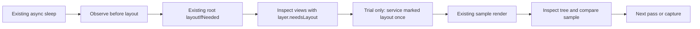

# Observe and test pending descendant layout

Status: complete. Published in [PR 533](https://github.com/kyleve/Stuff/pull/533). Depends on the [completed settlement investigation](../2026-11-18-settlement-clocks/README.md).



The retained Swift path observes two points in the existing settle loop. The temporary treatment arms also sample before root layout and after their extra layout calls.

```swift
layoutWithoutAnimation(host)
let afterLayout = layoutTrace.map { _ in inspectBackingLayers(in: host) }
let sample = drawAndCheckPixelsIfEnabled(host)
if let layoutTrace, let afterLayout {
    layoutTrace.emit(pass, afterLayout, afterDraw: sample.wasDrawn ? inspectBackingLayers(in: host) : nil)
}
```

1. Add an opt-in trace of pending layout after the ordinary root layout pass (R-01). For the experiment also observe before layout, after an optional intervention and after drawing. Correlate pass indices and capture IDs with the pixel events. Record view classes and child-index paths. Only a checked backing layer's current layout flag counts as positive.
2. Exercise a deliberate dirty descendant, a sibling invalidation during layout, display-only work and a delayed invalidation using the hosted path (R-02). Ensure a clean root cannot hide a dirty child. State which updates the observation cannot see.
3. Start with Settings, Planning Region Picker, Flyover, Device Layout Lab and Root on the pinned simulator. Compare ordinary references and exported PNGs, total and dirty passes, affected classes, whether dirty flags survive the draw, and later pixel changes. Where a view is still dirty, try one extra root layout and/or servicing the actual dirty views once. Keep the existing pixel proof and floors in the timing trials (R-03).
4. Use `./test --no-generate --timings --review --record never` with the selected suites. Validate the retained diagnostic on the full image suite. Adopt an intervention only if it advances meaningful real content, preserves images and yields repeatable elapsed benefit. Otherwise retain the observational switch alone. Verify cleanup, review the final diff and publish the results.

## Refinement from the first observations

The five suites produced 46 capture images and 492 sampled passes. The initial root layout cleared every marked backing layer across 62,676 view visits. The draw then left marked layers on 408 passes, including 78 that already met the final proof. This gives a second place to test the proposed extra layout. On continuing passes only, service the marked views once after drawing and inspect what remains before the next ordinary suspension. A fresh observational run and a repeated treatment use the same binary. Preserve both observation points in the opt-in diagnostic so a future run can distinguish them.

## What the walk measures

The observation reads `layer.needsLayout()` on the root view and each descendant in `subviews`, including descendants of a clean parent. Apple's API reports whether the layer is currently marked for layout. A callback can dirty another view and UIKit can consume that work before the outer `layoutIfNeeded()` returns. The observation measures the work still available to an immediate second pass. [UIKit layout](https://developer.apple.com/documentation/uikit/uiview/layoutifneeded%28%29) · [Core Animation layout flag](https://developer.apple.com/documentation/quartzcore/calayer/needslayout%28%29)

On the first focused run, 379 of the 492 passes entered root layout with at least one marked view. It cleared them all. Of the passes that ended the draw with marked views and had a subsequent pass, **330/330** still had at least one of the same views marked just before the next root layout. Only **19/330** next samples exceeded the one-channel-unit allowance against the quarter-scale pixel anchor. Of the 65 continuing passes with a clean post-draw tree, 29 next samples also exceeded the allowance, all in Device Layout Lab. In Settings, all 114 draws left marks and every later sample stayed within its anchor tolerance. The walking time for all four experimental observation points combined was 0.146s across those 492 passes, excluding diagnostic output.

The affected views included SwiftUI hosting views, navigation-stack hosts and collection views in Settings and Planning Region Picker, tab buttons and labels in Root, and buttons and labels in Flyover. Runtime class names describe the pinned simulator. Each location is relative to the hosted view at that pass. The experimental correlation used per-call object identities to distinguish the same view from a replacement at the same path.

## Hosted controls

Five temporary fixtures exercised real UIKit drawing on the pinned iPhone 17 simulator. They separate work that a second synchronous layout can perform from work that becomes runnable later.

| Trigger | Observation |
| --- | --- |
| A layout callback dirties a sibling that already laid itself out | The sibling was marked inside the callback. The same outer root layout serviced it before returning. Its new color was visible on the first draw. |
| A fixture marks a nested leaf immediately after its root layout returns from `super` | The walk found `root/0/0` below a clean ancestor. An extra root layout or direct leaf layout applied the new color before drawing. The ordinary draw also produced it. |
| A leaf is marked just after the first real hierarchy draw | The first raster stayed red. A later sample captured green. Layout alone cannot revise a raster already taken. |
| A later main-actor task invalidates the leaf | The synchronous walk was clean and the first draw was red. After suspension the task ran and a later sample was green. |
| A drawable leaf calls `layer.setNeedsDisplay()` | The display flag was set and the layout count was zero. The first version of this fixture used a plain view without a drawing implementation and failed to create its intended display work. |

All five fixtures passed in each of the four modes, for 20 scenario/mode combinations. The retained unit test covers walking through a clean container, leaving the six marked leaves dirty and bounding the example list to five. The test-only interventions and raster-export code were removed after the trials.

## Bounded layout trials

The five-suite selection ran with `./test --no-generate --timings --review --record never --only-file <selection>`. It covered 46 images in each run. Root and descendant treatments conditioned on a mark *immediately after root layout* executed zero extra calls in 491 and 496 passes respectively.

For the post-draw trial, on each continuing pass we called `layoutIfNeeded()` directly on each marked view that was still attached and dirty, visiting parents first. The first eligible call cleared its subtree in every observed case. These paired totals include the same one recovered Device Layout Lab timeout in every arm.

| Run | Sample draws | Extra calls | Time in extra layout | Total sampled settlement | Five suite bodies |
| --- | ---: | ---: | ---: | ---: | ---: |
| Observe 1 | 492 | 0 | — | 55.185s | 72.302s |
| Service after draw 1 | 479 | 315 | 4.399s | 56.293s | 73.768s |
| Observe 2 | 490 | 0 | — | 56.067s | 73.737s |
| Service after draw 2 | 477 | 314 | 4.483s | 56.630s | 73.999s |

The extra calls cleared 2,987 and 2,992 marked view occurrences. In the first pair, time inside the ordinary root layout fell from 0.726s to 0.265s. Some work moved forward, and both trials used 13 fewer samples. Total settlement still increased in both. A layout after drawing cannot update the bitmap already sampled. The next draw establishes whether the image has changed, and the quiet interval and elapsed-time floor still apply.

All 46 ordinary reference comparisons passed in every run. All 37 images from the four suites where the post-draw treatment executed matched the respective observation run byte for byte in both pairs. In each post-draw treatment, 45 final PNGs matched the control byte for byte. The remaining Device Layout Lab image differed by two pixels, one channel unit each. The ordinary observational runs also showed differences of this size on that fixture family.

## Full-suite result and decision

At `69559e7b4`, the enabled diagnostic ran on iPhone 17 / iOS 27.2 with `TEST_RUNNER_SNAPSHOT_TRACE_LAYOUT=1 ./test --no-build --no-generate --snapshots --timings --review --record never --skip-architecture --skip-host-tests`. The preceding focused invocation owned the build, architecture and host checks. All 78 tests in 71 suites passed in 12m 7s. All 935 capture identities and sizing configurations matched the PR 532 inventory. The trace joined one layout record to every one of the 5,604 sample passes. All 1,161 sampled calls settled and 657 calls explicitly skipped sampling.

| Settlement reason | Sampled calls | Sample passes | Passes dirty after root layout | Passes dirty after drawing |
| --- | ---: | ---: | ---: | ---: |
| Measurement | 246 | 990 | 0 | 968 |
| Content | 840 | 4,175 | 0 | 3,857 |
| Native insets, post-action or accessibility | 75 | 439 | 0 | 397 |
| **All** | **1,161** | **5,604** | **0** | **5,222** |

The post-layout walk checked 424,876 views. Across the post-draw walks, 17,920 view occurrences were marked, often SwiftUI hosting and scrolling views or UIKit collection views. Of the 1,161 passes that accepted a stability proof, 1,094 still had marks after drawing. Of 4,128 continuing passes with post-draw marks, only 39 next samples exceeded their pixel anchor tolerance. Another 29 next samples exceeded it after a completely clean post-draw tree. These occurred in Device Layout Lab, Developer Overlay, Main Tabs and Periscope Viewer.

Keep the recursive diagnostic behind `TEST_RUNNER_SNAPSHOT_TRACE_LAYOUT=1` with `--timings`. The full census found no work for an immediate second root layout, and the two after-draw trials increased elapsed settlement. Continue using the pixel proof. The observations cover hosted UIView backing layers on this simulator. Tasks, changes inside SwiftUI, and layers without a corresponding UIView can still alter a later frame.

The retained trace and quiescence unit suites passed all 14 tests. Settings passed 16 images in each opt-in check. With tracing enabled all 113 sample passes had a record. With the switch omitted all 111 passes emitted zero layout records. Independent source review against `f12cb58d8` caught a skipped-draw logging edge case and a disabled-path environment read. Both were corrected before publication. Repository SwiftFormat and diff checks passed. [Implementation PR 533](https://github.com/kyleve/Stuff/pull/533)

The diagnostic-off CircleCI snapshot job at the same revision passed 935 images, with 1,161 sampled calls, 657 immediate skips and zero retries. All four active shards reconciled to the PR 532 inventory. [CircleCI workflow](https://app.circleci.com/workflow/4e423ff9-86a1-4f4c-9c41-abeccc8aae19) · [GitHub checks](https://github.com/kyleve/Stuff/actions/runs/44339821146)
