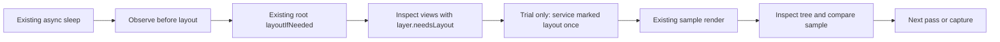

# Observe and test pending descendant layout

Status: executing. Depends on the [completed settlement investigation](../2026-11-18-settlement-clocks/README.md).

1. Add an opt-in trace of pending layout after the ordinary root layout pass (R-01). For the experiment also observe before layout, after an optional intervention and after drawing. Correlate pass indices and capture IDs with the pixel events. Record view classes and child-index paths. Only a checked backing layer's current layout flag counts as positive.
2. Exercise a deliberate dirty descendant, a sibling invalidation during layout, display-only work and a delayed invalidation using the hosted path (R-02). Ensure a clean root cannot hide a dirty child. State which updates the observation cannot see.
3. Start with Settings, Planning Region Picker, Flyover, Device Layout Lab and Root on the pinned simulator. Compare ordinary references and exported PNGs, total and dirty passes, affected classes, whether dirty flags survive the draw, and later pixel changes. Where a view is still dirty, try one extra root layout and/or servicing the actual dirty views once. Keep the existing pixel proof and floors in the timing trials (R-03).
4. Use `./test --no-generate --timings --review --record never` with the selected suites. Validate the retained diagnostic on the full image suite. Adopt an intervention only if it advances meaningful real content, preserves images and yields repeatable elapsed benefit. Otherwise retain the observational switch alone. Verify cleanup, review the final diff and publish the results.
