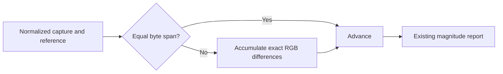

# 01 — Skip unchanged pixels when describing a difference

- Status: executing
- Dependencies: none. [Overview and scope](README.md)

## Deliverable and design

Implement R-01 and R-03 in `SnapshotReferenceDiff.swift`. The existing review path decodes both PNGs into the same packed RGBA layout. Swift calculates three channel differences, count, maximum and bounds for every pixel even when large portions are identical. Compare contiguous bytes first. Unequal spans still use the original RGB rules, including ignoring alpha. Keep allocation, coordinate origin and the reporting wire format intact.



Swift sketch inside the existing magnitude calculation, with pointer lifetime and row boundaries omitted:

```swift
if bytesDiffer(captureSpan, referenceSpan) {
    accumulateRGBDifferences(in: span)
}
```

## Steps and acceptance

1. Replay retained production-size captured and approved PNGs against the original scalar operation and candidate. Compare the complete magnitude per pair. Include equality, sparse and widespread change, alpha-only change, partial spans and boundaries in verification. Keep the simpler competitive implementation.
2. Exercise the public comparison path with Swift Testing. Run `./test --only SnapshotKitTestingTests/SnapshotReferenceDiffTests` and the focused RegionSummaryCard, EstimatedTimeFeaturesView and WhereLifecycleFailureView snapshot suites with `--review --timings --record never` before and after. Keep build and simulator preparation separate from test elapsed.
3. Adopt if replay agrees exactly and runtime savings reproduce on representative inputs. Run all snapshots once on the adopted change and compare counts, IDs and capture geometry against the retained PR 529 baseline. Report elapsed and summed work separately. Limit the strength of any full-suite speed claim to the available pairs.
4. Retain the measured results and independent review in the plan. If results diverge, keep the scalar implementation and record the mismatching case. Temporary benchmarks and raw logs stay outside Git.

## Progress and resume point

The implemented fast path compares one complete normalized RGBA row with `memcmp` and applies the scalar RGB calculation on every unequal row. The focused simulator build passed all eight `SnapshotReferenceDiffTests` functions, including an odd-width image, its last pixel, a full-image change, and an alpha-only change. SwiftFormat and whitespace checks passed.

A macOS Swift debug replay compared the parent and candidate magnitude functions on the same decoded inputs, alternating their order per image. The 93 ordinary captured/reference pairs from the retained PR 528 run contained 597,279,951 pixels. All 93 complete magnitudes matched, including counts, maximum channel differences and bounds from the historical reports. Summed scan time fell from 76.992s to 6.799s (91.2%). Image decoding and normalization took another 6.253s outside the scans. The replay shared the machine with a framework build. These are isolated diagnostic timings.

The three focused suites passed before and after. Their test bodies fell from 65.425s to 52.354s (20.0%). The runner test phase fell from 81.091s to 64.622s. All 77 capture identities, 215,727,762 pixels, 85 tiles and 149 settle calls matched, with zero retries. Forty-four of 45 diagnostic reports matched exactly across the live captures. One sheet in each run differed from the approved file at the PNG byte level only. The retained fixed-input replay above isolates algorithm equivalence from live capture variability.

Full-suite and CI measurements are in progress.
