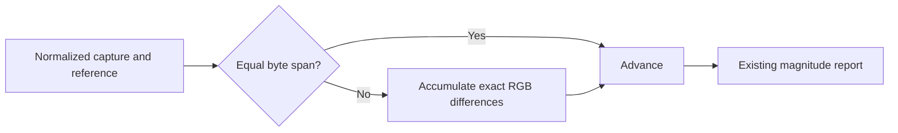

# 01 — Skip unchanged pixels when describing a difference

- Status: ready
- Dependencies: none. [Overview and scope](README.md)

## Deliverable and design

Implement R-01 and R-03 in `SnapshotReferenceDiff.swift`. The existing review path decodes both PNGs into the same packed RGBA layout. Swift calculates three channel differences, count, maximum and bounds for every pixel even when large portions are identical. Compare contiguous bytes first. Unequal spans still use the original RGB rules, including ignoring alpha. Keep allocation, coordinate origin and the reporting wire format intact.



Swift sketch inside the existing magnitude calculation, with pointer lifetime and row boundaries omitted:

```swift
if bytesDiffer(captureSpan, referenceSpan) {
    accumulateRGBDifferences(in: span)
}
```

## Steps and acceptance

1. Replay retained production-size captured and approved PNGs against the original scalar operation and candidate. Compare the complete magnitude per pair. Include equality, sparse and widespread change, alpha-only change, partial spans and boundaries in verification. Keep the simpler competitive implementation.
2. Exercise the public comparison path with Swift Testing. Run `./test --only SnapshotKitTestingTests/SnapshotReferenceDiffTests` and the focused RegionSummaryCard, EstimatedTimeFeaturesView and WhereLifecycleFailureView snapshot suites with `--review --timings --record never` before and after. Keep build and simulator preparation separate from test elapsed.
3. Adopt if replay agrees exactly and runtime savings reproduce on representative inputs. Run all snapshots once on the adopted change and compare counts, IDs and capture geometry against the retained PR 529 baseline. Report elapsed and summed work separately. Limit the strength of any full-suite speed claim to the available pairs.
4. Retain the measured results and independent review in the plan. If results diverge, keep the scalar implementation and record the mismatching case. Temporary benchmarks and raw logs stay outside Git.

## Progress and resume point

Ready for implementation. The root owns snapshot runs, timing interpretation and publication. No other plan depends on the result.
