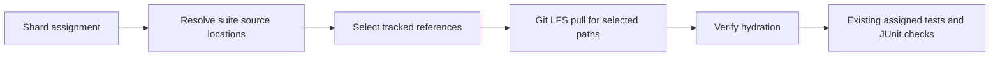

# 02 — Hydrate the references assigned to each snapshot worker

- Status: executing
- Dependencies: none. [Overview and scope](README.md)

## Deliverable and design

Implement R-02 and R-03 at CircleCI's existing hydration step. The suite list already controls test selection and JUnit verification. Resolve each assigned suite through the same project source inventory that validates its name. The existing Swift reference resolver uses the source file's parent and stem for the reference directory. Respect nested source locations, theme groups and special traits. This change is in the Python shard command and CI configuration, so no Swift interface is required.

## Steps and acceptance

1. Extend the owning shard command to hydrate the assignment, reject unknown suites, and skip network work when no reference is selected. Fail the worker on a fetch failure or remaining selected pointer. Avoid treating intentionally unselected pointers as failures. Preserve the empty-intake exit.
2. Replace the unconditional pull in the snapshot job and update command usage. Cover the public command or its filesystem/Git boundary with targeted failure and success tests. Include nested sources, grouped references, multi-root bundles where supported, new intake suites and probes. Common-case filters must select only assigned suites. If the suite directory itself contains an unrepresentable LFS filter character, log a fallback to all snapshot PNGs and still verify the assignment.
3. Replay all current worker assignments. Demonstrate that their union covers all 877 tracked reference paths once and that the common-case total logical bytes falls. Exercise real Git LFS against a cold local fixture or equivalent isolated checkout with an assigned and an unassigned object. Inspect selected file content and unselected pointer state.
4. Run the shard and CI configuration tests, public inventory check, Python lint and whitespace checks. Compare actual worker hydration times if a candidate CI run is available. Keep local transfer/work estimates separate from CI timing claims.

## Recovery, progress and resume point

A failed fetch or verification stops before tests and can be retried from the same assignment. A scope or coverage mismatch rejects the candidate. The public command now filters by the suite source directory and validates every selected tracked PNG. Punctuation within leaf filenames is safe. A comma in a directory name cannot be represented literally in the LFS include list. The explicit, tested all-snapshot fallback keeps exceptional assignments usable.

The cold offline Git LFS regression checks the working files and object store after a real pull. It also exercises a missing remote, an unresolved selected pointer, a zero-reference probe, and the fallback. The shard, hydration, and CI tool tests passed (52 tests). Ruff lint and format checks, `./snapshot-shards check` and `git diff --check` passed.

Replaying every assignment against the committed pointers accounts for all 877 reference paths exactly once. The intake worker had no assignments. De-duplicating OIDs within each active worker gives:

| Worker | Paths | Distinct object bytes requested |
| --- | ---: | ---: |
| 0 | 212 | 269,655,519 |
| 1 | 233 | 244,353,866 |
| 2 | 207 | 134,040,122 |
| 3 | 225 | 199,455,443 |

All four workers together need 847,504,950 bytes, down from 3,390,019,800 across four cold full pulls (75%). This counts uncompressed LFS objects. A fresh CI pair will supply worker and job times. Independent review verified the allocation and clarified the fallback exception above.
