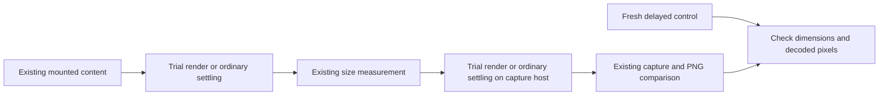

# Render-hook and glass controls

Status: executing. Depends on the [completed descendant layout investigation](../2026-11-18-snapshot-pending-layout/README.md).

1. Compare the ordinary path, a separately launched delayed control, one immediate hierarchy draw, and that same draw after calling `UIHostingController._render(seconds:)` on the mounted content controller. Include measurement and final hosting. Log successful invocations and unsupported hosts separately. Exercise Root, Settings and Planning Region Picker, known glass-free content and a synthetic delayed subject. The immediate arms intentionally bypass declared minimums to test the hook. Keep those arms out of the shipped framework.
2. Separately run with only the ordinary 250ms minimum removed, keeping the existing 120ms anchor rule, cadence and explicit per-case policies. Test the hypothesis with a late task that changes a plain SwiftUI view, a static control, and source-identified native/effect controls. Use traces and fixture construction to distinguish visible chrome from unrelated deferred work. A clean runtime class scan cannot establish the absence of glass.
3. Compare full decoded pixels and dimensions from fresh hosts on the pinned simulator. Keep ordinary references and recording disabled. Inspect mismatch locations and determine which state was captured. A matching final image cannot repair premature height measurement. Use `./test --no-generate --timings --review --record never` for focused trials and repeat timing pairs for a potential adoption. Make a narrower production change only with an owned readiness contract, matching delayed controls and repeatable timing benefit. Remove temporary experiments and publish the evidence even for a negative result.



The pseudocode shows the direct comparison. The floor-only treatment instead uses the ordinary sample loop.

```swift
if trialUsesHook { hostingController._render(seconds: 0) }
hostView.layoutIfNeeded()
drawHierarchyAfterScreenUpdates(hostView)
```

The control permits delayed work to finish before reading size or capturing the independent reference. Timeouts bound failed trials. A counterexample with an unambiguously glass-free view is sufficient to reject a universal glass-only rule. Passing selected fixtures establishes only those cases.

## Selected fixtures

Root exercises native translucent tab chrome and has an explicit 1.5s minimum. The direct-draw trial overrides it to test the private renderer, while the floor-only trial leaves it in place. Settings owns the earlier measurement clipping control. Planning Region Picker combines searchable navigation and asynchronous loading. Flyover provides a second earlier trace with a late change. Launch Splash freezes its clock and pulse during capture. Locations Background draws paper artwork loaded by a task. Installer’s Update Failure Card displays fixed error data and text on an opaque rounded background. Its two registrations are candidates for the existing immediate policy if their seven configurations pass the delayed control, including annotation and sizing.

The hosted control uses the same opaque field and schedules a red-to-green state change 215ms after preparation. It runs with and without an explicit glass element and with the colors fixed as static controls. Verify each exported center color and the actual time the task publishes. A static glass/plain image difference verifies the control drew a visible effect.

The pinned SDK also declares a distinct hosting-view method, `_BenchmarkHost._renderForTest(interval:)`. Run it on the actual content controller’s view with interval zero, followed by the identical hierarchy draw. Record the number of successful calls. The controller and hosting-view hooks have separate results because the SDK gives no equivalence guarantee.

## Is a 250ms minimum needed only for glass?

The glass-free witness disproves that general rule on the pinned iPhone 17 simulator. With the 250ms minimum removed and the 120ms pixel proof intact, the renderer returned a red bitmap at 200ms. The scheduled task published green at 218ms. With the ordinary policy the task published at 220ms and capture returned the green bitmap at 400ms. Their dimensions matched, but 147,356 of 147,456 pixels differed. The matching glass witness also returned red early. This was an observed capture difference in a diagnostic test that accepts either recorded endpoint for the experimental arms.

Both already-ready fields matched their ordinary PNGs exactly with the default minimum removed. The authored glass badge affected 10,028 pixels relative to the plain static field, so it was visible in the test. This glass badge exercises a static effect. Root separately exercises adaptive native tab chrome.

The prior complete PR 533 traces contained 1,051 calls with a 250ms minimum on each platform run. In the local run 669 had already met the pixel check before the deadline, and three later changed beyond the anchor tolerance. In the CI run 247 met the check early and none subsequently changed during the recorded interval. These observations motivate testing a narrower policy. They do not predict the full-resolution frame a real early capture would return.

## Full-suite floor-only follow-up

All 60 selected real captures matched the ordinary PNG byte for byte with the default minimum removed, even though the glass-free delayed witness captured the wrong frame. To distinguish that controlled counterexample from the experience of running the current suite, run the same floor-only arm over all recorded images. Preserve explicit floors, quiet checks, timeouts and normal fixture declarations. Compare capture identities, normal reference diagnostics, new failures and recovery with the prior full PR 533 run. The 60-image comparison supplies paired full-resolution evidence. Passing the ordinary repository tolerance elsewhere does not establish exact agreement with a fresh delayed reference.

## Focused rendered images

The seven suites exercised 60 captures and 114 settlement calls. Every call received the actual content hosting controller. Fifteen calls had a 1.5s minimum and 99 used the default. Each delayed control used a fresh process and host, ran ordinary settling, suspended for an additional 500ms and then laid out and drew before measurement or capture. All 60 ordinary PNGs matched those delayed controls byte for byte.

A single early draw produced 51 matching PNGs, with every dimension correct. The controller-private hook followed by the same draw produced the same nine wrong identities. On Root, the launch icon and rings were still on screen where the reference showed the logged-in Locations tab. On Planning Region Picker, the search field’s trailing clear button was pale and smaller. Its final list and field geometry already matched. Flyover contributed three mismatches. On Settings one ordinary hierarchy draw produced all 16 correct images, including the AX5 height. Immediate layout alone had clipped those same captures in the prior measurement experiment. The hosted Settings list can update its width during layout, so the error-card’s layout-only readiness contract does not apply there.

Each direct arm requested 114 hierarchy draws. UIKit reported incomplete drawing on the two tall post-measurement views for Settings AX5 and Flyover List iPad. The normal tiled final capture still matched for Settings AX5. A completed call and a proven final image are separate measurements.
