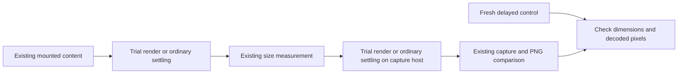

# Render-hook and glass controls

Status: executing. Depends on the [completed descendant layout investigation](../2026-11-18-snapshot-pending-layout/README.md).

1. Compare the ordinary path, a separately launched delayed control, one immediate hierarchy draw, and that same draw after calling `UIHostingController._render(seconds:)` on the mounted content controller. Include measurement and final hosting. Log successful invocations and unsupported hosts separately. Exercise Root, Settings and Planning Region Picker, known glass-free content and a synthetic delayed subject. The immediate arms intentionally bypass declared minimums to test the hook. Keep those arms out of the shipped framework.
2. Separately run with only the ordinary 250ms minimum removed, keeping the existing 120ms anchor rule, cadence and explicit per-case policies. Test the hypothesis with a late task that changes a plain SwiftUI view, a static control, and source-identified native/effect controls. Use traces and fixture construction to distinguish visible chrome from unrelated deferred work. A clean runtime class scan cannot establish the absence of glass.
3. Compare full decoded pixels and dimensions from fresh hosts on the pinned simulator. Keep ordinary references and recording disabled. Inspect mismatch locations and determine which state was captured. A matching final image cannot repair premature height measurement. Use `./test --no-generate --timings --review --record never` for focused trials and repeat timing pairs for a potential adoption. Make a narrower production change only with an owned readiness contract, matching delayed controls and repeatable timing benefit. Remove temporary experiments and publish the evidence even for a negative result.



The pseudocode shows the direct comparison. The floor-only treatment instead uses the ordinary sample loop.

```swift
if trialUsesHook { hostingController._render(seconds: 0) }
hostView.layoutIfNeeded()
drawHierarchyAfterScreenUpdates(hostView)
```

The control permits delayed work to finish before reading size or capturing the independent reference. Timeouts bound failed trials. A counterexample with an unambiguously glass-free view is sufficient to reject a universal glass-only rule. Passing selected fixtures establishes only those cases.
