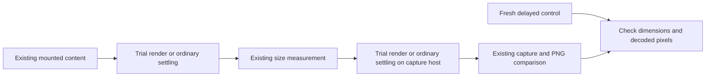

# Render-hook and glass controls

Status: complete. Published in [PR 534](https://github.com/kyleve/Stuff/pull/534). The original trial followed the [completed descendant layout investigation](https://github.com/kyleve/Stuff/blob/c23b824dab9d462d7ca2d0b8969e952ed8916985/Plans/2026-11-18-snapshot-pending-layout/README.md).

1. Compare the ordinary path, a separately launched delayed control, one immediate hierarchy draw, and that same draw after calling `UIHostingController._render(seconds:)` on the mounted content controller. Include measurement and final hosting. Log successful invocations and unsupported hosts separately. Exercise Root, Settings and Planning Region Picker, known glass-free content and a synthetic delayed subject. The immediate arms intentionally bypass declared minimums to test the hook. Keep those arms out of the shipped framework.
2. Separately run with only the ordinary 250ms minimum removed, keeping the existing 120ms anchor rule, cadence and explicit per-case policies. Test the hypothesis with a late task that changes a plain SwiftUI view, a static control, and source-identified native/effect controls. Use traces and fixture construction to distinguish visible chrome from unrelated deferred work. A clean runtime class scan cannot establish the absence of glass.
3. Compare full decoded pixels and dimensions from fresh hosts on the pinned simulator. Keep ordinary references and recording disabled. Inspect mismatch locations and determine which state was captured. A matching final image cannot repair premature height measurement. Use `./test --no-generate --timings --review --record never` for focused trials and repeat timing pairs for a potential adoption. Make a narrower production change only with an owned readiness contract, matching delayed controls and repeatable timing benefit. Remove temporary experiments and publish the evidence even for a negative result.



The pseudocode shows the direct comparison. The floor-only treatment instead uses the ordinary sample loop.

```swift
if trialUsesHook { hostingController._render(seconds: 0) }
hostView.layoutIfNeeded()
drawHierarchyAfterScreenUpdates(hostView)
```

The control permits delayed work to finish before reading size or capturing the independent reference. Timeouts bound failed trials. A counterexample with an unambiguously glass-free view is sufficient to reject a universal glass-only rule. Passing selected fixtures establishes only those cases.

## Selected fixtures

Root exercises native translucent tab chrome and has an explicit 1.5s minimum. The direct-draw trial overrides it to test the private renderer, while the floor-only trial leaves it in place. Settings owns the earlier measurement clipping control. Planning Region Picker combines searchable navigation and asynchronous loading. Flyover provides a second earlier trace with a late change. Launch Splash freezes its clock and pulse during capture. Locations Background draws paper artwork loaded by a task. Installer’s Update Failure Card displays fixed error data and text on an opaque rounded background. Its two registrations are candidates for the existing immediate policy if their seven configurations pass the delayed control, including annotation and sizing.

The hosted control uses the same opaque field and schedules a red-to-green state change 215ms after preparation. It runs with and without an explicit glass element and with the colors fixed as static controls. Verify each exported center color and the actual time the task publishes. A static glass/plain image difference verifies the control drew a visible effect.

The pinned SDK also declares a distinct hosting-view method, `_BenchmarkHost._renderForTest(interval:)`. Run it on the actual content controller’s view with interval zero, followed by the identical hierarchy draw. Record the number of successful calls. The controller and hosting-view hooks have separate results because the SDK gives no equivalence guarantee.

## Is a 250ms minimum needed only for glass?

The glass-free witness disproves that general rule on the pinned iPhone 17 simulator. With the 250ms minimum removed and the 120ms pixel proof intact, the renderer returned a red bitmap at 200ms. The scheduled task published green at 218ms. With the ordinary policy the task published at 220ms and capture returned the green bitmap at 400ms. Their dimensions matched, but 147,356 of 147,456 pixels differed. The matching glass witness also returned red early. This was an observed capture difference in a diagnostic test that accepts either recorded endpoint for the experimental arms.

Both already-ready fields matched their ordinary PNGs exactly with the default minimum removed. The authored glass badge affected 10,028 pixels relative to the plain static field, so it was visible in the test. This glass badge exercises a static effect. Root separately exercises adaptive native tab chrome.

The prior complete PR 533 traces contained 1,010 calls using the default policy. In the local run, 666 met the pixel check before 250ms. Three subsequently changed beyond the anchor tolerance. Planning Search measurement was quiet at 194ms in light appearance and 193ms in dark appearance, then changed at 265ms and 260ms. Flyover Compact measurement was quiet at 196ms and changed at 318ms. On CI, 247 met the check early and none changed again during the recorded interval. Another 41 calls with an explicit 250ms minimum were outside this treatment. These traces motivate earlier capture where readiness is known. Only an actual capture can establish its full-resolution output.

## Focused rendered images

The seven suites exercised 60 captures and 114 settlement calls. Every call received the actual content hosting controller. Fifteen calls had a 1.5s minimum and 99 used the default. The delayed arm ran in a separate invocation and mounted fresh hosts. Each stage ran ordinary settling, suspended for an additional 500ms, then laid out and drew before measurement or capture. All 60 ordinary PNGs matched those delayed controls byte for byte.

A single early draw produced 51 matching PNGs, with every dimension correct. The controller-private hook followed by the same draw produced the same nine wrong identities. On Root, the launch icon and rings were still on screen where the reference showed the logged-in Locations tab. On Planning Region Picker, the search field’s trailing clear button was pale and smaller. Its final list and field geometry already matched. Flyover contributed three mismatches. On Settings one ordinary hierarchy draw produced all 16 correct images, including the AX5 height. Immediate layout alone had clipped those same captures in the prior measurement experiment. That experiment did not isolate which Settings update changed the measured height.

Each direct arm requested 114 hierarchy draws. UIKit reported incomplete drawing on the two tall post-measurement views for Settings AX5 and Flyover List iPad. The normal tiled final capture still matched for Settings AX5. A completed call and a proven final image are separate measurements.

| Treatment on iPhone 17, iOS 27.2 | Final PNGs identical to delayed | Settle-loop samples | Sum of seven suite durations |
| --- | ---: | ---: | ---: |
| Ordinary | 60/60 | 593 | 66.258s |
| Ordinary plus 500ms and a draw | 60/60 | 592 | 134.213s |
| One immediate hierarchy draw | 51/60 | 0 | 29.818s |
| Controller `_render(seconds: 0)`, then draw | 51/60 | 0 | 30.043s |
| Hosting view `_renderForTest(interval: 0)`, then draw | 51/60 | 0 | 30.372s |
| Remove only the default 250ms minimum | 60/60 | 507 | 60.863s |
| Controller render before the loop with the default minimum removed | 60/60 | 514 | 60.965s |

Both private methods ran on the mounted content in all 114 targeted calls and missed the same nine identities as the immediate UIKit draw. The controller method consumed 0.149s across the calls and the hosting-view method consumed 0.447s. The floor-only comparison saved 5.395s (8.1%) in one pair, of which 5.327s was in sampled settlement. Adding the controller hook to those 99 default-policy calls yielded no further saving. These trials advanced the render hooks by zero simulated seconds. They demonstrate what processing currently queued work can achieve on this simulator.

A separate Region Picker run applied each intervention only during measurement of the two Search configurations. Both hooks and the plain UIKit draw gave the same first raster. Compared with delayed measurement, 58 of the 101 × 219 sampled pixels differed in light appearance and 51 in dark appearance. The measured bounds were 402 × 874pt throughout. With ordinary content settling restored, all 12 final Region Picker PNGs matched in each run. In these cases the field could be measured correctly while the clear button was still changing.

Each of the seven treatments also ran four 128pt hosted controls. The separately mounted delayed controls agreed with ordinary capture in all four. Both immediate hooks returned the early color in the two delayed-task cases and the correct pixels in both static cases. The hosting-view hook returned the plain delayed frame at 93ms, before the task published green at 227ms. A renderer can service a queued update. Only the fixture knows when it has supplied its intended data.

## Immediate capture for static Installer error cards

The standalone MissingFeed and OfflineCached cases supply fixed errors and a fixed cached-builds flag before the view is mounted. The card derives its message and diagnostic code synchronously. Both registrations can use the existing `.immediate` policy. The inherited `.sameAsCapture` measurement policy also uses it. Each stage yields once and lays out without sampling. Full-page fixtures own their separate refresh and navigation lifecycles.

Four fresh invocations of `./test --no-generate --timings --review --record never --only InstallerKitUISnapshotTests/UpdateFailureCardSnapshotTests` exercised the actual declarations in the same diagnostic build, in the order shown below. Each compared seven full-resolution PNGs to the independently delayed run, including light, dark, Dynamic Type and accessibility annotations.

| Run order | Suite duration | Settle-loop samples | Exact PNGs |
| --- | ---: | ---: | ---: |
| Settled | 4.412s | 87 | 7/7 |
| Immediate | 0.841s | 0 | 7/7 |
| Immediate | 0.837s | 0 | 7/7 |
| Settled | 4.363s | 86 | 7/7 |

This skips 14 sampled calls per run and saves 3.53–3.57s of suite time (about 81%). The production change consists of the two policy declarations. Prefer an explicit readiness contract on other candidate fixtures, especially when a task can publish new data after an apparently stable frame.

## Full suite with only the default minimum removed

The trial ran on locally built diagnostic products with `./test --no-build --no-generate --snapshots --timings --review --record never --skip-architecture --skip-host-tests`. The earlier focused build owned the architecture checks. All 78 tests in 71 suites passed. All 935 capture identities, dimensions, tile counts and declared policies matched the parent’s ordinary full run. Within these capture traces the trial removed the minimum on 1,010 calls spanning 717 images. The low-level probe also saw 11 default and 62 immediate calls outside the reported captures. It preserved the 120ms quiet check, 151 explicitly timed calls and 657 immediate calls. In particular, MainTabs kept its 500ms adaptive-chrome policy and Root kept its 1.5s policy. All 1,161 sampled calls settled on the first attempt.

Of the 1,010 treated calls, 655 completed before 250ms, across 509 captures. The number of settle-loop samples fell from 5,604 to 4,768. Traced settlement fell from 435.05s to 386.29s. The summed suite durations were 699.87s and 650.82s. The parent had recursive layout tracing enabled, while this diagnostic exported final images. These totals characterize the two runs. The focused timing pair above uses the same instrumentation in both arms.

Of 877 distinct checked-in reference PNGs, 720 matched byte for byte in both runs and at least 741 had exactly matching decoded RGB in both. Each full run reported differences on 153 distinct reference paths. The shortened run emitted 154 rows because a Device Layout Lab reference is checked twice. For 147 paths the reported difference was identical. Four paths appeared, four disappeared and two changed. Three newly differing images had received the shorter policy. The open Developer Overlay menus differed by 9,641 and 9,719 pixels with a maximum channel difference of two units. Interrupted Stay differed by one unit on 60 pixels of its illustrated passport seal. The other changes were in MainTabs. The 60 focused PNGs have the stronger comparison against fresh, separately delayed controls.

Two fresh runs repeated all 51 Developer Overlay and Presence Timeline captures with the same diagnostic build. Ordinary settling restored the exact checked-in menu and seal PNGs. Removing the default minimum reproduced the three earlier output files byte for byte. In this repeat the dark bottom-trailing menu also moved by up to two channel units. A glass backdrop is explicit in the menu implementation. The seal differences are in the illustrated content, well below the navigation bar. The comparisons locate the affected pixels but do not identify the framework operation that changed them.

The broad trial establishes that the current suite tolerates a shorter default on this simulator, with measurable changes even where assertions pass. Retain the general default, omit the private hooks and use the existing immediate policy for the two independently verified error-card fixtures.

## Verification of the retained change

At `2f262ca85`, the clean source contains the two DEBUG readiness declarations and their documentation. The temporary hooks, hosted controls and instrumentation were removed. A fresh `./test --no-generate --timings --review --record never InstallerKitUISnapshotTests` build passed all five suites and 103 images. The seven error-card captures used exactly seven immediate measurements and seven immediate content calls, with zero settle-loop samples. Repository SwiftFormat and diff checks passed. Independent review against the PR 533 base checked the scoped source diff, measured policies, raw PNGs and complete-run results. Validation was local to iPhone 17 on iOS 27.2.
