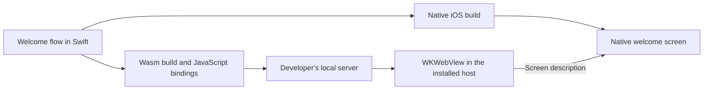

# 01 · Change a Swift feature on an installed iPhone

**Status** · draft. **Dependencies** · none. Covers US-01, R-01/R-02 and X-01/X-02 in the [overview](README.md).

## Experiment

Can an edit to one Swift welcome flow change what a developer sees on a physical iPhone without rebuilding the host? Start with two steps, one button and no account or persisted user data. Bound the trial to one device and one day. Q-01 determines whether the sample must also change native layout.



Swift and WebKit are existing tools. The host, native renderer and feature boundary are proposed. The host owns the current step. This sketch leaves the screen description open until Q-01.

```swift
// The same feature source supplies both builds.
func welcomeScreen(step: Step, action: Action) -> ScreenDescription
```

1. Use an isolated sample and the Swift SDK matching its compiler. Build the same feature natively and with `swift build --swift-sdk <installed-wasm-sdk-id>`. Give the WebKit host the JavaScript bindings and WASI imports required by the module.
2. On a development-signed iPhone, run the same tap sequence through each build and record the displayed steps. Change the Swift flow, rebuild only the Wasm artifact, and serve it from the paired development machine. Reopen the flow on the installed host.
3. Compare the screen sequence before and after, confirm the host build ID stayed fixed, and record edit-to-visible time and artifact size. Interrupt the transfer and relaunch offline. The bundled example should still open.

**Evidence and recovery.** Keep the device/OS, toolchain, reproduction commands and observed results here. A reproducible compiler, runtime or host limitation can conclude the experiment. An unavailable device leaves it pending. Keep temporary binaries and the local server out of the app. Return to the bundled flow after each failed attempt.

**Resume point.** No experiment has run. Set the acceptance example for [Q-01](README.md#open-decisions) before marking this plan ready.
