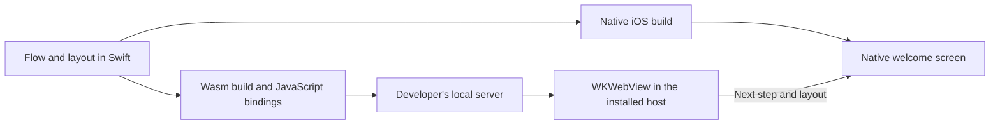

# 01 · Change a Swift feature on an installed iPhone

**Status** · ready. **Dependencies** · none. Covers US-01, R-01/R-02 and X-01/X-02 in the [overview](README.md).

## Experiment

Can new Swift behavior and a screen that did not exist at install time reach a development iPhone without rebuilding the host? Use a welcome screen, a finish state and one shared Swift function that decides where Continue goes. Bound the trial to one device and one day. Use synthetic inputs.



Swift and WebKit are existing tools. In the proposed host, a tap goes to the active feature. Swift returns the next step and layout. The host retains an opaque step ID between taps and translates rows, columns, text and buttons into native views. WebKit runs the module. The screen itself uses native controls. These primitives bound the one-day sample. Plan 02 must establish how much ordinary app source and which framework dependencies the tool can carry.

```swift
// The same feature source supplies both builds.
func welcome(stepID: String, action: Action, isNewUser: Bool) -> (nextID: String, layout: Layout)
```

1. In a disposable checkout, place the feature in an isolated Swift package and link it to a development-signed sample host. From the package root use `swift sdk list` and `swift build --swift-sdk <installed-wasm-sdk-id>` with a matching compiler. Bundle the first working artifact. Give the WebKit host the JavaScript bindings and WASI imports the module needs.
2. Install revision A. In native and Wasm modes, verify that Continue sits below the welcome label and goes to Finish for both new and returning users. In Swift revision B, put Continue beside the label, author a new Tips screen, and edit the shared rule so only new users go to Tips. Serve B’s Wasm artifact and reopen the flow on the original install.
3. Capture both layouts, the tap destinations, and the host build ID before and after reload. Check both user cases. Verify that the native host contains no Tips screen or prewired Tips route. Then compile B natively and repeat the same interaction to check parity. Record edit-to-visible time and artifact size. Interrupt a fresh download and relaunch offline. The bundled flow should still open.

**Evidence and recovery.** Keep the device/OS, toolchain, reproduction commands and observed results here. A reproducible compiler, runtime or host limitation can conclude the experiment. An unavailable device leaves it pending. Keep temporary binaries and the local server out of the app. Return to the bundled flow after each failed attempt.

**Resume point.** Await an execution request. Begin with the sample package and revision A on a development-signed iPhone. The [scope decision](README.md#decisions-and-open-questions) fixes the acceptance example.
