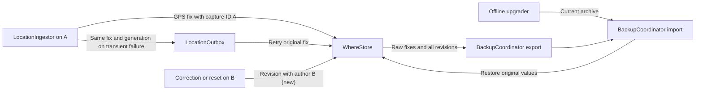

# 01 — Preserve who recorded a location and who corrected it

- Status: complete
- Depends on: None
- Shared context: [Overview](README.md)

## Deliverable

When phone A records a fix and device B corrects or restores it, Where can recover A from the raw fix and B from each revision. Both survive retries, sync, and backup restore. This slice ends at the WhereCore read APIs.

## User stories and requirements

| Story | Requirement | Result |
| --- | --- | --- |
| [US-02](README.md#user-stories) | [R-03](README.md#requirements) | Every persisted GPS fix has its original installation ID. |
| [US-02](README.md#user-stories) | [R-04](README.md#requirements) | Every GPS correction and reset revision names its author. |
| [US-03](README.md#user-stories) | [R-06](README.md#requirements) | Current archives round-trip both roles. The offline tool upgrades the owner's single-phone history. |

## Scope and constraints

Apply the [series exclusions](README.md#scope-boundaries). GPS capture is a property of an observation. Manually asserted and evidence-implied coordinates retain their source semantics. The receiver, importer, profile name and OS device name are unsuitable as author IDs.

At `a6b213ebe`, `LocationIngestor` already stamps live GPS. `SwiftDataStore.add(sample:)` accepts an unstamped fix and overwrites an existing sample with the same UUID. `SampleAttributionRevision` has no author. Its immutable revisions can sync before their sample. Follow the [location](../../Where/WhereCore/Sources/Location/AGENTS.md), [GPS review](../../Where/WhereCore/Sources/DataResolution/AGENTS.md), [recording device](../../Where/WhereCore/Sources/Devices/AGENTS.md) and [backup](../../Where/WhereCore/Sources/Backup/AGENTS.md) contracts.

## Data flow



The components exist today. The new persisted author and validation at each write boundary carry the guarantee. Profile and sample delivery can complete in either order.

## Architecture sketch

```swift
// Proposed changes to existing write paths. Constructors and unrelated fields omitted.
let author = installationContext.currentDevice.id  // Captured by WhereServices for this scope
let storedFix = incomingFix.recorded(by: recordingDeviceID)
try await store.add(sample: storedFix)              // Requires a capture ID for GPS
let revision = SampleAttributionRevision(id: revisionID, sampleID: sampleID,
    updatedAt: updatedAt, replacementRegions: regions, changedByDeviceID: author)
try await store.addSampleAttributionRevision(revision)
```

Ingestion runs under its existing recording authority. After compatibility admission, a correction uses the editing installation's ID even when automatic recording there is off. Restore takes values from the archive. The existing generation-checked transaction owns the write in each case.

## Steps

1. In `LocationSample`, `LocationIngestor`, `LocationOutbox` and the `SDLocationSample` adapter, validate capture ID on the transition from a transient GPS fix to durable data. Cover visits, significant changes, foreground fixes, single and bulk `DayJournal.ingest` paths (including the demo batch that writes manual overlays with samples), direct store writes, outbox save/replay and archive import. Preserve the stamped ID across retries. Return a permanent validation error on conflicting origins for one GPS UUID. At live ingestion and in `drainRetryQueue`, report the conflict, retain the stored capture and continue with valid fixes. Persist the drained queue without that rejected entry. Only retry transient failures. Keep existing protections for conflicting raw observations in reviews. Remove the nil-GPS shortcut from the per-device capture check once current data requires an origin.
2. Add required `changedByDeviceID: RecordingDeviceID` to `SampleAttributionRevision` and its SwiftData representation. Keep the current CloudKit column conventions and reject incomplete or conflicting immutable revisions. Keep `nextUpdatedAt` and the timestamp/revision UUID tie-break. Retain a revision before its sample or either profile arrives. A removed profile continues to identify its past actions. Removal cutoffs and flight grouping continue to use the *capture* ID alone.
3. Have `WhereServices` supply the author to `SampleCorrectionCoordinator`. Cover both proposal and individual flight-point writes, including restoring a point. Pass the author through `SampleAttributionReset.write` from coordinator reset, `DayJournal.clearManualDay` and `clearManualDays`, and the `clearYear` path through `WhereStore.clear` and `SwiftDataStore.clear`. Keep each group of revisions, clears and manual changes inside its original transaction. A stale review or rolled-back transaction contributes no revision to the active generation.
4. Apply the [two version changes](README.md#versioning-and-rollout). Append the next `DataModelVersion.changes` entry with an authored reason such as “Where now saves which device recorded a location and which device corrected it.” Bind it to the new WhereCore catalog resource and keep the v1/v2 entries intact. For the ZIP, advance both `BackupArchive.currentFormatVersion` and the Ruby output version from 8 to the next format. Require the capture ID on persisted GPS and the author on each correction, including when the sample has yet to arrive. Validate before pausing recording. Restore raw values and every revision through Merge and Replace, preserving local consent, removal cutoffs and the import receipt. Document the new format in [BACKUP_FORMAT.md](../../Where/WhereCore/BACKUP_FORMAT.md).
5. Extend [upgrade-backup.rb](../../Where/Tools/upgrade-backup.rb) to run the attribution transform on all supported v1–v8 inputs. The current v8 and released v7 paths return after changing the envelope. Route them into backfill without re-normalizing their fields. Keep the existing `homeRegionRecords` check for released v7 and the older prototype's normalization path. Fill only missing GPS capture and revision author IDs using the owner's historical phone. Retain every known ID, revision UUID, timestamp, payload, asset and profile. Reuse the existing, unambiguous source installation with its immutable profile intact, including a generic hardware label. When profiles or existing IDs leave the choice ambiguous, require an explicit source device mapping. For archives predating profiles, accept an operator-supplied reusable profile descriptor with a stable ID, label, kind, registration time and registration generation for the original phone. Reuse identical profiles, reject contradictory immutable fields for the same ID, and apply the same descriptor across overlapping exports. Never issue local recording consent or an advisory check-in. Skip backfill on current archives and reject malformed current values.
6. Extend the [verification driver](../../.agents/skills/upgrade-where-backup/scripts/upgrade_and_verify.rb) to pass the mapping and verify source record counts, with exactly one additional profile only when the upgrade requires it. Update affected fixtures and module docs. Keep flight fixture exports anonymized. Ship the wire formats, upgrader and verified restore path together.

## Acceptance and verification

Run from the repository root using synthetic A and B installations and disposable stores.

| Requirement | Check | Expected evidence |
| --- | --- | --- |
| R-03 | `./test --only WhereCoreTests/LocationIngestorTests --only WhereCoreTests/LocationOutboxTests --only WhereCoreTests/SwiftDataStoreTests` | Passive and foreground GPS persist A. Failure, outbox reload and retry preserve A and the generation. An unstamped GPS write fails. Inject the same UUID from B in a live fix and as a queued retry. Both preserve A, the permanent conflict leaves the saved queue, and the next valid fix persists. Stale generations cannot repopulate cleared history. |
| R-04 | `./test --only WhereCoreTests/SampleCorrectionCoordinatorTests --only WhereCoreTests/SampleAttributionRevisionTests --only WhereCoreTests/DayJournalTests --only WhereCoreTests/LocationHistoryReaderTests` | B can edit A's point with B's recording off. Replacement, exclusion and every reset retain B. Clear the year on B and verify A's raw fix is deleted while its reset revision still names B. Simulate reordered sample, revision, profile and removal delivery and check the IDs after each arrival. Reordered ties converge, identical replays coalesce, conflicting same-ID authors fail, and stale/cancelled transactions leave no partial revisions. |
| R-06 | `mise exec -- ruby Where/Tools/Tests/upgrade_backup_test.rb`, then `ruby .agents/skills/upgrade-where-backup/scripts/upgrade_and_verify.rb INPUT OUTPUT` on a synthetic legacy ZIP with the documented mapping when required | Cover released and prototype v7, plus v8 with a correction lacking an author. A v8 manual-only Ontario archive with empty GPS and correction arrays keeps `ca-ON` without asking for a source mapping or creating a profile. Test ambiguous and overlapping inputs, known A/B identities, malformed current input and repeated upgrades. Compare IDs, record counts, timestamps, bytes and normalized manifests. The production decoder reads the result and every referenced asset. |
| R-03, R-04, R-06 | `./test --only WhereCoreTests/BackupServiceTests --only WhereCoreTests/BackupCoordinatorTests`, then `./test --architecture-only` | Restore A's fix, B's correction and reset on a third device under Merge and Replace. Re-export identical origin values, raw motion and asset bytes. Preserve destination consent, tombstones and strategy-specific generation behavior. Update the exact export-version assertion. Reject v8 and a future version before decoding any missing fields or writing rows. |
| R-04, R-06 | `./xcstrings --lint` and `./test --only WhereCoreTests/DataModelVersionTests --only WhereCoreTests/DataCompatibilityCoordinatorTests --only WhereCoreTests/DataCompatibilityReceiptTests` | Check the new entry’s reason and retain the v2 Canadian-regions test. The recorder publishes the new version and reason together. A same-version viewer with recording Off can edit after publication. A v2 viewer loses access when it observes the new floor and can explain the lockout from its receipt on offline relaunch. |

For live CloudKit evidence, use two installations on one test iCloud account with `./Where/install --cloudkit --device <paired-device-ID>` once per device. Let A, with recording On and Always permission and an active installation identity, publish the higher floor and record GPS fixes that qualify for correction. Admit B with recording Off. Allow sync, apply the correction on B, and export from A after it receives the revision. Verify the raw fix names A as recorder and the correction names B as author in that archive. Record observed builds, account environment and result. If live transport is unavailable, report that gap separately from the simulated delivery-order tests.

## Recovery

Before switching the owner's phone to the incompatible build, drain pending fixes with the old build and export a ZIP. The installation outbox sits outside that ZIP. Keep the original export and verify a separate upgraded copy with the production decoder first. For the old phone’s store, use the verified copy with onboarding Replace so earlier incomplete rows stay in their retired generation. Merge and Replace both support destinations already on the current shape. Once the new cloud floor is published, recover using a build that understands it and the retained export. Preserve the published floor and receipt. A missing required mapping or conflicting profile stops conversion before publishing an output. A failed import uses the existing recovery sidecar and receipt to distinguish rollback from committed cleanup. Resume cleanup for a committed import. Reapplying its rows could duplicate the destructive operation.

## Decisions and revisions

On November 20, 2026 the owner authorized offline upgrade for their single-phone history. This plan uses the existing installation identity for both roles and persists the two roles separately.

November 27, 2026. The plan now starts from archive v8 and shared-data history entry 2. The original capture, author and retention requirements still apply.

## Progress

- [x] Enforce capture identity and persist each revision author.
- [x] Deliver strict schema, upgrade and restore together.
- [x] Verify acceptance, review and publish the implementation.

## Execution record and outcome

November 27, 2026. Implemented on `codex/where-location-provenance` above `41b1b116b`. A captured fix retains its recorder across retries, correction, and both restore strategies. Immutable revisions retain their editor. The destination re-exports the same actors and motion.

- `./test --no-generate WhereCoreTests WhereUITests` passed 1,641 executed tests. Store and controller tests cover independent delivery, recording Off, correction/reset authors, and original observations surviving removal cutoffs.
- The offline verification driver upgraded a synthetic v8 ZIP to v9 and loaded it with the production decoder. It preserved one GPS sample, two revisions, one evidence item and its attachment. Ruby passed 30 tests and 206 assertions. The owner selected synthetic archives for this run.
- Independent review found a count mismatch for already-known IDs without a profile and two transaction races. The driver now distinguishes selecting such an ID from adding a profile. Reset selection pins the prior history, and cancellation before the final save rolls back staged revisions.
- After review fixes, `./test --no-generate WhereCoreTests` passed 921 executed tests and the architecture checks. `./xcstrings --lint` and Swift formatting checks passed. The owner deferred the physical CloudKit exercise. Development and Production schema verification remain release checks.

## Outcome

Delivered in [PR #573](https://github.com/kyleve/Stuff/pull/573) at `be7c927c7`. Plan 02 can reuse the confirmed recorder and editor roles and the strict v9 archive.
