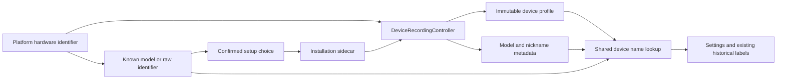

# 02 — Name devices during setup and in history

- Status: ready
- Depends on: [01 — Location provenance](01-location-provenance.md). Build on its archive and synced-data version bumps.
- Shared context: [Overview](README.md)

## Deliverable

During setup, Where offers a model name such as **iPhone 15 Pro**. The owner can accept it or enter **Travel Phone**. An unfamiliar model displays its hardware identifier. Clearing a nickname in Settings restores the model label. Existing historical device labels use the latest saved name, including after removal. These behaviors apply with recording Off. [Owner decisions](README.md#questions-and-resolutions)

## User stories and requirements

| [Story](README.md#user-stories) | [Requirement](README.md#requirements) | Contribution |
| --- | --- | --- |
| US-01 | R-01 | Offer an editable model-based name on fresh setup, restore and rejoin. |
| US-01, US-02 | R-02 | Resolve a trimmed nickname, then the familiar or raw model label. Two identical names can belong to distinct installation IDs. |
| US-03 | R-06 | Enrich an old profile through the external upgrader and keep its immutable fields intact on Merge and Replace. |
| US-02 | R-07 | Provide a shared ID-to-name lookup for existing device labels and for checking capture and author roles through Core. |

Apply [X-01 through X-03](README.md#scope-boundaries). The only new UI is naming at setup. The device registry, nickname editor, historical lookup and metadata event table already exist. Device identity and local recording consent keep their existing lifecycle.

## Context and design

The [sidecar](../../Where/WhereUI/Sources/Launch/InstallationRecordingContextStore.swift) freezes the installation ID, registration time and generic system name. The [store](../../Where/WhereCore/Sources/Persistence/SwiftDataStore.swift) rejects attempts to modify an existing profile with the same ID, even across a Replace. Keep that profile and its sidecar agreement intact. Add a hardware-identifier payload to the existing [device metadata events](../../Where/WhereCore/Sources/Devices/RecordingDeviceMetadataChange.swift) for every installation. Use the same representation for old and new devices.



Keep platform reads at the UIKit boundary. The repository's [machine identifier reader](../../Shared/Periscope/PeriscopeCore/Sources/Store/LogSession.swift) illustrates the physical-device call and the simulator caveat. Use a local lookup of known iPhone and iPad identifiers in Core so the displaying phone can name another model. For example, `iPhone16,1` maps to “iPhone 15 Pro.” Keep the raw identifier for models outside the lookup. Simulator fixtures supply explicit identifiers. [DeviceKit mapping](https://github.com/devicekit/DeviceKit/blob/master/Source/Device.generated.swift)

```swift
// Proposed shared formatting; eligible profile data can arrive in separate sync transactions.
func modelLabel(_ identifier: String) -> String { knownModels[identifier] ?? identifier }
func displayName(nickname: String?, identifier: String?) -> String? {
    trimmedNonempty(nickname) ?? identifier.map(modelLabel)
}
// Existing WhereCore lookup, extended to use the rule above and include removed profiles.
let names = try await recording.displayNames()
let recorder = names[sample.recordingDeviceID]
let editor = names[revision.changedByDeviceID]
```

## Steps

1. Add a `hardwareModelIdentifier(String)` variant and corresponding value slot on the existing metadata row. Require a nonblank raw identifier and matching target and author IDs for this target-owned hardware fact. Keep nickname changes remotely editable. Use a fixed model event ID derived from the installation UUID in a dedicated namespace, revision zero and the profile registration time in both Swift and Ruby. Reject disagreeing immutable values for that ID. Include the field discriminator and payload value in canonical duplicate ordering so independently synced readers converge.
2. In `SwiftDataStore`, treat the hardware field as a global fact with the same lifetime as its immutable profile, including when querying by event ID for replay. Keep nickname events in their current data generation. Resolve each field separately in both the store aggregate and the controller's current-device configuration. A cleared nickname reveals the known model or its raw identifier. For out-of-order sync, keep an unresolved device ID until the name arrives and refresh from committed store changes. Never substitute the viewing device's hardware.
3. Extend the final device choice in [OnboardingView](../../Where/WhereUI/Sources/Onboarding/OnboardingView.swift) and [OnboardingFlowModel](../../Where/WhereUI/Sources/Onboarding/OnboardingFlowModel.swift). Show the model immediately. Accepting it or leaving a whitespace-only name saves the model choice. A distinct trimmed entry becomes the nickname. Stage the initial choice and stable nickname event ID/time in the backup-excluded sidecar at confirmation. Opening setup or demo makes no durable registration writes.
4. After any selected import, register the current profile, its model event and any initial nickname together in a generation-checked write before finishing setup. Clear the pending handoff after commit. On ordinary registration, an existing confirmed installation publishes its own model fact under its existing ID. Honor removal and generation barriers before publishing. Keep original profile fields and consent. Replay the saved initial event without overwriting a later rename, including on cold launch after restore with backed-up onboarding preferences.
5. Reuse the shared rule for the editable draft and saved name in [Devices Settings](../../Where/WhereUI/Sources/Settings/DeviceSettingsRowModel.swift), and where [historical device names](../../Where/WhereUI/Sources/Model/YearReportModel.swift) are already shown. Resolve each role from its own stable ID. Verify A as recorder and B as editor through the Plan 01 fixture. Apply the [existing-history decision](README.md#q-03) to keep the attribution work within current records and surfaces.
6. Advance both version constants from Plan 01's delivered versions. Update [BackupService](../../Where/WhereCore/Sources/Backup/BackupService.swift), strict archive preflight, Merge/Replace, [format notes](../../Where/WhereCore/BACKUP_FORMAT.md) and the [offline upgrader](../../Where/Tools/upgrade-backup.rb) together. Require each complete archived profile to have its valid model fact, including removed profiles. Report missing sync data on export. Reject malformed values, mismatched targets and contradictory model facts before import begins. Preserve globally known facts alongside global profiles through Replace, without reviving older-generation nicknames.
7. Upgrade a copy of the owner's archive. Supply the original phone's raw model identifier explicitly for a generic profile, keyed by its original UUID. Reuse valid facts and add only absent model events. Preserve profile bytes and nickname history, including clears. Require an explicit mapping when the source phone is ambiguous. Extend Plan 01's verification driver to allow exactly the known added metadata rows and prove every original value survives. Run the production loader on the copy before any on-device cutover.

## Acceptance and verification

Run from the repository root during implementation.

| Requirements | Procedure | Expected result |
| --- | --- | --- |
| R-01 | `./test --only WhereUITests/InstallationRecordingContextStoreTests --only WhereUITests/OnboardingFlowModelTests --only WhereUITests/WhereLaunchTests --only WhereCoreTests/DeviceRecordingControllerTests` | Accept a known model, accept an unknown identifier, or enter a nickname. Exercise restore, rejoin, denied permission, recording Off, cancellation and interruption on either side of registration. Each confirmed identity has one model fact and at most one initial nickname event. |
| R-02, R-07 | `./test --only WhereCoreTests/RecordingDeviceMetadataChangeTests --only WhereCoreTests/SwiftDataStoreTests --only WhereUITests/DevicesSettingsModelTests --only WhereUITests/DeviceSettingsRowModelTests --only WhereUITests/YearReportModelTests` | A and B can share a model. Clear A's nickname, rename and remove A from B, then confirm that history still resolves A and B independently. Reorder model/rename arrivals, duplicate and replay events, and exercise two identical-ID conflicts in reverse order. |
| R-01, R-02 | `./test --only WhereUISnapshotTests/OnboardingViewSnapshotTests --only WhereUISnapshotTests/DevicesSettingsViewSnapshotTests --review`. On a physical phone complete setup, relaunch, rename and clear in Settings. | Snapshots cover known/unknown and custom names including large type. On-device hardware resolves the expected model. |
| R-06 | `mise exec -- ruby Where/Tools/Tests/upgrade_backup_test.rb` and `./test --only WhereCoreTests/BackupServiceTests --only WhereCoreTests/BackupCoordinatorTests --only WhereCoreTests/DataModelVersionTests`, then `./test --architecture-only`. Run Plan 01's verification driver on an upgraded synthetic ZIP. | Restore twice with Merge and once with Replace into a store already containing the old generic immutable profile. Both profiles resolve correctly after a fresh destination registers. Re-export stable IDs and model events, preserve target consent, reject malformed current archives and verify old writers are gated. |

## Recovery and execution record

If a sidecar write fails, retain the setup input and surface the failure. Retry a failed registration with the staged IDs. After commit, acknowledge a pending sidecar write without reapplying a nickname or replaying a committed restore. On generation change or identity retirement, re-read the current authority before retrying. Preserve the original export if verification fails.

- [ ] Implement and verify registration, name resolution and onboarding.
- [ ] Verify live registration of the owner's generic profile, strict upgrade and both import strategies.
- [ ] Review and publish the implementation.

November 20, 2026. The owner settled the setup, fallback and scope questions. The immutable-profile conflict found during plan review is addressed in steps 1, 2, 4 and 7. Implementation has not started. After authorization and completion of 01, begin with the existing-profile and two-device resolution tests.
