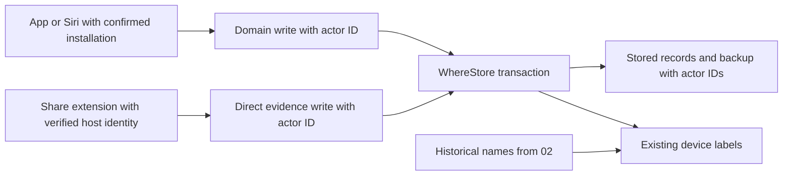

# 03 — Identify the device behind saved actions

- Status: complete
- Depends on: [01 — GPS capture and correction](01-location-provenance.md) and [02 — Device names](02-device-names.md)
- Shared scope: [US-02, US-03](README.md#user-stories), [R-04 through R-07](README.md#requirements) and [X-01 through X-03](README.md#scope-boundaries)

## Intended outcome

The stored manual day or evidence item identifies the installation that entered it, including a Siri entry made with GPS off. An export of a corrected location identifies both the recorder and the author of the correction. Those answers survive rename, device removal, sync and restore for as long as Where retains the record. If an action overwrites a row, keep the author with the winning value. A deletion that already leaves a tombstone carries the deleting device on that tombstone. A hard delete stays a hard delete. [Owner’s retention decision](README.md#q-03)

## Coverage inventory

| Saved action or observation | Current owner and evidence | Contribution to check at refinement |
| --- | --- | --- |
| Record a GPS point, correct its regions, exclude it, restore its automatic attribution | [01](01-location-provenance.md) supplies capture and revision author IDs. | Read the raw observation and individual revisions with their respective device IDs. A correction by B cannot change which device's track the point belongs to. |
| Add or override one day, backfill a range, clear an override | [DayJournal](../../Where/WhereCore/Sources/Journal/DayJournal.swift) writes manual days. The latest audit can replace an earlier one. Clear can delete a row. [WhereIntentWriter](../../Where/WhereIntents/Sources/WhereIntentWriter.swift) uses the same journal. Demo batches can write samples and manual overlays in one transaction. | Require the actor even when the caller supplies no note, fix or optional audit. Distinguish the act of entering a day from the date it describes. One range submission has one author across all its days. Keep the selected audit and its author together when an additive range meets an authoritative entry. Clearing the entry emits no new manual-history row. |
| Enter a manual coordinate or derive a point from evidence | [LocationSample](../../Where/WhereCore/Sources/Location/LocationSample.swift) distinguishes GPS, manual and evidence-implied samples. | Attribute a manual assertion to its author. Retain the link from an evidence-derived point to its evidence and author. Neither is an automatic fix by the user who later views it. |
| Add a document, photo, link or note | App writes through the journal. The [share extension](../../Where/WhereShareExtension/Sources/ShareEvidenceModel.swift) saves directly to the local App Group store. | Record which installation added the item even when the attachment has no bytes. A document date or photo's metadata does not establish that device took the photo. |
| Dismiss or restore a detected issue | DayJournal changes dismissal state. Restore removes the stored dismissal. | Attribute each retained dismissal to the dismissing installation. Restoring the issue deletes that dismissal as it does today. |
| Create, edit or delete a planned stay, change or clear the forecast home, edit or remove tracked regions | [PlannedStayCoordinator](../../Where/WhereCore/Sources/Forecasting/PlannedStayCoordinator.swift) writes stay/home revisions. [WhereServices](../../Where/WhereCore/Sources/WhereServices.swift) changes primary regions. Local writes can replace records or remove rows. | Carry the author on the stored stay/home revision, existing stay tombstone and changed region rows. For a reordered or otherwise edited selection, stamp only affected rows. Preserve forecast conflict resolution, region appearance and pick order. An inferred forecast or synthesized default has no user author. |
| Rename/remove another device, erase a year, erase all data, import | [DeviceRecordingController](../../Where/WhereCore/Sources/Devices/DeviceRecordingController.swift) records both target and issuing device. DayJournal clears years and issues resets. [BackupCoordinator](../../Where/WhereCore/Sources/Backup/BackupCoordinator.swift) owns import. | Reuse recorded actors. A reset or Replace can retain its existing control record under its issuing ID. Year erase retains author on its existing correction resets. Keep account erase and import recovery semantics. Merge and Replace preserve original actors. |

## Known design and assumptions

The app and [App Intents](../../Where/WhereCore/Sources/WhereServices+Intents.swift) share one service stack. Bind fresh writes to that scope's installation identity, including with automatic recording Off. Pass author and subject separately. Stamp once before durable retry and commit the actor with the mutation. Failed, canceled and duplicate operations must yield no false or duplicate history. Keep CloudKit conflict ordering and never turn incoming records into new local actions.

The share extension has no access to the application's private installation sidecar. Extend the app's audience-specific, backup-excluded App Group handoff with a read-only confirmed identity. Pair the proposed identity handoff with the verified receipt for the current domain and exact data version. The receipt’s change reason explains lockout. It carries no current author ID. Bind the handoff to the installation and data generation, revoke stale authority on account change, reset, removal or rejoin, and recheck at the write boundary. A missing or stale grant produces the existing “Open Where” path. Keep extension writes direct and local-only. [Share extension contract](../../Where/WhereShareExtension/AGENTS.md)



The diagram shows existing writers, persistence and read paths. Actor propagation and the share identity handoff are proposed. Extend each existing value, row and encoder with its required actor when the record lacks one. The resolved ID must travel with the same revision as its contents.

```swift
// Proposed boundary. App and intent writes use the same scope-owned actor.
let actor = installation.currentDevice.id
try await journal.saveManualEntry(entry, actor: actor)
try await shareStore.save(evidence, actor: verifiedHostIdentity) // same transaction as bytes
// Restores use the saved author on each value.
try await backup.restore(archivedEvidence)
```

Keep existing historical device labels working through the resolver from 02. For the new author fields, compare the records returned by Core with their exported values. This phase requires no new audit rows, screens or controls in the app.

## Persisted roles

| Archived value | Device field |
| --- | --- |
| Manual day, planned stay revision, forecast home revision, saved primary-region choice | `changedByDeviceID` |
| Evidence item | `addedByDeviceID` |
| Dismissal | `dismissedByDeviceID` |
| Manual or evidence-implied point | `assertedByDeviceID`, with the existing evidence link retained |
| Automatic GPS and its correction history | Plan 01’s `recordingDeviceID` and `changedByDeviceID` |

Each role uses the portable installation ID. The offline conversion preserves a known actor before applying a single-phone mapping and can derive an implied point’s author from the linked evidence.

## Implementation and verification

1. Bind the installation ID to the journal and forecast services at composition. A persisted manual day owns its editor even when its optional audit is absent. Use the receiving mutation’s author whenever the existing additive/authoritative merge selects its audit. Calculated DayPresence values can still lack an actor. Attribute manual and evidence-linked points at their original write and retain their SampleSource, evidence link and capture semantics. Exercise app and intent writes with GPS turned off.
2. Store the adding installation on each evidence item, including metadata-only shares, and the dismissing installation on each retained dismissal. Preserve both through the SwiftData adapters and backup. Keep existing hard deletes for evidence, restored issues and manual clears. Verify rows and bytes together.
3. Bind the author to each retained stay and home revision, including deletion and clearing. Preserve timestamps and UUID ordering. For primary region changes, retain the prior author when membership, pick order and appearance are unchanged. Record the editor on each changed region and keep the current removal behavior. Export persisted region choices separately from the picker’s synthesized defaults, so a fresh database can export without inventing an author. Imported regions carry their saved authors through merging and renumbering. When a nonempty Merge makes an untouched destination’s active defaults into saved choices, that import authors the newly saved rows. An empty Merge leaves its defaults implicit.
4. Extend the existing App Group compatibility receipt with a confirmed share author and data generation. Only the host with a valid admission can publish it. Bind it to the account/version, revoke it on identity retirement, and republish after successful registration. Capture the verified grant when composing a share, then compare it before opening the store and in the generation-checked batch that saves evidence and blobs. Check the profile, removal and reset barrier in the transaction, including while the host has yet to observe a remote removal. Test a pending draft across rejoin or account switch, a share with recording Off and an absent grant. Use the existing Open Where recovery.
5. Advance shared data to 5 with a localized reason and archives to 11. Strictly check authors at export and import. Keep the archive's original actors when rendering or restoring data. In the Ruby converter use an unambiguous original installation or the explicit source mapping for older rows with missing actors. Preserve all existing timestamps, notes, independent revisions, source links, tombstones, attachments and model facts. A strict current archive with missing authors fails before writes. Verify a v10 manual/evidence-only archive with no prior identity by supplying the original profile and its raw model. Merge and Replace onto a third device, then re-export. An existing actor survives even if the mapping names a different original installation. V10 did not distinguish an explicitly selected default region list from an exported computed default. Preserve the rows actually present in that archive under the original phone mapping.
6. Run the affected Core, UI and intent suites, architecture/host checks, and catalog lint. Exercise a Siri trip range without a GPS fix. Replay two offline stay/home revisions in both orders and repeat one. The winning value and actor follow timestamp and UUID. Exercise both orders for manual days with a missing audit, preserving their existing merge rule. Inspect A’s and B’s records through Merge, Replace and re-export on C. Confirm identity survives remote rename/removal, unchanged regions keep their authors and erased data stays absent. Retain the existing suite for interrupted restore and generation rollback.

A failed or stale transaction keeps the previous value and author together. Re-open the host to refresh a stale share grant. Recover a failed conversion from the original export. Do not advance a cloud account for validation in this run, per the owner's request.


## Refinement evidence

Plan 01’s Merge and Replace fixture retains A’s recorder and B’s correction author when restored on C. Plan 02’s Core integration uses the existing registry to resolve the same roles against a familiar iPhone model and an unknown tablet identifier. Its backup verifier uses the original installation UUID for offline model mapping. At refinement, the share extension had the account compatibility receipt but no host author. This identified the receipt as the place for a scoped grant after confirmed registration.

**Readiness and execution.** Reviewed after completion of [01](https://github.com/kyleve/Stuff/pull/573) and [02](https://github.com/kyleve/Stuff/pull/575). The owner’s selected scope and the two precursor verification results support all six steps. Execution began on `codex/where-action-attribution` at `6649b9016`.

## Execution evidence

- Shared data version 5 and backup format 11 carry authors on the existing records. Siri attributes a trip to its installation with GPS off. Evidence and implied points share their original author even when a different device derives the point. Share tests cover absent and retired grants, generation changes and rollback of attachment bytes.
- Merge and Replace on a third installation preserve both source authors on re-export. A fresh picker exports zero saved rows. Independent review caught a loss of active default regions during Merge. A nonempty import now authors only the default choices it materializes, preserving archived authors on overlap.
- Two offline installations edit the same stay and home choice, including deletion and clearing. Arrival order and duplicate replay preserve the winners and their authors. Review also caught conflicting physical rows with the same revision ID. Store reads and replacements now reject contradictory content before discarding any history.
- The offline Ruby checks passed 40 tests and 400 assertions. The synthetic v10 ZIP contained no original profile. Given the original phone descriptor and model identifier, the v11 converter and production `BackupService` preserved two points, two manual days, two evidence items, one dismissal, two stay revisions, two home revisions, one primary region and the attachment bytes.
- The owner selected synthetic archives and deferred live two-device CloudKit verification. Device-to-device propagation, the mirrored Development fields and Production deployment remain rollout checks.
- The final `./test --no-generate WhereCoreTests WhereUITests WhereIntentsTests` run passed 1,725 simulator tests and the architecture and host checks. Catalog serialization, Swift formatting and repository guidance checks passed. Independent diff review covered the full slice against `6649b9016`.

Delivered in [PR #577](https://github.com/kyleve/Stuff/pull/577).
