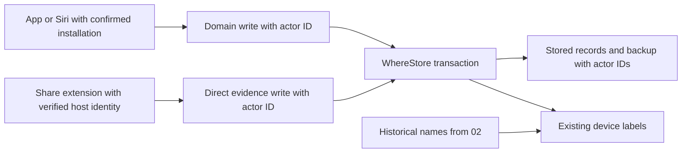

# 03 — Identify the device behind saved actions

- Status: outline
- Depends on: [01 — GPS capture and correction](01-location-provenance.md) and [02 — Device names](02-device-names.md)
- Shared scope: [US-02, US-03](README.md#user-stories), [R-04 through R-07](README.md#requirements) and [X-01 through X-03](README.md#scope-boundaries)

## Intended outcome

The stored manual day or evidence item identifies the installation that entered it, including a Siri entry made with GPS off. An export of a corrected location identifies both the recorder and the author of the correction. Those answers survive rename, device removal, sync and restore for as long as Where retains the record. If an action overwrites a row, keep the author with the winning value. A deletion that already leaves a tombstone carries the deleting device on that tombstone. A hard delete stays a hard delete. [Owner’s retention decision](README.md#q-03)

## Coverage inventory

| Saved action or observation | Current owner and evidence | Contribution to check at refinement |
| --- | --- | --- |
| Record a GPS point, correct its regions, exclude it, restore its automatic attribution | [01](01-location-provenance.md) supplies capture and revision author IDs. | Read the raw observation and individual revisions with their respective device IDs. A correction by B cannot change which device's track the point belongs to. |
| Add or override one day, backfill a range, clear an override | [DayJournal](../../Where/WhereCore/Sources/Journal/DayJournal.swift) writes manual days. The latest audit can replace an earlier one. Clear can delete a row. [WhereIntentWriter](../../Where/WhereIntents/Sources/WhereIntentWriter.swift) uses the same journal. | Require the actor even when the caller supplies no note, fix or optional audit. Distinguish the act of entering a day from the date it describes. One range submission has one author across all its days. Keep the selected audit and its author together when an additive range meets an authoritative entry. Clearing the entry emits no new manual-history row. |
| Enter a manual coordinate or derive a point from evidence | [LocationSample](../../Where/WhereCore/Sources/Location/LocationSample.swift) distinguishes GPS, manual and evidence-implied samples. | Attribute a manual assertion to its author. Retain the link from an evidence-derived point to its evidence and author. Neither is an automatic fix by the user who later views it. |
| Add a document, photo, link or note | App writes through the journal. The [share extension](../../Where/WhereShareExtension/Sources/ShareEvidenceModel.swift) saves directly to the local App Group store. | Record which installation added the item even when the attachment has no bytes. A document date or photo's metadata does not establish that device took the photo. |
| Dismiss or restore a detected issue | DayJournal changes dismissal state. Restore removes the stored dismissal. | Attribute each retained dismissal to the dismissing installation. Restoring the issue deletes that dismissal as it does today. |
| Create, edit or delete a planned stay, change or clear the forecast home, edit or remove tracked regions | [PlannedStayCoordinator](../../Where/WhereCore/Sources/Forecasting/PlannedStayCoordinator.swift) writes stay/home revisions. [WhereServices](../../Where/WhereCore/Sources/WhereServices.swift) changes primary regions. Local writes can replace records or remove rows. | Carry the author on the stored stay/home revision, existing stay tombstone and changed region rows. For a reordered or otherwise edited selection, stamp only affected rows. Preserve forecast conflict resolution, region appearance and pick order. An inferred forecast or synthesized default has no user author. |
| Rename/remove another device, erase a year, erase all data, import | [DeviceRecordingController](../../Where/WhereCore/Sources/Devices/DeviceRecordingController.swift) records both target and issuing device. DayJournal clears years and issues resets. [BackupCoordinator](../../Where/WhereCore/Sources/Backup/BackupCoordinator.swift) owns import. | Reuse recorded actors. A reset or Replace can retain its existing control record under its issuing ID. Year erase retains author on its existing correction resets. Keep account erase and import recovery semantics. Merge and Replace preserve original actors. |

## Known design and assumptions

The app and [App Intents](../../Where/WhereCore/Sources/WhereServices+Intents.swift) share one service stack. Bind fresh writes to that scope's installation identity, including with automatic recording Off. Pass author and subject separately. Stamp once before durable retry and commit the actor with the mutation. Failed, canceled and duplicate operations must yield no false or duplicate history. Keep CloudKit conflict ordering and never turn incoming records into new local actions.

The share extension has no access to the application's private installation sidecar. Extend the app's audience-specific, backup-excluded App Group handoff with a read-only confirmed identity. Bind it to the existing compatibility admission and scope, revoke it on reset or rejoin, and verify it at the write boundary, including removal or rotation races. A missing or stale grant produces the existing “Open Where” path. Keep extension writes direct and local-only. [Share extension contract](../../Where/WhereShareExtension/AGENTS.md)



The diagram shows existing writers, persistence and read paths. Actor propagation and the share identity handoff are proposed. Extend each existing value, row and encoder with its required actor when the record lacks one. The resolved ID must travel with the same revision as its contents.

```swift
// Proposed boundary. App and intent writes use the same scope-owned actor.
let actor = installation.currentDevice.id
try await journal.saveManualEntry(entry, actor: actor)
try await shareStore.save(evidence, actor: verifiedHostIdentity) // same transaction as bytes
// Restores use the saved author on each value.
try await backup.restore(archivedEvidence)
```

Keep existing historical device labels working through the resolver from 02. For the new author fields, compare the records returned by Core with their exported values. This phase requires no new audit rows, screens or controls in the app.

## Refinement trigger

The owner settled coverage and retention on November 20 in [Q-03](README.md#q-03). Refine when 01 demonstrates A-captures/B-corrects through restore and 02 supplies historical names. Walk each inventory row from its real app, intent or extension entry point through the store, sync, archive and any existing reader. List each actor field and its SwiftData and archive representation. Use the existing latest-write or event identity for deduplication. Pair the winning value with its own author when concurrent edits arrive out of order.

Carry each newly persisted shape through the strict version gate and offline upgrader in the same implementation step. Fill missing actor IDs on surviving old records using the single-phone source mapping. Keep absent notes and fixes optional. Preserve existing tombstones and leave hard-deleted rows absent. Re-export with every known actor unchanged.

Acceptance evidence should include an offline two-device edit and merge, a manual range created by Siri without a fix, an extension save before and after installation rotation, and a read after device removal. Verify a retained reset or stay deletion names the actor, an issue restore removes the dismissal, and account erasure removes the affected history. Exercise Merge, Replace, interrupted import and export again. Compare actor IDs, existing event IDs and attached bytes.

**Resume point.** Initial outline, November 20, 2026. Use the two prerequisite outcomes to promote this file and select focused tests for each writer, persisted form and existing reading path.
