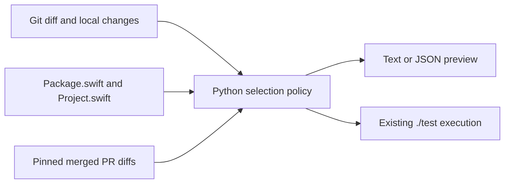

# Local affected-test selection

## Planning checkpoint

- Updated: 2026-11-21; base `ddb0a85466d0ca8ee65e830a43f096e2fb72738e`.
- Operation: Execute the user's request to fix selection gaps and try recent feature PRs locally.
- Stage: Complete; [PR #555](https://github.com/kyleve/Stuff/pull/555) is open for review.
- Completed: Selector and preview, 58 contract tests, lint, shellcheck, independent review, 11 simulator smoke tests, and six reproducible PR selections. See [01](01-selection.md) and [02](02-local-experiment.md).
- Pending: PR review and CI results. No requested implementation or experiment work remains.
- Next action: Review the PR and [experiment results](RESULTS.md); CI selection remains outside this series.
- Linear: [STU-343](https://linear.app/kve/issue/STU-343/fix-local-affected-test-selection-and-measure-representative-prs), In Review. The archived-inclusive search found related vendor evaluation STU-147; this local implementation has separate scope.

## Outcome and scope

Extend the existing `./test` command to select affected bundles safely and explain its decision.
Use recent merged feature PRs to measure the tests it would select on the current target graph.
Keep CI's full validation and evidence rules in force during this local experiment.

## User stories and requirements

| ID | Story |
| --- | --- |
| US-01 | A contributor needs a reliable local selection to avoid unrelated test execution. |
| US-02 | A maintainer needs repeatable evidence before deciding whether CI should use selection. |

| ID | Requirement | Story | Plan |
| --- | --- | --- | --- |
| R-01 | Include every owner of shared sources and resources, transitive package dependencies, test hosts, and generated snapshot inputs. | US-01 | [01](01-selection.md) |
| R-02 | Preserve both sides of renames and include local edits and untracked files. Missing history, unknown executable inputs, and unsupported manifest syntax must not silently skip tests. | US-01 | [01](01-selection.md) |
| R-03 | Preview the same decision used for execution, with selected/skipped logical bundles and selection reasons, without running checks, building, or starting simulators. | US-01 | [01](01-selection.md) |
| R-04 | Replay a small, varied sample of recent merged feature PRs, retain exact revisions and selections, and distinguish skipped bundles from measured runtime savings. | US-02 | [02](02-local-experiment.md) |

## Exclusions

| ID | Exclusion | Reason |
| --- | --- | --- |
| X-01 | Enable CI skipping or alter merged-PR validation reuse. | Local evidence is the requested first step. |
| X-02 | Adopt a vendor service, coverage instrumentation, or change physical test grouping. | Extend the existing tool first. |
| X-03 | Claim selection reduces compilation or proves elapsed-time savings. | The current runner builds the selected scheme; bundle selection limits execution. |
| X-04 | Change app behavior or snapshot references. | This work changes test tooling only. |

## Context and evidence

The base has 22 ordinary logical bundles and six snapshot bundles.
`Tools/test_runner.py` reads only the first source entry and does not model all host dependencies.
`test` uses newline-delimited Git output and falls back to `HEAD` when its base is missing.
Confirmed misses include `TestStore.swift`, `StuffTestHost/AppDelegate.swift`, installer site sources, and selector/CI scripts.
Main now groups 12 library bundles for full runs. Logical selections must retain the existing grouped-filter translation.
Earlier vendor research favored extending this graph before adding coverage-based selection.
No new external dependency is needed.

## Design and order

Git, manifests, and execution exist. Structured selection and preview are new.
No Swift architecture changes are proposed; a Swift sketch does not apply.

| Order | Plan | Deliverable |
| --- | --- | --- |
| 1 | [01 — Selection](01-selection.md) | Safe, inspectable local selection. |
| 2 | [02 — Local experiment](02-local-experiment.md) | Reproducible PR sample and evidence. |

The current horizon includes both deliverables. Refine the experiment after the selection interface is stable.

## Questions and resolutions

| ID | Status | Question | Impact and next action |
| --- | --- | --- | --- |
| Q-01 | closed | Should this enable CI skipping? | No. The user's 2026-11-21 request asks to test benefits locally first; incorporated in X-01. |
| Q-02 | closed | Which recent PRs give a useful sample? | Six area-based cases are recorded in 02, selected from recent merged PR metadata and complete landed diffs. |

Q-01 closed on 2026-11-21 after checking the scope against both deliverables.
Q-02 closed on 2026-11-21 after source inspection: #506, #496, #494, #537, #495, and #503 cover UI, shared libraries, persistence, broad features, and tooling. Incorporated into 02's method and acceptance.

## Plan review

Reviewed 2026-11-21 against `ddb0a8546`: requirements, exclusions, dependency order, failure behavior, public flags, and acceptance checks agree.
Both deliverables are complete. 01 passed verification and independent code review; 02 was executed against 01's published implementation revision.
Review correction: historical replay must exclude local edits and explicitly use the current graph, so it cannot claim historical test execution or timing savings.
Source inspection establishes known gaps; it does not establish safe selection or runtime savings.

## Review and delivery

Implementation and experiment: [PR #555](https://github.com/kyleve/Stuff/pull/555).
Independent review covered omitted dependencies, unsupported syntax, Git history errors, preview/execution consistency, grouped hosts, and all six replay selections.
The corrected findings and validation limits are recorded in 01 and the PR body.

## Outcome

The local selector includes the previously missed consumers and explains its selections.
Four representative PRs skip 15–23 of 28 iOS bundles; two conservatively select everything.
[The report](RESULTS.md) and [machine-readable selections](selections.json) retain the evidence.
No runtime-savings claim or CI skipping is introduced. STU-343 remains open while its implementation PR is unmerged.
