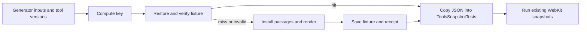

# Cache the installer-site snapshot fixture

The full iOS test builder installs npm packages and renders twelve offline HTML pages so the simulator can compare 24 WebKit snapshots. The ordinary [#555 builder](https://app.circleci.com/workflow/4d564cf3-6055-4f7d-8335-8ec870e3c961/job/54de3385-fff7-4e48-af42-f1680c346db8) spent 28.720 seconds installing those packages. The owner selected a cache trial after the [100-PR cost replay](https://github.com/kyleve/Stuff/pull/556). [STU-346](https://linear.app/kve/issue/STU-346)

## Planning checkpoint

The primary agent owns delivery on `perf/cache-installer-snapshot-fixture`, independently based on main `327b3f58e`. The fixture worker owns input identity and recovery, the workflow worker owns the builder and Xcode handoff, and the validation worker owns the local WebKit comparison. The current horizon is [01. Build and measure the fixture cache](01-fixture-cache.md). An independent review will verify the complete change before publication.

| ID | Required outcome for the CI maintainer (US-01) |
| --- | --- |
| R-01 | A cold build runs the existing production generator. A valid warm entry avoids the site dependency install and rendering work. |
| R-02 | Cache identity covers generator, renderer, package/tool inputs and registered artwork. A missing or invalid entry rebuilds. |
| R-03 | Confirm matching output bytes, all 24 WebKit captures, and real cold/hit builder costs including cache transfer. |
| X-01 | Limit reuse to the shared iOS test builder. Preserve local development, publication, shard assignments, and merge validation. |

Q-01 (closed for design). Project generation can select the fixture copy phase for the test builder. The ordinary project uses the existing Astro generator. The independent gate worker checked all three consumers of the shared setup command. Q-02 (open for experiment). Does the measured benefit on a real hit pay for restore, verification, and cache population on misses?

