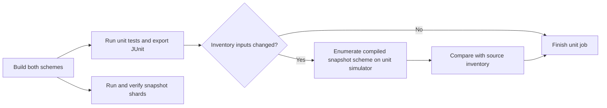

# Reuse the unit simulator for snapshot inventory validation

The CI maintainer (US-01) wants to catch any difference between the source inventory and the suites Xcode discovers in the compiled snapshot scheme, with less time on the shared builder. The owner selected inventory validation for investigation after PR #557. [STU-347](https://linear.app/kve/issue/STU-347)

## Checkpoint

The primary agent owns [the worker trial](01-unit-worker.md) on `perf/snapshot-inventory-validation`, independently based on main at `327b3f58e`. Discovery covered the actual Xcode invocation, artifact handoff, shard filters, JUnit reporting and four gated CI builds. The workflow agent owns failure-path tests. The primary agent owns implementation, independent review, PR publication and the measured CI comparison.

| ID | Acceptance |
| --- | --- |
| R-01 | On changes to the project, snapshot Swift sources or the gate script, Xcode lists the full compiled scheme and the comparison rejects missing or unexpected suites. |
| R-02 | Release the builder after compilation. Reuse the unit worker's attached products and simulator, preserve unit JUnit output, and surface failures in a required job. |
| R-03 | Compare old and new inventory time, equivalent compute credits, complete workflow duration and test outcomes on a real affected PR head. |
| X-01 | Keep shard assignments, intake, image references, test coverage and the public test commands in place. |

Q-01 (closed). All workers use positive suite filters derived from the source scanner. A compiled suite missed by the scanner could be absent from every JUnit report. Keep unfiltered Xcode discovery as the independent check.

Q-02 (closed for design). The unit worker already owns both compiled schemes and its shared simulator stays booted after tests. Validate after unit result export and before failure diagnostics. The ordinary PR trial measures the actual saving.

The implementation changes the CircleCI shell command and job ordering. The Swift project and snapshot code use their existing interfaces. On November 21, independent review against main checked both scheme paths, recomputed the four baseline timings and unit-worker headroom, and verified result-directory ownership and failure ordering. The horizon is the single authorized experiment.
