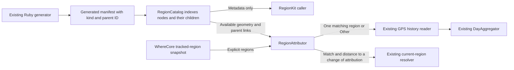

# 01. Model region relationships and resolve overlapping tracked regions

- Status: ready
- Depends on: none
- Shared context: [Overview](README.md)

## Deliverable

RegionKit can answer “what kind of place is California?” and “which country contains it?” without opening a polygon file. A tracked subdivision wins a coordinate match against its tracked country. This groundwork can ship with today's geometry and a test fixture for Ontario. The Canadian data release and its picker changes belong to [plan 03](03-ship-regions.md).

| Story | Requirement | Result |
| --- | --- | --- |
| [S-02](README.md#user-stories) | [R-01](README.md#requirements) | Callers can read a region's kind, immediate parent and direct children. Existing regions keep their IDs, serialization and ordering. |
| [S-01](README.md#user-stories) | [R-02](README.md#requirements) | One GPS observation credits its most specific matching tracked region. Tracking Canada alone still credits Canada. Relationships add no choices to the current UI in this phase. |

## Context and boundaries

At `acdae322d`, [Region](../../Where/RegionKit/Sources/Region.swift) decodes persisted IDs as bare strings. Its failable initializer validates interactive input. [RegionCatalog](../../Where/RegionKit/Sources/RegionCatalog.swift) requires a geometry file per entry. Its available list contains 50 states, DC, Puerto Rico, Canada and the European Union. The separate `.other` sentinel ends `Region.allCases`. That order also breaks ties in [day-count rankings](../../Where/WhereCore/Sources/Days/Region+Ordering.swift).

[RegionAttributor](../../Where/RegionKit/Sources/RegionAttributor.swift) currently returns the first match in caller order. [RegionAttribution](../../Where/WhereCore/Sources/RegionAttribution.swift) creates a snapshot in canonical order at rebuild or tracked-set read. [LocationHistoryReader](../../Where/WhereCore/Sources/Devices/LocationHistoryReader.swift) uses this snapshot for GPS unless the sample has a replacement. [DayAggregator](../../Where/WhereCore/Sources/Days/DayAggregator.swift) combines the day's region sets, including explicit manual entries. These are separate from [ElsewhereResolver](../../Where/WhereCore/Sources/Reporting/ElsewhereResolver.swift), which lazily uses the full catalog to name otherwise unresolved observations for a report.

Honor [X-01 through X-04](README.md#scope-boundaries) and the [overlap and US-parent decisions](README.md#questions-and-resolutions). Keep the US as a metadata-only parent. Canada retains its existing identity and geometry in this phase. The EU remains its existing bloc and `.other` stays outside the hierarchy. Keep the existing flat manual, relabel and primary workflows. Day totals and corrections continue to use explicitly attributed regions.

## Data flow



## Architecture sketch

```swift
// Proposed additions to the existing immutable catalog, signatures only.
enum RegionKind { case state, federalDistrict, territory, province, country, bloc }
struct Node {
    let id: String
    let kind: RegionKind
    let region: Region?          // nil for the metadata-only US
    let localizedName: String
}
extension RegionCatalog {
    func node(id: String) -> Node?
    func node(for region: Region) -> Node?
    func parent(of node: Node) -> Node?
    func children(of node: Node) -> [Node]    // direct, in manifest order
}
// Existing RegionAttributing contract continues to return one region.
func region(at coordinate: Coordinate) -> Region
// Proposed confidence and region-specific tests use the same immutable snapshot.
func matchWithBoundaryDistance(at coordinate: Coordinate) -> (Region, Double?)
func contains(_ coordinate: Coordinate, in region: Region) -> Bool?
```

Decode one set of manifest records. Index each node by ID and derive the existing geometry-backed `Entry` values from those same records. The US parent can be named and its children queried, but supplies no `Region` value to pass to existing logging or tracking APIs. Keep `entries`, `all`, `entry(for:)` and `Region.allCases` compatible for all available places. The failable `Region(rawValue:)` still accepts only a loggable ID or `other`. The bare-string Codable path still round-trips unknown IDs. Resolve relationships from explicit catalog links.

## Steps

1. Extend [the generator](../../Where/RegionKit/Tools/generate-regions.rb) and its [host regression](../../Tools/Tests/generate_regions_test.rb). Emit a `united-states` country node with no geometry, and attach the existing 52 US jurisdictions to it. Classify DC as a federal district, Puerto Rico as a territory and the 50 states as states. Mark `canada` as a country and `european-union` as a bloc. Validate unique IDs, reserved `other`, resolvable parents and acyclic ancestry before writing the manifest. Regenerate through the script. The 54 existing polygon files must reproduce byte for byte.
2. Decode and index those fields in RegionCatalog. Construct available Region values with the internal unchecked initializer during loading so lookup cannot recursively enter `RegionCatalog.shared`. Return nil for a root's parent and for the node of an unknown ID or `.other`. Leaves have no children. Invalid decoded graphs must follow the existing bundled-manifest fault, debug assertion and release fallback. Keep the metadata-only node out of `RegionAttributor.all`, [full-catalog artwork](../../Where/RegionKit/Sources/RegionGeometryCatalog.swift) and [credits](../../Where/RegionKit/Sources/RegionDataSource.swift). Continue diagnosing a declared file that is missing or corrupt.
3. Change match selection in RegionAttributor for ancestor/descendant overlaps. Among loaded polygons that contain the point, discard each matching ancestor of another match. Return the first remaining match in caller order. A country-only match still wins outside the loaded child's boundary. Preserve the bounding-box prefilter, requested-subset loading, and current fast first-match path where the loaded set has no ancestral overlaps. Preserve the existing synchronous methods and tracked-subset load behavior. For live confidence, resolve the winning region and distance to the nearest edge that can change that result from the same snapshot. When Canada wins outside tracked Ontario, include Ontario's nearby edge. When Canada alone is tracked, use Canada's own boundary. Keep the raw per-region boundary distance for callers that ask about a named place. The [planned-stay verifier](../../Where/WhereCore/Sources/Forecasting/PlannedStayLocationVerifier.swift) can test containment in its requested region even when a child wins GPS attribution. An Ontario fix satisfies a stay in tracked Canada without adding another region to the day. Audit the [correction assessor](../../Where/WhereCore/Sources/DataResolution/SampleCorrectionAssessment.swift) for checks about changes in the winning region. Use the appropriate boundary for that question and preserve manual overrides. Forward new operations through WhereCore's live attributor using one snapshot per query.
4. Use the existing internal polygon fixture initializer with an injectable catalog or equivalent internal seam to exercise synthetic Ontario and Canada before real Ontario ships. Verify that one Toronto observation yields only Ontario when both are tracked and only Canada when Canada alone is tracked. A single day can still contain both places when separate observations or explicit manual records warrant it. Do not expand corrected samples, manual entries, or ancestors when aggregating. Document the revised selection and hierarchy contract in the [RegionKit README](../../Where/RegionKit/README.md) and its [local instructions](../../Where/RegionKit/AGENTS.md).

## Acceptance and verification

Run from the repository root after implementation.

| Requirement | Check | Expected evidence |
| --- | --- | --- |
| R-01 | `ruby Tools/Tests/generate_regions_test.rb` | Two generations match the committed outputs, malformed hierarchies fail, and the metadata-only node has no GeoJSON. |
| R-01 | `./test RegionKitTests` | California's parent is the US, with 50 state children, one federal district and one territory. Canada and the EU have no assigned administrative parent. Checks cover the US parent's lookup, exclusion from selectable IDs, geometry and credits, 54 legacy available IDs in their prior relative order, bare-ID encoding, unknown-ID decoding, and `.other`. |
| R-02 | `./test RegionKitTests` | Synthetic Ontario-only, Canada-only, both in each order, neither, and Canada outside Ontario return the expected single region. Unrelated overlapping fixtures retain caller priority. A parent entry alone causes no child file reads. The shared defaults still attribute Toronto to Canada. Synthetic fixes on either side of a tracked child edge produce an uncertain current region when their accuracy circles cross it. Tracking the country alone ignores that internal edge. |
| R-01, R-02 | `./test --only WhereCoreTests/RegionAttributionTests --only WhereCoreTests/CurrentRegionResolverTests --only WhereCoreTests/PlannedStayLocationVerifierTests --only WhereCoreTests/DayAggregatorTests --only WhereCoreTests/ElsewhereResolverTests --only WhereIntentsTests/RegionEntityTests` | A tracked-set edit rebuilds the live snapshot. Current-region confidence is symmetric at a tracked child edge. A planned Canada stay accepts a fix inside tracked Ontario. Explicit manual and corrected sets keep their existing treatment. Full-catalog enrichment does not create a primary credit. Intent identifiers still resolve the existing jurisdictions and exclude the internal US parent. |
| X-02, X-03, X-04 | Review the implementation diff and run `./swiftformat --lint`. | The metadata lives in the bundle. SwiftData, backup and widget payload shapes remain compatible. No hierarchy control, network load, or ancestor roll-up is introduced. |

## Recovery and execution record

The resource directory is generated. If regeneration is interrupted, retain the source inputs, fix the cause, rerun the generator and compare with the host test's temporary-directory output. Land the schema, generated manifest and its reader together so each implementation commit can load the checked-in resources. The policy can follow in its own verified commit using the synthetic fixture. No user records need rollback.

| Date | Decision | Source |
| --- | --- | --- |
| 2026-11-22 | The US is an internal parent. A GPS match credits the most specific tracked region and a country remains usable on its own. | User answers to [Q-01 and Q-02](README.md#questions-and-resolutions) |

- [ ] Add and verify catalog metadata, compatible lookups and generator output.
- [ ] Verify single-region matching, update documentation and review the completed diff.
- [ ] Record tested commits, results and implementation PR here when implementation is authorized.

**Progress and outcome.** Implementation has not started. Resume at step 1 after plan review and a request to implement.
