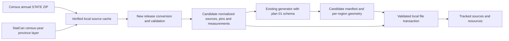

# 02. Build the US and Canadian boundary updater

- Status: ready
- Depends on: [01. Region hierarchy](01-region-hierarchy.md)
- Shared context: [Overview](README.md)

## Deliverable

A maintainer can reproduce checked-in RegionKit resources offline or evaluate a new Census release in a separate directory. This step delivers the working command, tests with small fixtures and a measured candidate from the 2026 publishers. [Plan 03](03-ship-regions.md) owns adoption of the production data, Swift geometry support and in-app credits.

| Story | Requirement | Observable result |
| --- | --- | --- |
| [S-03](README.md#user-stories) | [R-03](README.md#requirements) | One command fetches an explicit release, replays from cache, reports changes, installs an accepted result and recovers an interrupted installation. |
| [S-01, S-03](README.md#user-stories) | [R-04](README.md#requirements) | The candidate preserves jurisdiction IDs and records source versions, transformations, geographic fidelity and size. |

## Inputs and constraints

- **United States.** Fetch the national STATE ZIP from the annual Census TIGER/Line archive. The 2026 ZIP inspected on November 22 contains 56 NAD83 records and has SHA-256 `2e17ea40dff3e00163eec87a26efa0b0ff7e8fe364a191bf1a7754dcb49ea326`. Read `STUSPS`, `STATEFP`, `GEOID` and `NAME` as supplied. Map the exact existing 52 postal codes to their current IDs. The other four known equivalents are AS, GU, MP and VI. Report them as excluded and stop for missing, duplicate or unexpected codes. TIGER/Line includes water within state boundaries. [2026 STATE download](https://www2.census.gov/geo/tiger/TIGER2026/STATE/), [Census series metadata](https://catalog.data.gov/dataset/series-information-for-state-and-equivalent-entities-national-tiger-line-shapefiles-curren)
- **Canada.** Fetch the Statistics Canada detailed cartographic province/territory layer. It covers the mainland and coastal islands. Discover the named layer within the dated service and verify its schema. For 2026, layer 0 is `lpr_000b26s_e`, native EPSG:3347. Enumerate all IDs without geometry, then request one whole feature per PRUID with `outSR=4326`, `f=geojson` and no quantization or generalization parameters. Reject service errors, transfer limits, missing polygon parts and the wrong vintage or layer. On November 22 the service returned all 13 IDs and the Prince Edward Island query returned one multipolygon with 111 parts. Use the maintained PRUID-to-postal-code table for `ca-XX` and `PRENAME` for the English name. `PREABBR` contains values such as `Ont.`. Keep the vintage-specific `DGUID` for provenance. [Source layer](https://geo.statcan.gc.ca/geo_wa/rest/services/2026/Cartographic_boundary_files/MapServer/0), [PEI query](https://geo.statcan.gc.ca/geo_wa/rest/services/2026/Cartographic_boundary_files/MapServer/0/query?where=PRUID%3D%2711%27&outFields=PRUID%2CPRENAME&returnGeometry=true&outSR=4326&f=geojson), [record layout](https://www150.statcan.gc.ca/n1/pub/92-160-g/2026001/tbl/tbl_4.1-eng.htm)
- The [current Ruby generator](../../Where/RegionKit/Tools/generate-regions.rb) deletes the live geometry directory before parsing all its inputs. Preserve its no-argument regeneration interface and its [byte-for-byte host test](../../Tools/Tests/generate_regions_test.rb). Ship compact, deterministic normalized sources under `Where/RegionKit/Tools/source/` so a clean checkout can regenerate without network access or GIS software. The large upstream files belong in a maintainer cache. Follow the [tool mutation contract](../../Tools/AGENTS.md) and [RegionKit resource and credit contract](../../Where/RegionKit/AGENTS.md).
- [X-01 through X-04](README.md#scope-boundaries) apply. The updater keeps the existing EU geometry and bytes, produces no polygon for the US metadata parent, and runs only on maintainer machines. App selection, historical records and tracking policy remain the responsibility of their current owners.

## Data flow and command interface



Extend the Ruby entry point. The proposed examples below run from the repository root. `$candidate`, `$replay` and `$cache` denote distinct maintainer-selected directories outside tracked output. Refresh and replay write their own candidate directory. They never install it implicitly.

```sh
tool=Where/RegionKit/Tools/generate-regions.rb
ruby "$tool" --refresh --us-year 2026 --ca-year 2026 --cache "$cache" --output "$candidate"
ruby "$tool" --replay "$candidate/sources.lock.json" --cache "$cache" --output "$replay"
ruby "$tool" --adopt "$candidate"
ruby "$tool" --check
```

The first two commands can run in this step. Exercise adoption only on a fixture checkout here. Plan 03 runs the third command on the production candidate. `--check` generates from the tracked normalized sources in temporary storage, compares every owned byte and reports drift without modifying the checkout. No Swift architecture changes are needed for this host-side tool.

## Steps

1. Add argument handling, a local cache, source adapters and machine-readable release pins. Include publisher, vintage/reference date, product/layer, requested URLs and parameters, content SHA-256, license and attribution, stable source IDs, conversion options and exact tool versions. Keep the full raw payloads addressable by digest. Every replay checks the digests before reading them. A fresh download for a known vintage with different content must report the change explicitly and produce a separately reviewable candidate. The cache must never substitute an older release after a fetch or validation failure.
2. Normalize into longitude/latitude WGS84 Polygon or MultiPolygon with stable precision, sorting and ring orientation. Preserve component and interior rings, validate coordinates and topology, and handle Alaska across the antimeridian. Use a pinned host GIS toolchain for archive import, projection, coverage simplification and dissolve. Record the exact GDAL/GEOS/PROJ versions, CRS operation and projection data or immutable tool image used, plus the requested Canadian `outSR` and the hash of the returned WGS84 geometry. The publisher controls that server-side conversion. Disable dynamic grid fetching during replay. A coverage-aware simplifier must operate on shared boundaries within each source. Dissolve the 13 Canadian outputs to form `canada` and remove internal seams, including when measuring distance to the country boundary. Do not snap one publisher's international border to the other silently. Compare gaps and overlaps around the 49th parallel, Niagara and Alaska/Yukon with the unsimplified inputs. Report inherited discrepancies separately from those introduced by conversion. [GDAL coverage simplification](https://gdal.org/en/stable/programs/gdal_vector_simplify_coverage.html)
3. Reuse the plan 01 manifest writer to stage the complete resources. Generate a compact report of added/removed IDs, parents, parts, holes, vertices, byte counts by region and total, maximum measured displacement and test-point disagreements against the unsimplified sources. Measure displacement in metres with appropriate local projections, including islands and Arctic latitudes. Try a full-detail baseline and measured simplification settings. Keep the least costly candidate that preserves holes, inhabited islands, valid shared borders and known classifications on both sides of the US/Canada border. Record chosen tolerances and observed error separately. The existing 54 geometry files occupy 2,156,498 bytes. Report the default four's combined bytes and the largest file as well as the total, so plan 03 can check actual load times on the same device against the existing one-second load span. Resolve material size or classification regressions before adoption. Record upstream limitations and their measured impact separately.
4. Stage and validate all owned replacements on the destination filesystem. Serialize mutating runs targeting the same checkout. Use the existing [FileTransaction](../../Tools/file_transaction.rb) to install normalized inputs, release pins, metadata and generated resources together. Preserve unrelated files, including string catalogs. Guard against interrupted fetches, invalid archives or ArcGIS error JSON, checksum changes, incomplete membership and writes that fail partway. Keep valid cache entries available for retry. FileTransaction rolls back caught write errors in process. For termination between renames, record the release hashes and recoverable staging paths before adoption. On restart under the same lock, finish or restore a complete matching release before another write. Treat a cleanup error after a verified install as committed with backups to remove.
5. Document the release/replay procedure, dependency installation, parameters, water/shoreline semantics and credit text in the [module README](../../Where/RegionKit/README.md). Identify the US Census Bureau and public-domain federal source. The Canadian service credits the Government of Canada and Statistics Canada and declares the Open Government Licence – Canada. Retain that licence link and identify the adapted product, reference date, simplification and dissolve. Pass these facts to plan 03 for its About screen. Register and attribute any new development tool under the [build-system contract](../../.agents/references/build-system.md#attribution). [Canadian service terms](https://geo.statcan.gc.ca/geo_wa/rest/services/2026/Cartographic_boundary_files/MapServer/info/iteminfo?f=pjson), [licence](https://open.canada.ca/en/open-government-licence-canada)

## Acceptance and verification

Run from the repository root after implementation.

| Requirement | Procedure | Expected evidence |
| --- | --- | --- |
| R-03 | Run `ruby Tools/Tests/generate_regions_test.rb`. Use a small source-format ZIP and recorded ArcGIS metadata/GeoJSON to exercise refresh, replay, adopt and check through the CLI. Inject a failed download, changed hash, missing code and mid-transaction write failure. Terminate a fixture adoption between renames and retry. | No test needs live network. Two runs from identical inputs produce identical bytes. Failures before adoption preserve the prior catalog. A recovered interrupted adoption leaves a complete old or new release with its matching pins, and preserves unrelated resources. Bad cache bytes fail offline. |
| R-03, X-04 | Run the documented 2026 refresh, disconnect network for replay, and compare candidate source pins, normalized sources and generated bundle trees with `diff -r`. Run `--check` against the current checkout. | Both candidate trees match. A normal build and clean-checkout regeneration use only local inputs. Live coverage still matches the checked-in plan 01 catalog. |
| R-04, X-01 | Inspect the real candidate and geometry report. Compare source/candidate probes on each side of an interprovincial boundary, coastal land/water, an enclave or hole, Arctic islands and Aleutian longitudes. Compare Canada with the union of the delivered subdivisions. | Exactly 52 US jurisdictions and 13 Canadian subdivisions map one-to-one, plus Canada, the legacy EU and the internal US node. Zero missing source attribution, unresolved geometry failures or unexpected changes to unaffected data. Record residual source disagreements, sizes and distances for plan 03. |
| R-04 | If a development dependency was added, run `./attribution` followed by `./attribution --check`. | Tool pins and credits reproduce, independently of bundled geometry attribution. |

## Recovery and execution record

Incomplete downloads and candidates are disposable. Verify the last good lock and cache, resolve the reported source or conversion error, and replay into a new destination. A reported rollback failure retains the transaction backups and both error messages. Do not adopt that candidate until the prior checkout has been restored and `--check` passes.

| Date | Decision and source |
| --- | --- |
| 2026-11-22 | Use explicit dated publisher releases, the current 52 US tracking choices and the detailed Canadian cartographic layer. See the [overview decisions](README.md#questions-and-resolutions). |

- [ ] Implement and verify the command on fixtures.
- [ ] Record the two release pins, reproducibility results, measured geometry trade-offs and resumable candidate location.
- [ ] Review the completed diff, record tested commits and publish the implementation PR when authorized.

**Outcome and resume point.** Implementation has not started. Begin after plan 01 is complete and implementation has been requested. Plan 03 can reconstruct the accepted candidate from the verified pins and cache.
