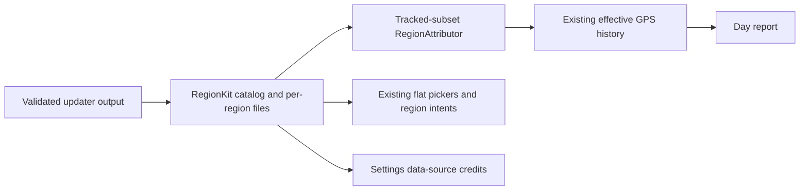

# 03. Ship the US and Canadian catalog

- Status: outline
- Depends on: [01. Catalog relationships and attribution](01-region-hierarchy.md) and [02. Reusable boundary updater](02-boundary-updater.md)
- Shared context: [Overview](README.md)

## Intended outcome

An existing US user keeps their tracking choices and receives refreshed boundaries. A Canadian user can select Ontario and Canada, log a manual day in Nunavut, and find each in the ordinary reports. The United States is available only as catalog metadata. Maintainers can reproduce the exact released data.

## Stories, requirements and exclusions

[S-01 through S-03 and R-01 through R-05](README.md#requirements) apply. This step activates R-02, R-04 and R-05 with production geometry and existing app entry points. Keep the [scope boundaries](README.md#scope-boundaries), including the existing EU behavior, single-region GPS results, and flat selection. See the [user's choices](README.md#questions-and-resolutions).

## Known design



The updater runs outside the app. The existing [RegionAttribution](../../Where/WhereCore/Sources/RegionAttribution.swift) owns the tracked snapshot. The existing [history reader](../../Where/WhereCore/Sources/Devices/LocationHistoryReader.swift) applies explicit corrections before returning effective sample attribution. Keep the existing read-time treatment of raw GPS. On an upgraded device an old Toronto fix can resolve to Ontario after it is tracked. A saved manual or explicitly corrected Canada entry still means Canada.

```swift
// Expected results with production files and the existing synchronous API.
RegionAttributor(for: [canada, ontario]).region(at: toronto) // ontario
RegionAttributor(for: [canada]).region(at: toronto)          // canada
RegionAttributor(for: [ontario]).region(at: vancouver)       // other
```

- **Catalog and geometry.** Run the updater’s `--adopt "$candidate"` and `--check` modes from plan 02. The 67 available geometries comprise 52 US jurisdictions, 13 Canadian subdivisions, Canada and the existing EU. The US metadata node and the separate Other sentinel have no file. Check each mapped ID, English name and jurisdiction kind against the official source and code mapping. Preserve existing US IDs and localization keys. Verify the Canada outline and all child regions against the same processed boundaries. Remove internal province lines from Canada's country polygon.
- **Real polygon behavior.** Preserve polygon members and inner rings through the [GeoJSON decoder](../../Where/RegionKit/Sources/GeoJSON.swift), [point and edge math](../../Where/RegionKit/Sources/GeoPolygon.swift), and map displays used for selection. A point inside a hole is outside its surrounding region. Distance to any edge includes interior rings. Islands remain selectable. Inspect the Alaska antimeridian and the US–Canada seam. Use the actual candidate files and fixtures either side of boundaries to distinguish geometry defects from the device's horizontal uncertainty. Review polygon drawing order so the Canada fill does not obscure provinces. The list must allow selecting the country even where a map tap selects its child.
- **Eligibility.** Replace the [US-prefix primary-picker policy](../../Where/WhereUI/Sources/Regions/PrimaryRegionSelectionModel.swift) with a common flat list for the 52 US jurisdictions, Canada and its 13 subdivisions. Use it in onboarding, Settings and existing forecasting callers ([home](../../Where/WhereUI/Sources/Forecasting/PlanningRegionSelectionModel.swift) and [planned stay](../../Where/WhereUI/Sources/Forecasting/PlannedStayEditor.swift)). Preserve the five-pick limit, pick order and appearance drafts. Confirm the existing manual day, correction, intent lookup and tracked-only suggestions behave correctly. Preserve each surface's existing eligibility for the EU and Other. Audit the picker map's fixed US starting view and state-specific copy for reachability. Country and province rows display as ordinary region choices.
- **Compatibility.** The app uses bare region IDs in backups, store rows and widget data. Exercise an old backup with `us-CA` and `canada`, and a new backup with `ca-ON`. A previous reader can filter out `ca-ON` in [SwiftDataStore](../../Where/WhereCore/Sources/Persistence/SwiftDataStore.swift). Use the [existing account compatibility gate](../../Where/WhereCore/README.md#data-compatibility) for the new writable-ID vocabulary before it ships. Test old and new versions with an isolated transport, including admission of a new reader to existing data and the old reader's update-required path after the shared version advances. Test the recording-device-only advance and the wait state on a viewer paired with an older recorder. The portable backup has a separate compatibility boundary. At the current base the v7 importer can accept a manual-only archive with an unfamiliar raw ID and later omit it. Protect new archives with the [format-version gate](../../Where/WhereCore/Sources/Backup/BackupService.swift), and teach the [external upgrader](../../Where/Tools/upgrade-backup.rb) to carry existing archives forward without altering region strings. Demonstrate lossless restore on the new build and rejection before store mutation on the old build, even for a manual-only backup moved to a different account. An offline reader has only its last verified receipt until its next successful check.
- **Credits and documentation.** Update [RegionDataSource](../../Where/RegionKit/Sources/RegionDataSource.swift), its exhaustive tests, [Settings licence formatting](../../Where/WhereUI/Sources/Shared/WhereFormat.swift) and the [About screen](../../Where/WhereUI/Sources/Settings/AboutSettingsView.swift). Every available geometry has exactly one source credit. Carry the US Census credit and StatCan's requested notice and licence link through conversion and bundling. Keep the EU's hand-drawn credit specific to its geometry. Update RegionKit's public-domain-only note and regeneration instructions, WhereUI's US-only picker documentation and the [repository acknowledgements](../../README.md#acknowledgements).

## Evidence required before execution

Refine this outline after 01's fixture checks pass and 02 produces a candidate, reproducibility evidence, jurisdiction inventory and geometry/size report. Link those results here. Choose the simplification settings and tested tool versions from those measurements. Inspect cases where the official datasets disagree on shoreline or common-border points and record which cases remain ambiguous. Use the repository's existing performance spans for the real app paths. Capture a baseline on the same simulator or device and report the before/after bundle size, largest files, default and full-catalog construction times, map loading, and representative lookups. Resolve material regressions before adopting the files.

| Acceptance area | Evidence when promoted |
| --- | --- |
| Geography and confidence | One known interior coordinate for each Canadian subdivision, including the three territories. Exercise a coastal island, an actual cross-border pair, a hole and the antimeridian. From a point near a provincial border, province confidence uses the internal boundary while Canada-only confidence uses its true boundary. With Canada and Ontario tracked, test both sides of the Ontario–Quebec border for an accuracy circle that crosses it. |
| App and historical behavior | Run `./test RegionKitTests`, applicable `WhereCoreTests` (attribution, history, reports, compatibility and backup), `WhereIntentsTests/RegionEntityTests`, and primary/forecast picker tests through `./test --only`. Check Ontario alone, Canada alone, both in either order, and neither. Verify corrections, manual entries, defaults, save/reopen, and new-name intent lookup. Exercise a two-sample day supporting two distinct regions without adding a parent for either fix. |
| Reachability and presentation | In the simulator configure Canada and Ontario, save, reopen, manually log Nunavut and inspect the day's report. Confirm Ontario can be found in the list and selected on the map. Check the US parent is absent. Inspect relevant picker, map and About snapshots under the repository's UI and snapshot guidance. |
| Repeatability and failure | Replay the accepted release offline and compare the full generated manifest, resources and credits. Keep the previous revision intact on source-validation failure. Check root and module provenance and each per-source licence. |

## Refinement and resume point

The user chose review before implementation on November 22. No implementation or performance acceptance measurements have run. After both dependencies complete, refine this file in place, record measured results and exact checks, review the rollout and recovery steps, and satisfy the readiness rules before starting it.
