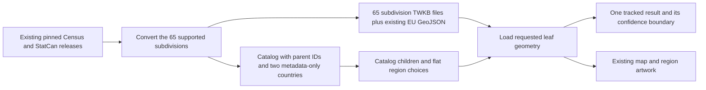

# 04. Derive country behavior from subdivisions

- Status: complete
- Depends on: [01. Hierarchy](01-region-hierarchy.md), [02. Updater](02-boundary-updater.md), [03. App rollout](03-ship-regions.md)
- Shared context: [Overview](README.md), [November 25 decision, Q-04](README.md#questions-and-resolutions)

## Deliverable

The offline release stores geometry once for each of the 52 supported US jurisdictions, 13 Canadian provinces and territories, and the EU bloc. The US and Canadian country nodes contain metadata. Canada remains a flat tracking choice. Tracking it alone matches land in any of its 13 children, and artwork for it draws those children. A Canada-only observation can remain confident on either side of an inland provincial border.

## Requirements and exclusions

| Stories | Requirements | Observable result |
| --- | --- | --- |
| S-02 | R-01 | Each subdivision carries its direct parent ID. RegionKit derives the child list in catalog order. Metadata lookup reads zero geometry files. The US is an internal metadata node. |
| S-01, S-02 | R-02, R-05 | A Toronto fix yields Ontario if both Ontario and Canada are tracked and Canada if only Canada is tracked. Canada-only confidence uses the exterior and holes of Canadian coverage. Named Canada containment, manual entries and history keep their existing meaning. |
| S-01, S-03 | R-03, R-04, R-05 | The updater reproduces a 66-file release. Its normalized data and app bundle both omit national rings. The installed app shows the existing flat choices, draws the available subdivisions and credits its sources accurately. |

All [scope boundaries](README.md#scope-boundaries) apply. The US catalog has 52 children. The Census input still has 56 records, including AS, GU, MP and VI, which stay outside the catalog. The existing 67 loggable IDs retain their raw strings and order. Other remains a separate sentinel. The earlier backup and account compatibility gates continue to protect the same vocabulary.

## Data flow



The existing updater, catalog, attributor and artwork entry points remain the integration boundaries. The revised path derives geography for Canada when requested. A province-only request loads that province. When both Ontario and Canada are tracked, the same Ontario shape can serve direct matching and Canadian land coverage. All-region map and source views can enumerate physical leaf shapes once. A Canada artwork request uses the Canadian shapes under the selected country identity. An explicit US node lookup yields metadata and no drawable geometry.

```swift
// Observable behavior using existing APIs, abbreviated.
catalog.parent(of: ontarioNode)?.id == canadaNode.id
catalog.children(of: canadaNode).count == 13
RegionAttributor(for: [.canada]).region(at: toronto) == .canada
RegionAttributor(for: [ontario, .canada]).region(at: toronto) == ontario
RegionAttributor(for: [.canada]).distance(to: .canada, from: toronto) == 0
```

## Implementation and verification

1. **Regenerate the release (R-03, R-04, R-05).** Update the [converter](../../Where/RegionKit/Tools/convert_boundaries.py), [release validation](../../Where/RegionKit/Tools/region_release.rb) and [generator](../../Where/RegionKit/Tools/generate-regions.rb) so both country rows omit file geometry. Keep country geometry out of normalized input, generated assets and persisted indexes. Retain the verified publisher inputs, source membership checks, mapping, hole preservation and EU asset. Recreate normalized input, report, lock, generated manifest and files through the tool. Run its host fixtures and replay against the pinned cache. Compare each surviving geometry to the November 24 version byte for byte. With identical leaf bytes, the 66 installed geometry files total 13,787,008 bytes. The two retired files account for 13,378,046 bytes of the original 27,165,054. Verify both obsolete country files disappear after adoption and the check command accepts the installed tree.
2. **Apply the hierarchy in RegionKit (R-01, R-02, R-05).** Update [RegionCatalog](../../Where/RegionKit/Sources/RegionCatalog.swift), [RegionAttributor](../../Where/RegionKit/Sources/RegionAttributor.swift) and [RegionGeometryCatalog](../../Where/RegionKit/Sources/RegionGeometryCatalog.swift). Country metadata has no geometry file. A requested Canada match uses its 13 direct children; day counting, caller order and manual entry rules stay as in plan 01. A Canada-only horizontal accuracy circle crossing an inland shared child edge can still resolve Canada. A circle spanning the Canadian coast, a lake hole or an international border accounts for that change. When Ontario is tracked with Canada, the Ontario–Quebec edge can change the selected result on either side. Exercise named Canada distance and planned stays too.
3. **Verify the offline app (R-02, R-04, R-05 and X-01 through X-04).** Exercise the existing flat primary and forecast pickers, manual day/report, region intents, developer source map, Canada artwork and About credits. Canada can still be selected separately from Ontario. Compare attribution and drawing with the precise subdivision geometry, including an island, an interior hole and the Alaska antimeridian. Verify that a Guam fix yields Other with all app regions available. Record cold default/full loads, repeated Canada membership and boundary queries, physical bytes and geometry reads. Compare with the [prior release](03-ship-regions.md#measured-release) on the same hardware where available. Review images changed by the switch to constituent artwork or source counts before accepting them.

Run the following from the repository root. The release worker supplies separate publisher-cache and candidate directories using the existing [updater interface](../../Where/RegionKit/README.md).

```sh
ruby Tools/Tests/generate_regions_test.rb
ruby Tools/Tests/region_release_test.rb
ruby Where/RegionKit/Tools/generate-regions.rb --check
./test RegionKitTests WhereCoreTests WhereUITests WhereIntentsTests
./test --snapshots --only WhereUISnapshotTests/RegionPickerViewSnapshotTests --only WhereUISnapshotTests/RegionMapViewSnapshotTests --only WhereUISnapshotTests/AboutSettingsViewSnapshotTests --record never --review
```

Run additional existing card, forecast or report image suites when their shared artwork changes. Verify child-related fixture cases and real Toronto, Vancouver, coast and shared-border probes. Review the catalog, release and app documentation alongside the test results. The 68-file measurements in plans 02 and 03 establish only the earlier baseline.

## Recovery

Generate and validate in a separate candidate before using the updater's existing adoption transaction. Failed replay or validation leaves the installed release intact. If app verification fails, keep the verified publisher cache and replayable candidate, correct the failing resource or consumer and rerun its checks. To restore an earlier publisher vintage, refresh or replay the corresponding v2 candidate and adopt the verified output. Restoring the archived November 24 v1 release requires its matching app reader and updater as well as its normalized source, lock, manifest and geometry. The v1 manifest stores file names under `geometry.file`, and the v2 reader expects `geometryFile` on each file-backed node.

## Execution record and resume point

- November 25, 2026. The owner's direct request superseded the November 24 storage decision. Reviewed this follow-up against the existing PR head `c94ce9640`, both country nodes, the former 68 files, the publisher inventory, existing tracking behavior and the four exclusions. Plan 04 owns the new representation. Plans 01–03 retain their original implementation records.
- Completed November 25, 2026, for [implementation PR #563](https://github.com/kyleve/Stuff/pull/563). The release, runtime and app evidence below covers the revised country representation. [Current checkpoint](README.md#planning-checkpoint).
- A live 2026 refresh and fully offline replay produced identical bytes in all 71 candidate files. The 66 surviving bundled geometry files matched `c94ce9640` byte for byte. All 20 generator, CLI and GIS tests passed. Including the manifest, installed resources fell from 27,180,802 to 13,801,455 bytes (49.22%). Compressed normalized geometry fell from 44,321,267 to 22,503,962 bytes, and the three-file release used for offline regeneration fell from 44,413,600 to 22,593,242 bytes. All 184 fixed publisher-to-candidate location probes agreed. The v2 release lock gives explicit refresh guidance for a v1 lock. [Release lock](../../Where/RegionKit/Tools/source/release/sources.lock.json), [conversion report](../../Where/RegionKit/Tools/source/release/report.json)
- An independent optimized Swift host check compared the new Canadian coverage with the national file at `c94ce9640`. It sampled 1,353 shared edge occurrences. All 8,118 midpoint, endpoint and near-edge membership checks agreed. Distances to the country boundary agreed at all 43 sampled midpoints (maximum difference 0.0 m).
- A second optimized host check across 540 sites found identical containment and country-boundary distances. All 13 children loaded in 43.1 ms. Boundary lookup averaged 5.50 ms, with a maximum of 48.74 ms in that sample. The built simulator app and its two extensions contained the same 66 files with the release hashes.
- The four application unit bundles on iPhone 17 Pro / iOS 27.2 reported 1,753 passing tests, zero failures and two skipped opt-in fixtures for backup-upgrader export verification and recorded GPS export. Independent review aligned the source legend and its fixture with physical files, enforced the country-file rule in manifest decoding, and verified child artwork reuse after an earlier Canada request.
- A fresh iPhone 17 Pro simulator process on iOS 27.2 built the default attributor in 517.4 ms, then the full loggable attributor in 74.6 ms. The source map loaded in 27.2 ms and a Toronto lookup took 0.43 ms. These simulator timings complement the host seam benchmark. The 34 WhereFormat tests passed after the source-viewer caption change. Lint, SwiftFormat, Xcode string serialization and architecture checks passed.
- Visual review confirmed that selecting Canada colors all its land and selecting Ontario also gives it its own color. The flat picker list was byte-identical to the prior release. The developer source legend lists each file-backed region once. About displays 52 Census regions, 13 Statistics Canada regions and the complete Canadian licence notice at accessibility size AX5. The annual card and location backgrounds show the new provincial seams in Canada's artwork. The review updated 25 image references across six suites. The final assertion on iPhone 17 / iOS 27.2 passed all 33 tests across 27 suites, covering 491 captures and 438 reference files.
