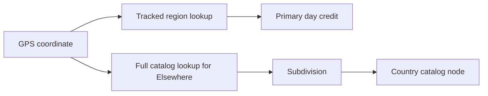

# 05. Countries as catalog parents

- Status: complete
- Depends on [04. Derive country behavior from subdivisions](04-country-geometry.md).
- Implements [R-01, R-02 and R-05](README.md#requirements), subject to [X-01 through X-04](README.md#scope-boundaries).

## Outcome

Both countries remain addressable by catalog node ID. Users select states, provinces or territories. The existing EU bloc keeps its previous eligibility. A primary fix in an untracked province can receive Other, and Elsewhere can identify its subdivision from the saved coordinate. A reader can obtain its country using the parent link. Country totals and hierarchy UI remain outside this rollout.



A caller can look up a region’s country through the catalog.

```swift
let province = catalog.node(for: region)
let country = province.flatMap(catalog.parent(of:))
```

## Implementation and checks

1. Regenerate both country records as ineligible, keeping all 66 grouped boundary files byte-identical. Check the updater, release replay/adoption and manifest. Keep the existing release lock if the normalized source is identical.
2. Remove country-wide geometry loading, interprovincial edge comparisons and parent-map selection. Verify real Ontario and Quebec points, parent lookup, caller priority across overlapping regions, and the EU. Drop Canada from the existing defaults; leave province choices to the user.
3. Verify the primary and forecast pickers, manual entry, home and stays, intent lookup, Elsewhere enrichment, demo data, and widgets against eligible regions. Opening the updated catalog preserves the raw observations and other configured primary selections. The existing North American picker and backup/version gates retain their previous scope. No country-record migration or substitution of a guessed province is required.
4. Run the updater host tests, RegionKit, WhereCore, WhereUI, WhereIntents and affected host, backup and snapshot checks. Inspect changed visual references before adoption; publish on the existing PR. To recover the previous release, revert the complete change together; the normalized boundaries and release lock are reusable.

## Review and execution

November 25, starting at `ab28552e5`. Reviewed the updater and current backup guards, consumer defaults, real and synthetic boundary behavior, and picker/preview paths. The agreed scope excludes a migration for Canada-specific manual days, home, stays and explicit corrections. Existing GPS observations can still be read using the current tracked set.

- The offline release replay and adoption reproduced the 66 geometry files byte for byte. Only Canada’s eligibility and the default geometry size changed in the 71-file candidate. The three defaults use 20,294 bytes. Generator and release tests passed 223 assertions across 15 tests. The five GIS tests and the 16 backup-upgrader tests passed.
- Independent review found that Spotlight’s upsert would retain the former indexed Canada entity. Launch indexing now removes inactive catalog IDs. The mixed-selection store test verifies an older country selection can be ignored while preserving other regions’ order and appearance. The plan diagrams rendered and all 120 local links and anchors resolved.
- Five iOS bundles (RegionKit, WhereCore, WhereUI, WhereIntents and the app) passed 1,800 tests on iPhone 17 Pro / iOS 27.2. Two opt-in archive fixtures were skipped. Reproduce with `./test RegionKitTests WhereCoreTests WhereUITests WhereIntentsTests WhereTests`. The tests cover Montréal with only Ontario tracked, adjacent provincial borders, overlap priority, reporting, planned stays and intent eligibility. Integration review corrected a report fixture that still supplied a Vancouver coordinate for Ontario. The rebuilt app, widget and share extension each contained all 66 expected boundary files. SwiftFormat, architecture, string-catalog and guidance checks passed.
- In an isolated timing test on the same simulator model as plan 04, the default attributor built in 3.6 ms (previously 517 ms). Loading the full catalog after the defaults took 540 ms and identifying Toronto took 0.23 ms. These are single simulator measurements.
- Dark-mode review found that Ontario's coral title and count blended into the tinted Locations card. The adaptive coral keeps the existing light color and brings the dark card back to the previous card's measured contrast. Coverage checks the color and swatch checkmark in both appearances. The full iPhone 17 / iOS 27.2 run of `./test WhereUISnapshotTests --review --record never` passed all 72 tests and 844 captures. Visual review updated 155 PNG references across 19 suites, including the provincial picker, AX layouts, Ontario card and widget samples. Independent verification matched all 155 Git LFS pointers to the reviewed files.
- Ready for review on [PR #563](https://github.com/kyleve/Stuff/pull/563), stacked above the [planning PR](https://github.com/kyleve/Stuff/pull/560). The checks use simulators. Physical-device Spotlight and production CloudKit were outside this verification.
