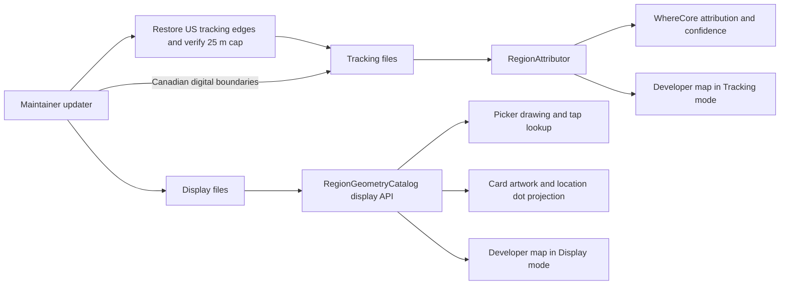

# 06. Tracking and display boundaries

- Status: executing
- Depends on [05. Countries as catalog parents](05-country-parents.md). Revision reviewed against `f69ad364d` on [PR #563](https://github.com/kyleve/Stuff/pull/563).
- Delivers [R-06 through R-08](README.md#requirements) for [S-01, S-03 and S-04](README.md#user-stories). Retains R-01 through R-05 and [X-01 through X-05](README.md#scope-boundaries).

One region ID answers two questions. Where uses the tracking polygon to decide where a GPS observation counts. It uses the display polygon to draw geography. A ferry passenger just north of Port Jefferson can earn a New York day while the card draws Long Island with water around it.

## Boundary products

| Region | Tracking | Display |
| --- | --- | --- |
| 52 US states and equivalents in Where | Use [2026 TIGER/Line STATE](https://www2.census.gov/geo/tiger/TIGER2026/STATE/), including assigned water, with a verified 25 m cap on simplification displacement. | Import the [2025 Census 1:500,000 cartographic states](https://www2.census.gov/geo/tiger/GENZ2025/shp/cb_2025_us_state_500k.zip). This shoreline is already generalized. |
| 13 Canadian provinces and territories | Import the [2026 StatCan digital province and territory boundaries](https://geo.statcan.gc.ca/geo_wa/rest/services/2026/Digital_boundary_files/MapServer/0), including the coastal waters assigned to each region. | Retain the [2026 StatCan detailed cartographic source](https://geo.statcan.gc.ca/geo_wa/rest/services/2026/Cartographic_boundary_files/MapServer/0). Use the currently bundled, simplified land and coastal islands as the visual baseline. |

The products agree on IDs. Each Census file contains 56 state or equivalent records. Join by postal code and ship the existing 52, including DC and Puerto Rico. Join both Canadian layers by `PRUID` and verify the 13 expected identifiers and their `DGUID`s. The US vintages can advance independently. Canada publishes both products for one census vintage. The EU keeps its one existing GeoJSON for both uses. Country parents own neither boundary and Other is a separate sentinel. [Census cartographic product description](https://www2.census.gov/geo/tiger/GENZ2025/description.pdf) · [StatCan release](https://www150.statcan.gc.ca/n1/daily-quotidien/261118/dq261118f-eng.htm)

The following coordinates were checked against the publisher data during research. They are acceptance fixtures for the generated bundle. Each tracking expectation assumes the region is tracked. Display hit testing uses the corresponding offered regions.

| Coordinate (latitude, longitude) | Tracking | Display |
| --- | --- | --- |
| Port Jefferson on land (40.946, −73.067) | New York | New York |
| Long Island Sound north of Port Jefferson (40.998, −73.066) | New York | No hit |
| Strait of Georgia (49.28, −123.65) | British Columbia | No hit |
| Lake Simcoe (44.47, −79.35) | Ontario | Ontario |
| Lake Ontario south of Toronto (43.60, −79.40) | No Ontario match | No Ontario hit |

Include a Vancouver land control in the same tests. The inland lake examples capture the limits of the source products. Where uses the published assignments and coastlines at their stated precision.

## US tracking accuracy

The November 25 decision sets a **25 m maximum displacement** for every US tracking boundary relative to the original TIGER/Line geometry. It governs the entire boundary in both directions, including islands, holes and shared state edges. It bounds the error introduced during conversion. The phone’s reported location accuracy and the publisher’s underlying geographic precision remain separate inputs.

Start with the existing 180 m area-based simplification. Match each simplified segment to the original chain of vertices between its endpoints. Keep a segment that meets the cap. Where it strays too far, restore the original vertex of greatest deviation, split there and repeat. Use a small margin for rounding (the 25 m prototype used 24 m internally). Process shared chains deterministically so both jurisdictions retain the same vertices. If restoration introduces a self-intersection, restore the implicated original chains on both sides and revalidate the coverage.

Scratch measurements on the locked 2026 TIGER release cover all 52 US jurisdictions. Both candidates preserved the original 130 polygon parts and two holes. Byte counts cover the tracking files before app compression.

| Cap | Boundary vertices | TWKB bytes | Verified upper bound against TIGER |
| --- | ---: | ---: | ---: |
| 50 m (comparison) | 93,552 | 532,149 | 48.93 m |
| 25 m (selected) | 128,444 | 708,466 | 24.00 m |

The selected 25 m candidate costs 176,317 bytes more than the 50 m candidate. At the Texas–Louisiana bend used in the regression below, it retained the original vertex where the 50 m boundary lay about 30 m away. In an optimized macOS benchmark using California and New York, containment and boundary-distance checks for 2,000 synthetic points averaged 0.77 µs per point with the 50 m cap and 0.88 µs with 25 m. These host measurements inform the choice. The updater must verify the actual adopted files on every release.

## RegionKit API and consumption

Today [RegionCatalog](../../Where/RegionKit/Sources/RegionCatalog.swift) exposes one `geometryFile` on both `Node` and `Entry`. [RegionAttributor](../../Where/RegionKit/Sources/RegionAttributor.swift) and [RegionGeometryCatalog](../../Where/RegionKit/Sources/RegionGeometryCatalog.swift) resolve the same file. The [picker](../../Where/WhereUI/Sources/Regions/RegionPickerView.swift) also builds a GPS attributor to draw and select its offered regions. The proposed API makes each consumer's choice explicit at its entry point.

```swift
// Existing tracking API. The user's tracked set determines which regions can win.
let tracker = RegionAttributor(for: trackedRegions)
let region = tracker.region(at: fix)
let match = tracker.matchWithBoundaryDistance(at: fix)

// Proposed display API. A card requests just its own cartographic outlines.
let outlines = await RegionGeometryCatalog.displayOutlines(for: region)

// Proposed batch API. The picker prepares its offered regions once, off the main actor.
let map = try await RegionGeometryCatalog.displayGeometry(for: offeredRegions)
let overlay = RegionMapGeometry(outlines: map.outlines)   // Existing WhereUI type
if let tapped = map.region(containing: tapCoordinate) { model.toggle(tapped) }
```

| API | Contract and callers |
| --- | --- |
| `RegionAttributor(for:)` and `RegionAttributing` (existing) | Resolve tracking files only. Keep synchronous lookup, both distance methods, confidence and caller priority on overlaps. Live recording, planned-stay verification, read-time reports and the lazy all-region Elsewhere lookup inherit the same rule through WhereCore. |
| `RegionGeometryCatalog.displayOutlines(for: Region) async -> [RegionOutline]` (proposed) | Replace the ambiguous single-region `outlines(for:)`. A cold card reads only its region’s display file. Keep the existing decorative failure behavior and empty result for Other. Both loaders in `RegionOutlinePathCache` use it, so silhouettes, backgrounds, forecast cards, previews and projected location dots share a coastline. An offshore observation can count even when the card’s existing land mask hides its dot. |
| `RegionGeometryCatalog.displayGeometry(for: [Region]) async throws -> RegionDisplayGeometry` (proposed) | Return an immutable, sendable value with `outlines` and `region(containing:) -> Region?`. Reuse RegionKit’s polygon containment, bounding boxes and decoded buffers. Skip Other and retain only the first occurrence of each offered region. Assign unique outline IDs across the batch. Preserve input priority for overlaps, and use the existing containment rules for holes and the antimeridian. A tap on uncovered water leaves selection alone. The picker retains its cap and haptics around the existing toggle. Whole-map callers get a visible error on a broken resource. A cancelled load cannot publish partial results. |
| `RegionGeometryCatalog.trackingOutlines(for: RegionAttributor) -> [RegionOutline]` (diagnostics) | Expose the existing conversion of an already-loaded snapshot for the developer map. Replace the mixed `outlines(for:attributor:)` entry point. The in-app and standalone RegionViewer open on Display and can switch to Tracking to inspect exactly what the engine matched. Only the Tracking branch constructs `.all`. |

Replace the single file field with a pair of descriptors on each file-backed manifest node. Each descriptor identifies its relative path, product and the publisher’s vintage when one exists. The original EU artwork has no publisher vintage. Keep these details inside RegionKit. Migrate uses of `Node.geometryFile` and `Entry.geometryFile` to catalog eligibility or the appropriate API. Make the internal URL resolver take the purpose. The shared reader already caches by file URL, so distinct files stay distinct and the EU can share its buffer. Source credits cover each (region, purpose) pair once. `RegionDataSource.all` remains the public entry point for Settings → About.



The updater, attributor, catalog and views already exist. The paired resources and display entry points are new. RegionKit owns offline geographic data and lookup. WhereUI owns screen-size simplification, projection, MapKit conversion and round strokes. Persisted IDs, selections, corrections and raw GPS use their existing representations. Historical results that resolve coordinates at read time can change near a restored US border or within newly covered Canadian waters. Explicit corrections retain precedence.

## Implementation steps

1. **Build a paired candidate.** Extend [the converter](../../Where/RegionKit/Tools/convert_boundaries.py), [release validator](../../Where/RegionKit/Tools/region_release.rb) and [generator](../../Where/RegionKit/Tools/generate-regions.rb). Add `--us-display-year` alongside `--us-year` (TIGER) and `--ca-year` (both Canadian products). Key download pins by product and member. A format-3 lock records all four source products, vintages, URLs, checksums, licences, projection, simplification settings and normalized output hashes. Use the existing external cache, Ruby offline generator and journaled adoption. Stage the whole candidate before changing the app bundle.
2. **Validate by product.** Check membership before joining. Validate the digital Canadian features against their own native topology, including Nunavut. The existing 2026 component counts apply only to the cartographic product. Preserve holes, islands, orientation, Alaska’s antimeridian handling and country grouping. Regenerate US tracking using the [25 m maximum displacement](#us-tracking-accuracy). Pin the initial tolerance, restoration method, cap and coordinate precision in the release lock. Start US display at the publisher’s 1:500,000 scale and Canadian display at its existing simplification. For Canadian display, compare the existing 45 m setting with a coarser 180 m candidate at actual card and picker sizes. Adopt the smaller output if the coastline fixtures, islands and visual checks pass. Record the comparison so the next refresh can reuse the decision. Choose digital tracking tolerance separately using raw-to-processed classification, displacement and border confidence. Record the chosen settings and evidence by role.
3. **Switch resources and consumers together.** Use paired filenames under the existing `regions/us/` and `regions/ca/` directories (for example, `us/us-NY.tracking.twkb` and `us/us-NY.display.twkb`). Validate both resource descriptors, safe paths and source coverage. EU points both descriptors to its existing path. Migrate the public Swift callers and fixtures in the same cutover as the manifest. Retain per-region loading, fault logging and debug assertions for invalid bundle data. Keep each consumer’s existing release error path and avoid substituting the other role. Build the picker’s display lookup off the main actor and reuse it for taps. Use the same prepared geometry in production, previews and snapshot capture. Update the developer legend, mode labels and About credits. Document the new API, provenance and refresh workflow in RegionKit, revise its [credit invariant](../../Where/RegionKit/AGENTS.md#invariants), and update the [repository acknowledgements](../../README.md#acknowledgements) and [RegionViewer guide](../../Where/RegionViewer/README.md#what-it-shows).
4. **Verify and publish the implementation.** Complete the checks below. Record actual source vintages, per-role and total bytes, timings and representative reviewed images on the implementation PR. Keep the existing v2 bundle usable through any groundwork commits and land the paired bundle, readers and their visual references as a consistent release.

## Acceptance and verification

Run from the repository root. The commands below are for implementation.

- **Reproducible update (R-03, R-04, R-07).** Run `ruby Tools/Tests/generate_regions_test.rb`, `ruby Tools/Tests/region_release_test.rb` and `"$REGIONKIT_PYTHON" -B -m unittest discover -s Where/RegionKit/Tools -p test_convert_boundaries.py`. Exercise a missing or swapped product, mismatched IDs, truncated digital geometry, checksum drift, offline replay and interrupted adoption. With the pinned GIS environment, an external cache and fresh output paths, exercise the public commands.

  ```sh
  tool=Where/RegionKit/Tools/generate-regions.rb
  ruby "$tool" --refresh --us-year 2026 --us-display-year 2025 --ca-year 2026 --cache "$cache" --output "$candidate"
  ruby "$tool" --replay "$candidate/sources.lock.json" --cache "$cache" --output "$replay"
  diff -qr "$candidate" "$replay"
  ruby "$tool" --adopt "$candidate"
  ruby "$tool" --check
  ```

- **US tracking displacement (R-08).** In the converter and release tests, compare the final decoded TWKB against the full, unrounded TIGER source transformed to WGS84. Bound the distance over continuous segments in both directions, accounting for projection scale and coordinate rounding. During refresh and replay, record per-jurisdiction and overall upper bounds and bind the report to the raw source and emitted TWKB hashes. Offline adoption must reject a missing report or a hash mismatch. Reject a candidate if the 25 m limit or shared-edge validity cannot be demonstrated. Include a failing case where checking only a few vertices would miss a bend, test both owners of that edge and check displacement at the Texas–Louisiana source vertex (31.094584, −93.553852). For attribution, the nearby synthetic fix (31.097843, −93.558908) should resolve to Texas when both states are tracked. Verify that offline replay reproduces the corrected bytes.
- **Resource accounting (R-01, R-05, R-07).** Inspect the manifest and packaged app and extension bundles. Expect 68 catalog nodes, 66 loggable IDs, 132 logical references and 131 distinct files (130 TWKB + one shared EU GeoJSON). Verify four North American product credits and one EU credit. Country metadata lookup opens no files. Record unique bytes, per-role bytes, cold default tracking and single-card load costs against the plan 05 baseline. Instrument which files each request opens so cache warming cannot hide a cross-role read.
- **Geographic behavior (R-02, R-06).** Run `./test RegionKitTests WhereCoreTests WhereUITests`. Check the water and land controls above through the generated bundle, including both tracking distance and confidence at an offshore point. Cover saved-coordinate Elsewhere lookup, an untracked region, overlap priority, holes and Alaska on both sides of the antimeridian. Replace assertions that equate tracking and display ring counts with region membership and role-specific geometry checks. Drive picker selection through its real tap lookup on land and water. Exercise an empty batch, repeated regions and Other, including uniqueness of the emitted outline IDs. Prove an inaccurate or missing display file cannot affect tracking.
- **Visible result (R-06, R-07).** Review Long Island on the forecast and Locations cards that prompted the change, at their actual sizes, and in the full map. Compare the same framing with the current PR. Inspect BC and Vancouver Island, the picker overlay, developer Display/Tracking modes, About credits and existing round-join artwork regressions. Confirm card dot projection uses the displayed outline. Exercise a live picker tap and diagnostic toggle on the simulator. Build the standalone [Catalyst viewer](../../Where/RegionViewer/README.md#running-it) to verify its shared consumer. The developer legend snapshot alone cannot verify the map. Review affected references and rerun `./test WhereUISnapshotTests --review --record never` after adoption.

## Recovery

Format 2 cannot identify both products. Give maintainers an actionable message to refresh the pinned years with an explicit US display vintage to create a format-3 candidate. The previous Git revision remains available to replay a format-2 release as originally published. Until a complete candidate passes validation, retain the adopted release. After interruption, recover through the existing adoption journal, regenerate and run `--check`. To revert a published cutover, restore the paired release and its consumers to the same prior revision.

## Execution evidence

- November 25. The production TIGER simplifier reproduced all 52 files from the selected prototype. Independent decoding of the Ruby encoder’s bytes bounded displacement against every original WGS84 chain in both directions. The largest upper bound was 24.000 m including coordinate rounding. Three offline regression cases cover a missed bend, both owners of a shared edge, islands, holes and rounding. The previous release stays in use until the paired candidate is adopted.

## Resume point

The owner authorized implementation on November 25. Work started on the four source adapters, selective TIGER edge restoration and verification, the paired release format, and its Swift consumers. Adopt the verified candidate before checking app behavior and publishing.
