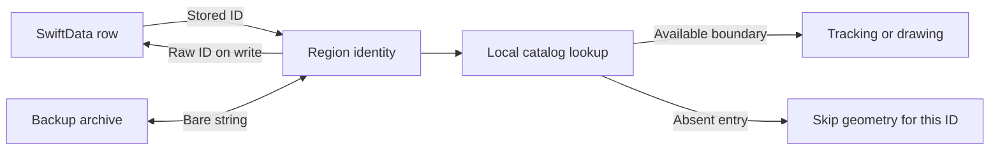

# 01 — Preserve unfamiliar region IDs in storage and backups

**Status** ready · **Depends on** none · [Series overview](README.md)

## Deliverable

A build whose catalog lacks a saved region can read and back up its records without losing the ID. Installing a catalog that contains the region restores its meaning from the original ID. This phase supplies the identities and geometry behavior needed for the “Unknown region” presentation in plan 02.

| [Story](README.md#stories-requirements-and-execution-order) | Requirement | Result |
| --- | --- | --- |
| US-01 | R-01, R-03 | An established user can continue recording GPS and reading saved assertions. |
| US-02 | R-01, R-02 | History, customizations and revision identities survive a portable backup and restore. |
| US-03 | R-03 | A maintainer can demonstrate recovery with test catalogs and the existing wire format. |

## Context and boundaries

The `Region` Codable conformance carries a bare string. The public `Region(rawValue:)` checks local catalog membership. SwiftData reuses that check for stored values, so a manual day can lose a region and a correction revision can disappear entirely. Forecast Home and planned stays also reject unfamiliar IDs during archive validation. Keep the account version at 2 and the archive format at 8 under the owner's single-phone rollout. Picker transactions, presentation and release guidance belong to plan 02. [Series exclusions](README.md#stories-requirements-and-execution-order) · [Region](../../Where/RegionKit/Sources/Region.swift) · [Store](../../Where/WhereCore/Sources/Persistence/SwiftDataStore.swift) · [Backup contracts](../../Where/WhereCore/Sources/Backup/AGENTS.md)

## Data flow and architecture



Existing owners keep their roles. RegionKit supplies one explicit path for rehydration and decides which boundaries are available. WhereCore owns row validation, snapshots and transactions. Illustrative Swift omits per-field validation and error handling.

```swift
let saved = try Region(storedID: rawID)           // proposed structural check
let selectable = Region(rawValue: inputID)        // existing local membership check
let node = catalog.node(id: .init(rawValue: saved.rawValue))
// Handle .other separately. A present, non-loggable node is a known parent.
// An absent node leaves a well-formed stored identity available for history.
```

## Steps

1. Expose an explicit way to restore a stored ID in RegionKit. Use the existing catalog producer’s spelling for fresh IDs (ASCII letters or digits in nonempty groups separated by single hyphens). Keep the bare-string wire representation and original case. Handle the reserved `.other` and each field’s existing rules. Empty, malformed or wrongly typed inputs follow the corruption path. Use lookup by node ID to distinguish a retired, non-loggable country from an absent entry. Preserve existing per-field country behavior. [Catalog producer](../../Where/RegionKit/Tools/generate-regions.rb)

   Keep external lookup strict. In `RegionAttributor` and `RegionGeometryCatalog`, skip an absent node for tracking and display, including batched requests. A known descriptor with a broken resource still follows its existing error path.
2. Replace catalog-filtered SwiftData reads and manual backfill unions. Retain manual sets and audit, optional evidence region and blob, all correction revisions, and primary membership, order and appearance. An all-unfamiliar tracked set still represents configured rows. Defaults apply when the store has no configured rows. Keep recording raw coordinates so a future catalog can attribute them at read time.
3. Separate planning record validation on restore from eligibility when choosing a new Home or stay. Preserve stay/revision IDs, windows, timestamps, Home clear and stay deletion. Continue rejecting invalid windows, mismatched identities and prohibited region values such as explicit Other for Home. Keep winner selection by revision intact. Split existing tests that treat every unfamiliar Home or stay as invalid. Test local eligibility when a destination is chosen and lossless restoration when a stored choice is read. [Forecast contracts](../../Where/WhereCore/Sources/Forecasting/AGENTS.md)
4. Export from the existing snapshot. Exercise archive preflight and the full import transaction for both strategies. Merge uses existing conflict rules for each record family, including the primary-set union and appearance/order rules. Apply the same rules to known and unfamiliar incoming IDs. Replace restores the archive into its fresh generation. Compare logical records and attachment bytes after re-export. Keep structural and format validation in place. [Backup coordinator](../../Where/WhereCore/Sources/Backup/BackupCoordinator.swift)

## Acceptance and verification

Run from the repository root. Use two distinct test-only IDs absent from the bundled catalog, one known region and genuine `.other`.

- **Identity and geometry (R-01, R-03).** Run `./test RegionKitTests`. Verify bare-string round trips, strict external lookup, mixed and unknown-only geometry requests. The known polygon still matches. An absent boundary yields no match, distance or outline for its ID. A second fixture catalog recognizes the exact saved identity. Extend the existing manifest-based fixtures used by RegionKit’s geometry tests, including a small polygon for the new ID. Keep a wrong-type ID, an empty string, a known non-loggable country and a broken declared polygon as negative controls. [Fixture examples](../../Where/RegionKit/Tests/RegionGeometryCatalogTests.swift)
- **Store and ZIP (R-02).** Run `./test WhereCoreTests`. Seed real SwiftData rows, read and write through normal services, reopen, export, merge and replace. Include a manual-only untracked day, a backfill over an authoritative day, evidence with attachment and note, unknown winning Home/stay/correction revisions, nil reset and empty exclusion. Check revision history, winning values, saved appearance/order and metadata after re-export. Malformed records and unsupported archive versions still follow existing rejection paths.

## Recovery and checkpoint

Compare the first divergent row or ZIP field against the original fixture. Fix that conversion, recreate the test store, and repeat both import strategies. Previously discarded IDs require a surviving original row or backup.

November 27, 2026. The owner selected lossless preservation for the single-phone rollout. Implementation awaits a separate request. Resume at step 1 after the [series review](README.md).

- [ ] Implement and verify store, archive and geometry behavior.
- [ ] Record commands, tested revision and results, then review and publish.
