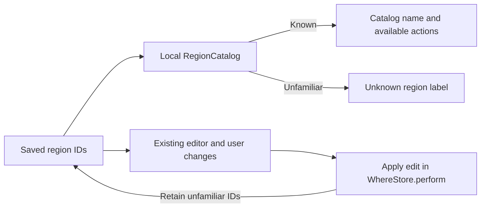

# 02 — Use an older catalog and qualify future additions

- Status: ready
- Depends on [01 — Preserve stored regions](01-preserve-stored-regions.md).
- Shared [stories, requirements and scope](README.md#stories-requirements-and-execution-order). Delivers R-03 through R-05 for US-01 through US-03. X-01 through X-03 apply.

## Deliverable

The user can open history, keep recording, and save an ordinary edit on the tolerant build. Any saved region it cannot name reads “Unknown region.” An updated catalog restores its name and eligible actions. This step also gives maintainers a repeatable same-version release check.

## Data flow and proposed edits



RegionKit owns names and catalog facts. WhereCore owns persisted identity, counts and atomic writes. WhereUI owns form state and which controls it offers. RegionKit’s catalog API, WhereServices and the store transaction exist today. The edit semantics below are proposed. Pseudocode omits error presentation and the normal post-commit change notification.

```swift
// A Settings save changes only the picks the editor lets the user change.
try await store.performInCurrentGeneration {
    let current = try await store.primaryRegions()
    let updated = try edits.applying(to: current, maximumCount: 5)
    try await store.setPrimaryRegions(updated)
}
```

1. **Display saved values.** Localize the fallback in RegionKit. Keep stable IDs as row keys, use saved appearances, and allow no-outline artwork. In reports, calendars, timelines, forecast summaries, widget totals and today’s widget rows, enumerate the IDs actually present. Keep the existing count/rank and configured-primary rules. At equal rank, keep the existing known order and place missing IDs after it, sorted by raw ID. Raw IDs stay out of user-facing names. Keep the existing exclusion of retired country rows. Check the device-local last-seen counts used by presentation when the app relaunches. [Ordering](../../Where/WhereCore/Sources/Days/Region+Ordering.swift) · [Widget projections](../../Where/WhereUI/Sources/Widgets/WidgetSnapshot+Ranking.swift)
2. **Save an edit without erasing another selection.** In Settings, show unfamiliar saved picks as read-only rows and count them toward the existing five-pick limit. Apply changes to supported picks against the current stored rows in the transaction. Preserve unfamiliar picks, their appearance and relative positions, including rows received after the form opened. If a concurrent arrival fills the last slot, refresh the form and let the user revise the addition. Keep backup replace semantics with the backup coordinator. Manual-day and relabel forms must carry unfamiliar saved members through a note edit or a change to another member. Keep an unfamiliar-only entry editable. Apply this protection inside the journal’s transaction for single-day edits, range backfills and authoritative overrides. Read the current day and retain members this edit cannot change, or reject a stale edit and reload. An additive write over another additive row currently replaces the entire set. Preserve its unfamiliar members while keeping the existing behavior for known members, audit updates, and additive-over-authoritative unions. Keep existing explicit delete/reset actions and their audit semantics. For Home and stays, show the saved choice and validate a newly chosen destination against the local picker. A date-only stay edit retains the current destination or asks the user to reload a changed revision. [Settings model](../../Where/WhereUI/Sources/Regions/PrimaryRegionSelectionModel.swift) · [Day form](../../Where/WhereUI/Sources/Manual/ManualDayView.swift) · [Journal](../../Where/WhereCore/Sources/Journal/DayJournal.swift)
3. **Keep choices and geometry honest.** New-entry pickers, map taps, Spotlight suggestions and Shortcut parameters offer only locally eligible choices. Resolve missing write-intent parameters before saving anything, including a mixed list with a known ID. A stale Log Day or Log Trip shortcut must ask for a supported choice or return an actionable failure. Eliminate its silent substitution of Other. Read-only results can still display saved unknown values. For geometry-based suggestions, preserve raw GPS and explicit corrections. Skip a proposed correction or prefilled region if it relies on geometry the device lacks. In particular, accepting Mark Travel Day must never persist a provisional GPS “Other” as an authoritative selection. Explicit manual Other remains available. [Intent entity](../../Where/WhereIntents/Sources/RegionEntity.swift) · [Travel-day suggestion](../../Where/WhereCore/Sources/DataResolution/AbruptChangeIssue.swift) · [Planned-stay verifier](../../Where/WhereCore/Sources/Forecasting/PlannedStayLocationVerifier.swift)
4. **Qualify the release.** Use the plan 01 fixtures to exercise two tolerant catalogs at the same model and archive versions. For the end-to-end check, build two test variants from the same implementation, varying only bundled catalog resources. Install them successively onto the same simulator using the same app identity and disposable store. This exercises the production singleton, editors and archive reader without a runtime catalog switch. Document the procedure under RegionKit’s “Adding a region” and in the WhereCore backup format and compatibility guidance. Define an additive change as a fresh stable ID using existing wire shapes and meanings, with names and boundaries the new catalog can supply. An incompatible model or archive still follows its own version policy. Leave the Canadian v2/v8 history and upgrade instructions accurate. [Region release guidance](../../Where/RegionKit/README.md#adding-a-region) · [Backup format](../../Where/WhereCore/BACKUP_FORMAT.md) · [DataModelVersion](../../Where/WhereCore/Sources/Compatibility/DataModelVersion.swift)

## Acceptance and verification

Run commands from the repository root after implementation. Use test-only catalogs and temporary stores. Seed the B fixture with two distinct IDs, including a polygon around the GPS test point. Keep that point outside A’s known polygons; track the same ID throughout. For stale-form tests, add a row between opening the form and saving it.

| Requirement | Exercise | Required result |
| --- | --- | --- |
| R-03 | Record with a mixed tracked set and with only unfamiliar picks. Read the same raw fix with and without the new polygon. Open a suggested travel-day or border correction. | Known geometry still works. Missing geometry yields no invented match or durable correction. Adding the matching polygon can reclassify the original fix. An explicit day override or sample correction still wins. |
| R-04 | Save a note on an unfamiliar-only day, backfill over both additive and authoritative rows, edit another member of a mixed authoritative day, change a known primary appearance, and edit dates of an unfamiliar stay. Inject an unfamiliar primary after the editor opens. | Reopen the store and export. The original IDs, opaque pick’s appearance/order, unrelated revisions and edited fields survive. The five-pick cap holds, including on retry. Retired-country primary and widget fixtures still omit their country rows. A new-entry picker never offers either fixture ID on the older catalog. |
| R-04 | Put two distinct unfamiliar IDs, California and actual Other on the same manual day. Inspect the day detail, report, cached widget (with room for four rows) and accessibility labels. Exercise stale log-day and trip intents. | Four per-region credits on one calendar day. Both unfamiliar rows say “Unknown region,” sort deterministically and retain separate histories when opened in the app. A failed shortcut writes nothing. Run `./test WhereCoreTests WhereUITests WhereIntentsTests` and `./test --snapshots --review`. Inspect representative rendered day and widget content. |
| R-05 | First open a known-only setup on tolerant catalog A. Catalog B adds fixture IDs and writes representative data at v2/v8. Reopen with A, edit and re-export, then reopen with B. Include the manual-only ZIP and both restore strategies from 01. Exercise genuine higher-version account and archive fixtures. | The first launch needs no reconfiguration. Equal-version verification admits A and B, and B recovers the names and exact IDs. Higher versions still follow the appropriate lockout or import rejection before access/mutation. Run `./test RegionKitTests WhereCoreTests` including the existing compatibility and receipt suites. |

## Release, recovery and resume

- Install the completed tolerant build and its extensions on the owner’s sole phone before any future region is written or imported. This is the rollout assumption from [Q-02](README.md#questions-and-resolutions). Existing v8 archives with familiar IDs remain usable.
- A failed fixture or real-store round trip blocks the new writable ID. Keep the current catalog active while fixing the reader. Once future IDs exist, use a build with tolerant readers for any rollback. An app with the smaller catalog can safely reopen the data after passing these checks.
- **Progress, November 27, 2026.** Reviewed plan only. No implementation or device checks have run. On an execution request, finish and verify 01, then implement and verify these steps. Record the tested revisions, fixture results and release evidence here.
