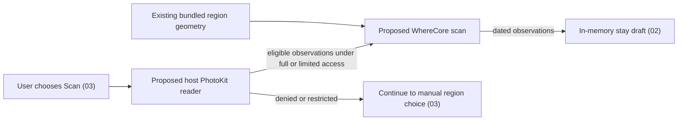

# 01 — Read current-year photo locations

- Status: complete
- Depends on: None
- Shared context: [Overview](README.md)

## Deliverable

Give the regular app a cancellable, read-only scan that returns dated regional observations to an onboarding caller. This is groundwork. The user-facing route ships with [03](03-finish-onboarding.md), when the review and save paths exist together.

## User stories and requirements

| Story | Requirement | Result |
| --- | --- | --- |
| [US-01](README.md#user-stories) | [R-01, R-02](README.md#requirements) | Explicit opt-in can produce a full or limited result, an empty result, or an unavailable-access state. |
| [US-01](README.md#user-stories) | [R-03](README.md#requirements) | Observations identify photo-backed dates and regions before the user has picked anywhere to track. |

## Boundaries

[X-01–X-03](README.md#scope-boundaries) apply. This step ends at transient observations. The later plans apply the user's gap, retention and ranking decisions to this same stream of dated observations.

## Context and constraints

The existing evidence picker loads chosen image bytes. The new scanner needs only metadata. The host owns PhotoKit and the generated main-app permission string. WhereCore owns date and coordinate validation plus conversion to region/day values. Keep `PHAsset`, `CLLocation` and permission prompts on the host side. Inject the reader into fresh, interactive onboarding in the regular runtime. Tests and previews inject values. [Evidence picker](../../Where/WhereUI/Sources/Evidence/AddEvidenceView.swift) · [Host composition](../../Where/Where/Sources/RegularApplicationRuntime.swift) · [Target manifest](../../Project.swift)

The live attributor loads the user's tracked set. The read-only Elsewhere resolver shows how to obtain catalog geometry lazily off the main actor. Reuse that lookup or its smallest shared unit. Update RegionKit's geometry contract to describe this use if needed. [Resolver](../../Where/WhereCore/Sources/Reporting/ElsewhereResolver.swift) · [RegionKit contract](../../Where/RegionKit/AGENTS.md) · [Date rules](../../Where/Guidance/dates.md) · [Launch rules](../../Where/Guidance/launch.md)

## Data flow



## Architecture sketch

```swift
// Proposed boundaries. Pseudocode omits framework adapters and UI state.
struct PhotoObservation: Sendable {
    let capturedAt: Date
    let coordinate: Coordinate
    let horizontalAccuracy: Double?
}

protocol PhotoLocationReading: Sendable {
    func requestAccess() async -> PhotoAccess
    // Emits only main-library observations that pass the source and timing checks.
    func enumerate(in window: ScanWindow,
                   consume: @Sendable ([PhotoObservation]) async throws -> Void) async throws
}

actor PhotoLocationScanner {
    // Proposed WhereCore operation. Its input calendar and cutoff stay fixed.
    // Resolves each batch off the main actor and retains distinct point values.
    // CompletedPhotoScan carries the window, access scope and observations
    // with their CalendarDay and catalog Region for the draft in 02.
    func scan(using reader: any PhotoLocationReading,
              in window: ScanWindow, access: PhotoAccess) async throws -> CompletedPhotoScan
}
```

## Steps

1. In WhereCore, fix the scan clock and reporting calendar once. Use the injected Gregorian calendar with the device's time zone at scan start. Accept capture instants at or after local January 1, before next January 1, and at or before the scan instant. Derive stable `CalendarDay` values from that same calendar. Use creation time for the photo day.
2. Add the PhotoKit adapter in the Where app target and a localized `NSPhotoLibraryUsageDescription` through `Project.swift`. Request the read-capable `.readWrite` authorization only from the explicit action. Fetch authorized images by creation date with `includeAssetSourceTypes = [.typeUserLibrary]`. Before emitting an observation, require `sourceType == .typeUserLibrary`, a visible asset, both `creationDate` and `addedDate`, and `abs(addedDate.timeIntervalSince(creationDate)) <= 300`. This excludes identifiable Shared Album, computer-synced and unknown sources, even when their timestamps match. Apply the same checks to limited access. Use the added date only for eligibility. Inspect optional location in process. Skip missing dates and absent, nonfinite or out-of-range coordinates. Reject a Core Location fix with negative horizontal accuracy, which invalidates its coordinates. Keep genuinely unavailable accuracy optional in the domain input and avoid fabricating a radius. Reject nonfinite numeric metadata. [Core Location accuracy](https://developer.apple.com/documentation/corelocation/cllocation/horizontalaccuracy)
3. Enumerate in cancellable batches with backpressure. Keep PhotoKit objects inside the adapter, resolve coordinates off the main actor and report progress regularly enough to expose cancellation. Hand off the capture instant, coordinate, optional accuracy, resolved region and derived day for each distinct point, along with the frozen scan window and calendar. Repeated assets with identical time and coordinates represent one point. Preserve different points in the same region/day for the approved GPS history. Keep an outside-catalog observation distinguishable from a date with no observation. Return the access scope so the UI can explain partial results. Recheck current access on retry and before releasing a result if the grant changed. Discard a canceled or stale scan.
4. Wire the dependency at the normal host composition boundary, with no launch-time fetch or geometry load. Exercise it through a fixture-backed onboarding caller. Add executable coverage in the affected Where host/Core test bundles and update the module descriptions. The permission offer and production routing are activated in 03.

## Acceptance and verification

Run from the repository root during implementation. The named suites added by this plan must be selected in these bundles.

| Requirement | Check | Expected result |
| --- | --- | --- |
| R-01, X-01 | Run `./test WhereTests` with an authorization spy. Exercise skip, first opt-in, existing grant, limited selection, revoked access and cancellation. | Zero fetches before opt-in. Denied or canceled scans produce no candidate history. Limited access yields only visible assets. |
| R-02 | Run `./test WhereCoreTests` with an injected clock and zone. Include local New Year, a late-night UTC crossover, February 29, DST, a future time today, an absent capture time, an absent coordinate, a valid coordinate with unknown accuracy in the domain fixture, and a negative Core Location accuracy in the host fixture. | Only valid observations inside the year-to-date window are emitted with the expected logical days. Unknown accuracy stays absent. A Core Location fix marked invalid is skipped. |
| R-02 | In `./test WhereTests`, exercise full and limited grants with otherwise identical geotagged fixtures. Vary source, timestamp availability and signed capture-to-added offsets. | Main-library offsets of 0 and ±300 seconds pass. ±301 seconds, either date missing, and Shared Album or unknown sources at zero seconds yield no observation. A received copy saved to the main library one minute after capture can pass. If every asset is excluded, the result is empty. |
| R-03 | In the same Core suite, use a repeated identical point, two different points in one region on the same day, two distinct regions on a travel day, a supported region outside the default tracked set, and an outside-catalog coordinate. | Two distinct points survive while duplicate identities collapse. Both support one day of presence for that region. An outside-catalog observation stays separate from an unknown day. |
| R-01, R-03, X-02 | Drive a large synthetic sequence through the adapter seam, cancel after a known batch, then retry. Run `./test --architecture-only` after composition changes. | Batches stay bounded, cancellation prevents stale publication, the retry matches a clean run, and launch/ownership checks pass. |
| R-01, R-02 | Inspect the generated main-app purpose string and the adapter API calls. Use a host test with a limited grant containing one geotagged image and one image without GPS. | Only the geotagged photo contributes when it passes the source and timing checks. The adapter requests metadata only. [03 performs the real-device permission check](03-finish-onboarding.md). |

## Recovery

All scan state belongs to the attempt. Discard results on cancel, route change or revoked access, including completions from older attempts. Retry from a new clock/grant snapshot. Quitting before review discards the draft and leaves the real store untouched.

## Decisions and revisions

The proposal uses local polygon lookup across the catalog so a place can be discovered before it becomes primary. The current reporting calendar supplies a reproducible day boundary even when a photo lacks a capture time zone. [Source and alternatives](README.md#research-and-evidence)

## Progress

- [x] Implement and test the metadata reader and regional observations.
- [x] Verify authorization branches, limited results and cancellation in the host tests.
- [x] Review and publish the groundwork.

## Execution record, resume point and outcome

November 27. The regular runtime injects the metadata reader. The host and Core scanner suites passed inside `./test WhereCoreTests WhereTests` (959 tests passed). The architecture checks passed. Independent review identified late cancellation and limited-library selection changes. The scanner now rechecks cancellation before returning and verifies that fetched assets remain visible under limited access. Synthetic host tests cover Shared Album, synced, unknown and mixed source values. Published in [PR #579](https://github.com/kyleve/Stuff/pull/579) at `982916f20`. Phase 03 owns integrated device verification.
