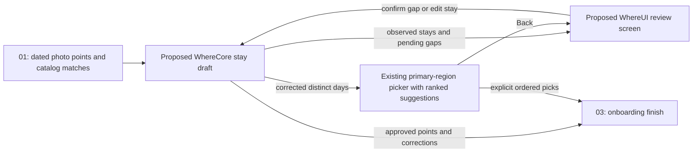

# 02 — Review photo-backed stays and suggest primary regions

- Status: complete
- Depends on: [01 — Read current-year photo locations](01-read-photo-locations.md)
- Shared context: [Overview](README.md)

## Deliverable

Someone who has scanned photos can review where they spent time, correct the dates and places, and see eligible primary regions ranked by their corrected day counts. The review starts from dated observations and distinguishes days with photos from suggested days between them. This step delivers the draft model, review screen and picker presentation against injected data. [03](03-finish-onboarding.md) connects the screens to live onboarding and saves the approved history.

## User stories and requirements

| Story | Requirements | Result |
| --- | --- | --- |
| [US-01, US-02](README.md#user-stories) | [R-03, R-04](README.md#requirements) | Show all observed regions per day and ask about each eligible gap. |
| [US-02](README.md#user-stories) | [R-05](README.md#requirements) | Add, remove, relabel or adjust an inclusive stay range while preserving other regions on shared dates. Keep edits when returning from the picker. |
| [US-03](README.md#user-stories) | [R-05, R-06](README.md#requirements) | Hand off approved photo points with corrections and rank eligible places by corrected days. The user chooses one to five primary regions. |

## Scope boundaries

[X-01–X-03](README.md#scope-boundaries) apply. The review operates on transient values supplied by 01. Photo access, the real store, recording services and forecasting are outside its responsibilities. The existing Settings picker keeps its own grouping. [Launch contract](../../Where/Guidance/launch.md)

## Context and constraints

A recorded stay is a run of consecutive days in one region. Two stays can share a travel day. `PresenceTimeline.stints(from:calendar:)` already groups report days in this way. Use its semantics for the display of accepted days, supplying the scan calendar. Additional presentation is needed for proposed gaps and edits. `ManualDayView` saves immediately through a live report model and its edit mode covers one fixed date. Reuse its date and region controls where suitable. `PlannedStayEditor` edits forecast intent. [PresenceTimeline](../../Where/WhereUI/Sources/Model/PresenceTimeline.swift) · [Manual day form](../../Where/WhereUI/Sources/Manual/ManualDayView.swift) · [Date contract](../../Where/Guidance/dates.md)

The onboarding picker already enforces selection limits, preserves pick order and carries appearance drafts into customization. Its Settings grouping takes an unordered set. Give the onboarding list a ranked section with day counts. Users can also search by name or postal code and browse the eligible regions by country. The catalog-order tie-break already exists in Core. [Selection model](../../Where/WhereUI/Sources/Regions/PrimaryRegionDraft.swift) · [Region picker](../../Where/WhereUI/Sources/Regions/RegionPickerView.swift) · [Day-count ordering](../../Where/WhereCore/Sources/Days/Region+Ordering.swift)

## Data flow



## Architecture sketch

```swift
// Proposed WhereCore values. Scan output types come from 01.
struct PhotoStayDraft {
    init(scan: CompletedPhotoScan)
    mutating func apply(_ edit: StayReviewEdit) throws
    var pendingGaps: [ProposedGap] { get }
    var correctedDays: [CalendarDay: Set<Region>] { get }
    var approvedHistory: ReviewedPhotoHistory { get }
}

// Proposed view state, owned for the lifetime of the fresh onboarding flow.
@MainActor @Observable final class StayReviewModel {
    var draft: PhotoStayDraft
    let selection: PrimaryRegionDraft   // Existing explicit picks and appearances.
    var suggestedRegions: [RegionDays] { /* rank eligible positive counts from correctedDays */ }
}
```

Keep each point's capture time, original coordinate, available accuracy and observed region linked to its review decision. The handoff describes accepted points and their effective days/regions, exclusions, and user-confirmed day assertions. An inferred or hand-added day has no synthetic point. Represent an exclusion distinctly enough for 03 to omit it from imported history. A retained point with a corrected date or region keeps its original evidence and credits only the corrected attribution. Reconcile draft edits once in Core so the review, ranking and save payload agree. Names in the sketch are illustrative. Persistence format and generation checks belong to 03.

## Steps

1. Build the draft beside Core's day/presence logic. Bucket all points using 01's scan calendar and retain each accepted point even when several support one region/day. Process consecutive **observed** day keys, including dates with an outside-catalog observation. For each adjacent pair, count the interior calendar days. Propose a bridge for one to seven missing days when exactly one named region is common to the endpoints and the interval has no contrary location evidence. Observations in another region or outside the catalog within the interval break the pair. A mixed endpoint can support a bridge to its uniquely shared region and keeps all regions on that endpoint. Two shared candidate regions leave the gap open for a manual edit. Consecutive observed dates need no gap prompt. Leave dates before the first and after the last observation open.
2. Show the observed ranges chronologically and mark every proposed span with its region, dates and count of days without photos. Give each gap an explicit confirmation and a way to leave those days unknown. Continuing accepts reviewed photo-backed days and explicit edits only. Neither an untouched suggestion nor a declined one contributes inferred days. Two proposed gaps in one stay have independent decisions. Let the user adjust dates or regions, add a missed stay, or remove a proposed stay. Limit edits to January 1 through the scan day. An explicit addition of dates is a user assertion. Preserve other regions on overlapping dates. Validate a whole edit before applying it. If its anchors change, drop the stale gap confirmation and present any newly eligible suggestion for a new decision. Never infer across excluded contrary evidence on recomputation.
3. Create the review screen and observable model under `Where/WhereUI/Sources/Onboarding/`, with a localized editable range, region and status for each entry. Keep the draft owned by the flow so returning from primary selection preserves edits and gap decisions. Provide a clear route onward when all stays are removed. Add review fixtures with no photos dependency and update the WhereUI README. Follow [presentation](../../Where/Guidance/presentation.md) and [shared controls](../../Where/WhereUI/Sources/Shared/AGENTS.md) for date formatting, Dynamic Type, VoiceOver labels, and previews.
4. Count distinct corrected `CalendarDay` values per region. Filter positive counts to the picker's `available` regions, then call `Region.rankedByDayCount`. A shared travel day counts once in each applicable region. Extend the existing picker list to show those counts in rank order. Start with zero picks and enable continuation after the first explicit choice. Recomputing suggestions after a correction preserves explicit picks, their order and appearance drafts, including a previously chosen region that now has zero reviewed days. When no suggestions qualify, show the ordinary manual picker. Make the reviewed-history value and ordered picks available to 03.

## Acceptance and verification

Run from the repository root during implementation. Add the named suites in their owning bundles.

| Requirement | Procedure | Expected result |
| --- | --- | --- |
| R-03, R-04 | `./test --only WhereCoreTests/PhotoStayDraftTests`. Use matched Ontario endpoints June 2 and 6 with Québec also observed June 6. Include two Ontario photos taken at different times June 2. | Before confirmation Ontario has 2 days and Québec has 1. One prompt covers June 3–5. Confirming yields Ontario 5 and Québec 1. Declining or continuing untouched yields 2 and 1. Both original Ontario points on June 2 remain available on approval. |
| R-03, R-04 | In the same suite, compare Ontario June 1/9 with June 1/10. Add cases with a single photo, adjacent dates, contrary Québec or outside-catalog evidence in a gap, and two endpoints both containing Ontario and Québec. | Seven missing days produce one pending gap, eight yield separate stays. A single observed day produces one day. No leading/trailing extrapolation, gap across contrary evidence, guessed region for ambiguous endpoints, or prompt for adjacent dates. |
| R-04, R-05 | In the same suite, confirm just one of two gaps, edit one anchor, exclude a point, and extend, shorten, relabel, remove and add a stay on shared dates. Attempt reversed and out-of-window ranges. | Only explicitly retained days contribute. An invalid edit leaves the previous draft intact. A stale confirmation cannot supply days to a newly changed gap. Other-region days survive. Approved points retain their original coordinates and dates. New day assertions carry no GPS fix. A removed point contributes no history. |
| R-05, R-06 | `./test --only WhereUITests/StayReviewModelTests --only WhereUITests/PrimaryRegionSelectionModelTests`. Navigate review → picker → review with the Ontario fixture. Shorten Ontario to June 2, keep Québec on June 6, and verify the tie in catalog order. Add a third eligible region manually and change suggestion counts after choosing it. | Counts match the edited day sets. Out-of-catalog observations and zero-day regions receive no recommendation. Empty suggestions still permit manual selection. Nothing starts selected. One to five explicit choices retain their order and appearances through back navigation. |
| R-04–R-06, X-01–X-03 | `./test --only WhereUISnapshotTests/StayReviewViewSnapshotTests` with an injected scan. Inspect representative iPhone, iPad and accessibility-size images of pending gaps, corrected results and the picker. Exercise each action with VoiceOver. | Dates, region names, evidence versus inferred days and decision controls are accessible. Fixtures require neither photo assets nor an active scope. Rendering and edits trigger zero PhotoKit, GPS or store calls. |

## Recovery

Returning to review reuses the same scan and draft. Reject invalid ranges in place, retaining the user's last valid state. Discard the draft on abandoning fresh onboarding or starting a new scan attempt. Dropping the draft leaves no store work to undo. [03](03-finish-onboarding.md) owns commit, retry and interruption after Finish.

## Decisions and revisions

November 27, 2026. The user chose seven missing days, individual gap confirmation, retained approved photo GPS with corrections, and user-selected primaries ranked by corrected distinct days. The uniquely shared endpoint rule operationalizes a same-region bridge when a travel day belongs to two places. [Question register](README.md#questions-and-resolutions)

## Progress

- [x] Define and test the Core draft and approved-history handoff.
- [x] Deliver and verify the editable review screen and ranked manual picker.
- [x] Review and publish this deliverable.

## Execution record, resume point and outcome

Delivered in [PR #579](https://github.com/kyleve/Stuff/pull/579). Four focused draft and model tests passed. The snapshot assertion passed all nine pending-gap, confirmed-stay and ranked-picker images on iPhone, iPad and accessibility-size iPhone. Fresh review identified two loss cases. Moving a stay now preserves its capture, and adding another region on a confirmed day preserves both. Date formatting uses the scan calendar. Manual VoiceOver and device-library verification remain part of integrated acceptance.
