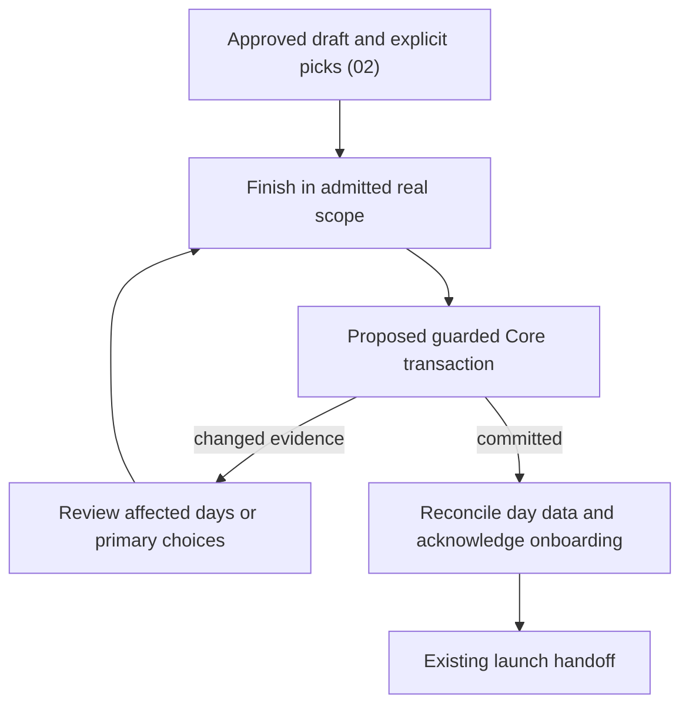

# 03 — Save the reviewed year and finish onboarding

- Status: complete
- Depends on: [02 — Review stays](02-review-stays.md)
- Shared context: [Overview](README.md)

## Intended outcome

Fresh, interactive setup offers the photo scan, stay review and region picker in order. Explain that Where looks for likely device captures by excluding identifiable Shared Album photos and checking how soon each photo entered the library. Invite the user to remove visits from received or synced photos that pass. Someone can grant limited Photos access, correct a trip, pick different primary regions from the suggestions, turn automatic recording off and still finish with the reviewed history. Reopening Where shows the same accepted points, stay dates and primary choices.

| Story | Requirement | Outcome |
| --- | --- | --- |
| [US-01](README.md#user-stories) | [R-01, R-09](README.md#requirements) | The fresh setup offers scan, skip, progress and retry. Limited access, denial, cancellation and empty results all have an accessible route onward. |
| [US-03](README.md#user-stories) | [R-06](README.md#requirements) | The picker presents the ranking from 02. Only the user's selections, pick order and appearances become the configured primary regions. |
| [US-02, US-03](README.md#user-stories) | [R-07](README.md#requirements) | Approved photo points retain their origin. The calendar and year report retain corrected days, including visits to places the user did not choose as primary. |
| [US-03](README.md#user-stories) | [R-08, R-09](README.md#requirements) | A failed or interrupted Finish can recover safely. Skipping Photos and the existing restore, demo and recording-choice-only routes still work. |

## Known design

The regular onboarding flow owns the transient review until the user chooses Finish. Keep the existing compatibility admission, installation recording choice and single scope resolution. The launch contract permits an early store opening specifically for recording-device discovery. Photo scanning and editing need no store, session or recording authority. Headless launch remains parked at the gate. The existing finish method logs a region-write failure and can proceed. The new reviewed-history path must surface save errors and hold the gate until the commit succeeds. [Launch contract](../../Where/Guidance/launch.md) · [Onboarding flow](../../Where/WhereUI/Sources/Onboarding/OnboardingFlowModel.swift)



```swift
// Proposed Core operation reached through WhereServices; storage types await Q-05.
let outcome = try await store.perform(expectedDataGenerationID: reviewedGeneration) {
    // Read a single snapshot of existing assertions, accepted points and primary rows.
    // Return affected items for review if applying the draft would change prior intent.
    // Write approved photo facts, reviewed day attribution, ordered picks and a receipt.
}
// After commit, reconcile day data and finish the installation's onboarding handoff.
```

**History and selection.** Persist the approved capture time, coordinate, available accuracy and explicit photo origin. Keep photo facts separate from passive fixes, device authority and flight inference. Account for unavailable accuracy without inventing a measurement. Store accepted calendar days and corrections so moving a boundary, rejecting an observation or deselecting a primary cannot add phantom days or erase a non-primary stay. A confirmed gap contributes reviewed days without synthetic map points. Reassess maps, widgets and reports through the effective history reader. Today that reader attributes points against the tracked set and applies sample revisions only to live GPS. A new source tag alone cannot preserve the reviewed result. [Sample sources](../../Where/WhereCore/Sources/Location/LocationSample.swift) · [History projection](../../Where/WhereCore/Sources/Devices/LocationHistoryReader.swift) · [Ranking](../../Where/WhereCore/Sources/Days/Region+Ordering.swift) · [Picker](../../Where/WhereUI/Sources/Regions/PrimaryRegionDraft.swift)

**Conflict and failure.** On Finish, capture the admitted store's generation and inspect affected days and primary rows. Surface overlaps that would change existing assertions or explicitly saved picks, with choices to keep existing data or approve the specific change. Revalidate those decisions in the transaction's `readSnapshot`. A concurrent edit returns a fresh review. Account changes and Reset or Replace invalidate the attempt. Preserve unrelated regions, prior GPS corrections, and manual-entry audit records, including all days of an earlier range edit. Record when the user approved a correction or gap. Photo coordinates describe capture time and must stay out of the audit field for the device's location when editing. Blindly looping over `setManualDay` can replace an additive row or change an authoritative row's regions and audit. Keep the confirmed selections and the history in one transaction. Reconcile using existing day-write fan-out after commit. [Store contract](../../Where/WhereCore/Sources/Persistence/WhereStore.swift) · [Manual writes](../../Where/WhereCore/Sources/Persistence/SwiftDataStore.swift) · [DayJournal](../../Where/WhereCore/Sources/Journal/DayJournal.swift)

**Interrupted Finish.** Bind the commit's identity to this installation, admitted domain and generation. A retry or relaunch after commit but before the onboarding marker must recognize the same successful operation, finish pending reconciliation and acknowledgment, and avoid duplicate points or repeated assertions. Never replay an uncommitted draft into a different account or generation. Backup restore has its own recovery sequence. Preserve that independent ownership. [Launch recovery contracts](../../Where/WhereUI/Sources/Launch/AGENTS.md) · [Backup contracts](../../Where/WhereCore/Sources/Backup/AGENTS.md)

**Compatibility.** Baselines at planning time are backup format 8 and data model version 2. Specify the next strict backup format, external v8 upgrade and merge/replace round trips for every new durable history field. Preserve older GPS, manual entries and audits. Document incompatible data semantics in the next model-version entry with a localized reason and retain existing admission and publication rules. Verify an admitted viewer with recording off can finish. [Archive](../../Where/WhereCore/Sources/Backup/BackupArchive.swift) · [External upgrader](../../Where/Tools/upgrade-backup.rb) · [Version history](../../Where/WhereCore/Sources/Compatibility/DataModelVersion.swift) · [Publication rules](../../Where/WhereCore/README.md#data-compatibility)

## Boundaries

[X-01–X-03](README.md#scope-boundaries) apply. Process metadata on device. Keep image bytes, library identifiers and unapproved points out of the saved history. Approved history follows Where's ordinary storage and backup settings. This route is for fresh interactive setup. Demo, restore, Flyover, recording-choice-only setup and extensions do not request Photos access. Travel forecasting and continuous library monitoring are outside this series.

## Refinement trigger and outcome evidence

The phase 02 fixture demonstrated explicit gap confirmation, preserved original captures and corrected rankings. That evidence resolved [Q-05](README.md#questions-and-resolutions) and established the storage, backup and acknowledgment steps below.

- In Core, prove the calendar totals and visible photo points agree with the draft after reopen, a later primary edit, backup merge, backup replace and external upgrade. Exercise two regions on one day, a removed assignment, an existing authoritative day, a concurrent change, save failure and duplicate Finish.
- Include a photo just after local midnight on January 1. Approve the stay, change to a time zone where that instant falls on December 31, and reopen both year reports. The original point keeps its capture instant. The approved stay keeps its reviewed calendar day, including in the presence of year-bounded fetches. [Day identity](../../Where/WhereCore/Sources/Days/AGENTS.md)
- In launch tests, stop immediately after commit and before the onboarding preference. Relaunch with Photos access revoked. The app can finish once from the committed result. Verify compatibility retirement and reset cannot revive that attempt. Exercise skip, denial, restore, demo, headless promotion and the second-device recording choice. [WhereLaunchTests](../../Where/WhereUI/Tests/WhereLaunchTests.swift) · [BackupCoordinatorTests](../../Where/WhereCore/Tests/BackupCoordinatorTests.swift)
- The user chose simulator fixtures for acceptance on November 27. Under that boundary, simulate limited access to known photos covering a travel day, several photos in one region, an image without GPS and a short gap. Exercise full access and the PhotoKit adapter with a known Shared Album asset and a main-library image saved more than five minutes after capture. Verify that neither supplies a point or changes a stay or region count. Exercise cancellation during a larger scan and restart it. Review and edit a stay, explicitly confirm or decline the gap, leave a visited region unselected, then finish with recording off. Verify the photo provenance, points and expected day totals after relaunch. Exercise the manual picker after denial and the accessible labels for permission, correction, suggestions and retry.

## Decisions and resume point

The November 27 product choices [Q-01–Q-04](README.md#questions-and-resolutions) govern gap confirmation, photo retention, active region selection and the seven-missing-day suggestion limit. The phase 02 fixture now produces the accepted original capture, reviewed day and region, and separate asserted days. Its move and co-presence regression tests passed. This resolves Q-05.

## Execution steps

1. Add a distinct photo sample source carrying the observed and reviewed region/day and approval time. Hash the capture instant and coordinates for a stable identity. Store day keys with the sample. Project these rows by reviewed day and attribution in reports, widgets and maps, including across New Year. Keep raw trajectory reads timed by capture. Bump the strict archive to 9 and model version to 3. The external v8 upgrade preserves rows and changes the version.
2. Write accepted points, day assertions, explicit primary rows and an installation-scoped receipt in a generation-guarded transaction. Read conflicting days and picks inside the snapshot. Show affected dates and regions, offer to keep prior entries or apply the reviewed additions, recheck on retry, preserve old audit details. Reconcile day-dependent outputs after save.
3. Write the receipt token, domain and generation into the installation sidecar before the transaction. Compare the receipt during ordinary Finish and launch recovery before acknowledgment. A superseded or uncommitted token cannot replay the draft. Keep backup-import recovery independent.
4. Connect the optional fresh-onboarding scan, cancellable progress, review, picker and Finish. Continue to the manual picker after skip, denial or empty results. Pass the reviewed history only after explicit Finish. Route failed commits back to the final page with retry.
5. Run the focused scanner, editor, persistence, backup, admission and onboarding suites and architecture checks. Verify stable stored capture data in different calendar zones and in both backup strategies. Recheck snapshots, the installation sidecar and the combined diff before publication.

### Plan review

November 27, 2026 against `982916f20` and the verified phase 02 draft. Review traced the moved June 2 capture to its June 3 reviewed assignment, the accepted gap to audited day assertions, and an unselected region through the existing tracked-only projection. The store supports a single rollback boundary and installation-scoped receipts. A backed-up preference alone cannot distinguish an interrupted write. The sidecar must retain the independent operation identity. Acceptance uses simulator fixtures by user direction. System permission prompts on personal hardware and a live VoiceOver session are outside the verification evidence.

## Execution record

The integrated route is on [implementation PR #579](https://github.com/kyleve/Stuff/pull/579). A simulator fixture scanned two Ontario photos under limited access, confirmed the three intervening days, selected California and finished with recording off. It retained two photo points and five Ontario days. Cold-store and backup tests covered both calendar years around January 1, later primary changes, rejection and approval of conflicting days, atomic rollback, repeated Finish, merge, replace, and clearing by reviewed year.

Independent review caught a committed receipt that could be lost during lockout, a stale decision after an existing entry disappeared, and a year-clear operation that still used capture time. The writer now revalidates conflict evidence and uses the approved day for destructive year selection. Temporary lockout retains the pending sidecar. On a fresh account that needs a recording device to publish the data version, a local scan can still proceed. Only a current admission can write, and recovery requires a matching committed receipt.

The complete Where Core, UI and host unit bundles passed 1,698 simulator tests. The standalone architecture check, Swift formatting check, string-catalog normalization and local document links passed. The user selected simulator fixtures for acceptance. No personal library or physical device was accessed. Accessibility snapshots expose the region and date range on each gap decision.

Final verification passed 42 compatibility and launch tests plus both snapshot tests, covering 14 images. The new admission fixture scanned with the store gated, simulated a postcommit account invalidation, and recovered the same receipt without applying a changed list of picks. The independently reviewed implementation is ready for human review in PR #579.
