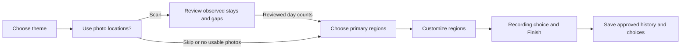

# Build this year's stay history from photos during onboarding

## Planning checkpoint

- Updated November 27, 2026, against `2f639e987`.
- The user requested a plan for current-year photo GPS backfill during Where onboarding, followed by stay correction and selection of primary regions using the result.
- Planning and review are complete. [STU-185](https://linear.app/kve/issue/STU-185) owns the work. The user resolved the four product questions. The scan and stay-review plans are ready, in that order. The final save is an outline pending Q-05.
- The next action is implementation of 01 if requested. After 02 produces a reviewed draft, refine 03 using its recovery and compatibility fixtures. Implementation awaits a separate request.

## Experience

After theme selection, someone setting up Where can choose **Use photo locations** or continue directly to the region picker. The offer explains the date range and what approval will save. The scan reads capture times and locations from the photos available on the device. A limited grant works with the selected photos. Skipping, unavailable permission and a library with no usable locations all leave a clear route onward.

The scan opens a provisional stay history. People can adjust the region and dates, remove a mistaken visit, add a missed stay, and confirm or dismiss suggested days. They can accept the observations without making any edits. Accepting the review feeds corrected day counts into the existing region picker. All eligible regions remain available, and the user chooses and customizes their primaries. Finish saves approved photo GPS points and stay corrections in the admitted real scope. This works with automatic location recording off.

**Illustrative review.** Two Ontario photos are dated June 2 and June 6. A Québec photo is also dated June 6. Where offers the three intervening days as part of the Ontario stay. June 6 counts once for each region.

| Ontario stay | June 2 | June 3 | June 4 | June 5 | June 6 | Days for the picker |
| --- | --- | --- | --- | --- | --- | --- |
| Before confirming | Photo | Suggested | Suggested | Suggested | Photo | 2 Ontario · 1 Québec |
| After confirming | Photo | Confirmed | Confirmed | Confirmed | Photo | 5 Ontario · 1 Québec |

With eight missing days, the review shows separate stays. A person who remembers a longer stay can enter its dates. Extending the stay adds regional presence on those dates. Only the observed dates have photo GPS points.

## User stories

| ID | Story |
| --- | --- |
| US-01 | During setup I can use the location metadata already in my photo library to recover this year's travel, with control over access and what gets saved. |
| US-02 | I can see where the photos place me, recognize uncertain days, and correct the stay history before I rely on it. |
| US-03 | I can choose the regions that matter to me using my corrected history and find the approved history in Where after setup. |

## Requirements

| ID | Required outcome | Story | Owner |
| --- | --- | --- | --- |
| R-01 | Offer an optional scan on interactive fresh setup. Request access on tap. Show limited access, progress, cancellation, failure, retry, empty results and a direct manual route. | US-01 | [01](01-read-photo-locations.md), [03](03-finish-onboarding.md) |
| R-02 | Read image metadata locally from January 1 through the scan instant in this year's reporting calendar. Skip undated or unusable locations. Keep media out of the import. | US-01 | [01](01-read-photo-locations.md) |
| R-03 | Attribute observations across bundled loggable regions before primary selection. One day can contain multiple regions. Repeat photos do not multiply a region's day count. | US-01, US-02 | [01](01-read-photo-locations.md), [02](02-review-stays.md) |
| R-04 | Offer a continuous stay over **one to seven missing days inclusive** when adjacent observed days identify one shared named region and there is no intervening evidence. Flag each gap for explicit confirmation. Unconfirmed gaps, longer gaps, ambiguities and open-ended periods contribute no inferred days. | US-02 | [02](02-review-stays.md) |
| R-05 | Review the year-to-date stays with inclusive date and region edits, addition and exclusion. Preserve co-present regions. Keep edits when moving back from the picker and recalculate suggestions. | US-02 | [02](02-review-stays.md) |
| R-06 | Rank eligible regions by distinct accepted days with the catalog tie-break. Keep initial selection empty, all eligible choices available, and existing one-to-five selection, order and appearance controls. | US-03 | [02](02-review-stays.md), [03](03-finish-onboarding.md) |
| R-07 | Retain approved observed coordinates and capture times with distinct photo provenance. Keep user corrections and confirmed gap days auditable. Preserve the reviewed regional history even for a region the user leaves unselected. | US-02, US-03 | [03](03-finish-onboarding.md) |
| R-08 | Save through the admitted real scope at Finish. Handle existing or newly synced assertions, conflicts, retries, interrupted completion, sync and backup compatibility without losing the user's history. | US-03 | [03](03-finish-onboarding.md) |
| R-09 | Keep the photo flow independent of recording consent. Respect the existing backup restore, demo, headless and restored-device entry paths. | US-01, US-03 | [03](03-finish-onboarding.md) |

## Scope boundaries

| ID | Boundary | Reason |
| --- | --- | --- |
| X-01 | Exclude image bytes, thumbnails, filenames, asset identifiers, evidence attachments, uploads of library material and external geocoding. | Photo metadata and bundled geometry supply the observations. Approved Where records use the app's ordinary history sync and backup behavior. |
| X-02 | Exclude early opening of a real scope for photo scanning, live GPS attribution, and recording permission as an import prerequisite. | Launch owns admission and device recording consent. Photo-derived history needs its own provenance. |
| X-03 | Limit the feature to a user-initiated current-year scan in fresh onboarding. Exclude background library monitoring, previous years and forecast/planned stays. | This series recovers past presence during setup. |

## Research and evidence

| Source at `2f639e987` unless noted | Finding and consequence |
| --- | --- |
| [STU-185](https://linear.app/kve/issue/STU-185) and [original request](https://github.com/kyleve/Stuff/pull/183) | The existing human backlog item calls for opt-in, local metadata, preview, provenance, deduplication and skip. The November 27 request specifies correction before choosing primaries. |
| [Closed PR #201](https://github.com/kyleve/Stuff/pull/201) and [origin-filter discussion](https://github.com/kyleve/Stuff/pull/201#discussion_r3741293126) | The prior implementation has reusable ideas for deterministic point IDs and a deferred write. It required preselected regions, applied a five-minute capture/added-date filter and edited only days with photos. Use photos visible in the authorized library. Their presence cannot establish who took them. Test edits on dates without photos. |
| [Onboarding flow](../../Where/WhereUI/Sources/Onboarding/OnboardingFlowModel.swift) and [launch contract](../../Where/Guidance/launch.md) | Fresh setup currently chooses regions after theme. Restore skips this picker. Restored-device verification starts at recording. Pre-Finish store preparation is reserved for recording-authority discovery. Keep photo state in memory and discard it on abandonment. |
| [Apple on library access](https://developer.apple.com/documentation/photokit/delivering-an-enhanced-privacy-experience-in-your-photos-app), [PHAsset](https://developer.apple.com/documentation/photos/phasset) and [fetch options](https://developer.apple.com/documentation/photos/phfetchoptions) | Direct asset enumeration requires an access-level-aware PhotoKit grant and a purpose string. Capture date and location are optional asset metadata. Test capture dates in the fetch and validate coordinates during enumeration. |
| [RegionKit](../../Where/RegionKit/AGENTS.md), [Elsewhere resolver](../../Where/WhereCore/Sources/Reporting/ElsewhereResolver.swift) and [date contracts](../../Where/Guidance/dates.md) | Full-catalog geometry can load lazily for read-only lookup. Pin the device-zone Gregorian calendar and scan cutoff for the draft. The reviewed dates use stable calendar days. |
| [Presence timeline](../../Where/WhereUI/Sources/Model/PresenceTimeline.swift), [ranking](../../Where/WhereCore/Sources/Days/Region+Ordering.swift) and [selection model](../../Where/WhereUI/Sources/Regions/PrimaryRegionSelectionModel.swift) | The timeline supports overlapping travel days. The ranking helper already supports distinct-day totals and a deterministic tie-break. The picker offers US and Canadian subdivisions. Restrict suggestions to its offered set while keeping other approved history. |
| [Day journal](../../Where/WhereCore/Sources/Journal/DayJournal.swift), [store](../../Where/WhereCore/Sources/Persistence/SwiftDataStore.swift) and [backup contract](../../Where/WhereCore/Sources/Backup/AGENTS.md) | Blind manual-day writes can replace existing regional sets or audit data. The current live attributor uses tracked regions. The final writer must preserve existing assertions, non-primary photo attribution and backup fidelity. The closed PR's archive version predates today's v8. |

## Execution order and planning horizon

| Order | Deliverable | Horizon |
| --- | --- | --- |
| 1 | [Read photo locations](01-read-photo-locations.md). Supply dated, on-device photo observations and permission outcomes without opening the real scope. | Detail now |
| 2 | [Review stays and choose regions](02-review-stays.md). Exercise gap decisions, corrections and ranking against a reproducible draft. | Detail now, depends on 01 |
| 3 | [Save approved history and finish onboarding](03-finish-onboarding.md). Integrate the route and verify stored data, recovery and compatibility. | Outline, depends on 02 |

The first two deliverables establish the evidence and review inputs that the final writer must reproduce. Keep production navigation in 03 so onboarding always offers a complete route. After 02, refine 03 using its approved payload and a current compatibility audit. Each numbered file owns its implementation sketch and acceptance checks.

## Questions and resolutions

| ID | Status | Decision, source and integration | Impact and next action |
| --- | --- | --- | --- |
| Q-01 | closed | On November 27 the user chose a continuous stay proposal with its gap flagged for confirmation. Reviewed in R-04 and the Ontario fixture in 02. | An untouched or declined gap contributes zero approved days. |
| Q-02 | closed | The user chose to keep approved GPS points as photo-sourced history, plus stay corrections. Reviewed in R-07, the 02 handoff and 03. | Confirmed gap days produce zero invented coordinates. |
| Q-03 | closed | The user chose suggestions by days spent, with manual primary selection. Reviewed in R-06 and 02. | Approval of the history starts the picker with zero primaries selected. |
| Q-04 | closed | The user set the maximum bridge to seven missing days. Reviewed in R-04 and 02. | The seven/eight fixtures count intervening calendar dates only. |
| Q-05 | deferred | Which persisted attribution and completion receipt will reproduce the approved draft across unselected regions, retries, sync and restore? This depends on the concrete approved payload and the writer versions at execution. | Blocks readiness of [03](03-finish-onboarding.md) only. At refinement, trace the report, backup and Finish paths with an unselected-region and crash/retry fixture and specify the writable format and recovery boundary. |

## Plan review and delivery

Reviewed November 27 against `2f639e987`, including the whole dependency chain and executable detail for 01 and 02. The review moved integrated device acceptance to 03 so 01 can finish independently. It also added coverage for distinct photos on the same day, a valid point with missing accuracy, and a reviewed New Year's Day stay reopened across time zones.

All four Mermaid flows rendered in local Chromium. The plan checks cover local links and anchors, the 01 → 02 → 03 dependency chain, and agreement between the linked requirements and acceptance fixtures. Swift sketches are illustrative. Device behavior, compatibility and recovery will be verified during implementation.

Implementation has not started. [Plan PR #570](https://github.com/kyleve/Stuff/pull/570) · [STU-185](https://linear.app/kve/issue/STU-185)
