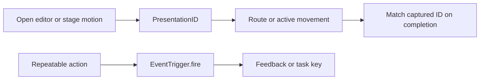

# Migrate presentation lifetimes and triggers

- Status: complete
- Depends on: none
- Shared requirements, exclusions and inventory: [overview](README.md)

## Design

Existing owners create the proposed values at the user action or model transition. SwiftUI observes a stored value. Delayed callbacks capture the run they started and check it at completion.



```swift
struct PresentationID<Owner>: Hashable, Sendable { /* private UUID */ }
struct EventTrigger: Hashable, Sendable { mutating func fire() { /* advance private generation */ } }
```

## Steps and acceptance

1. Introduce the two values and document the review convention in BroadwayCore. Verify fresh and copied IDs, successive firings and value semantics through BroadwayCoreTests.
2. Migrate the inventory on main, including callback signatures and composite task keys. Keep pending and released movement tied to one ID. Preserve the last released animator key when a year resets. Preserve independent retry inputs, one haptic per reconciliation, and silence on baseline changes. Check WhereUI, Flyover, Inspector and PeriscopeTools through ./test with focused suites and the architecture checks. Inspect each change for X-01.
3. For branch-only sites, post a before-merge migration comment on each affected PR and verify its URL. The user selected comments on November 27. Review the final diff and publish.

## Recovery and progress

Resume at the first unverified step after checking the branch against its base. Preserve current PR work and operate from the latest head for each branch. If an affected PR merges, locate its code on main and migrate there. Track code review, test commands, publication, and outstanding work here.

- November 27. Compared main and the 24 open PR diffs. Ready for authorized execution.

- Posted the requested migration notes on [#585](https://github.com/kyleve/Stuff/pull/585#issuecomment-7231873113), [#579](https://github.com/kyleve/Stuff/pull/579#issuecomment-7231873285), [#306](https://github.com/kyleve/Stuff/pull/306#issuecomment-7231873496), [#462](https://github.com/kyleve/Stuff/pull/462#issuecomment-7231873691), and its dependent [#464](https://github.com/kyleve/Stuff/pull/464#issuecomment-7231873882).

## Execution record and outcome

- Groundwork at `313ae5239` defines both BroadwayCore types. Main migration at `75dc71d46` applies them to the inventoried owners and consumers. The card animator retains its last released ID when the year changes. Mismatched completions leave the active movement intact.
- `./test --only BroadwayCoreTests/PresentationIdentityTests` passed both tests on iPhone 17 / iOS 27.2, plus the repository architecture and host checks.
- `./test --skip-architecture --skip-host-tests --no-generate --only-file /tmp/stuff-presentation-suites.txt` rebuilt the changed targets. Xcode's result bundle reports 125 passed, zero failed and zero skipped across 19 suites. The suite list is below to reproduce the run. Hardware haptics and physical-device motion were outside this representation change.
- `./swiftformat --lint`, `./sync-agents --check` and `git diff --check` passed. Independent review traced the production counters and PR-only lifetimes. Its corrections are integrated in the overview.
- Complete. [Implementation PR #589](https://github.com/kyleve/Stuff/pull/589) delivers main. Branch authors own the changes requested in the five linked comments.

### Focused suites

Save these lines in the file passed to `--only-file`.

```text
BroadwayCoreTests/PresentationIdentityTests
FlyoverTests/FlyoverModelTests
FlyoverTests/FlyoverPreviewReadinessTests
InspectorTests/InspectorSwiftDataMutationTests
PeriscopeToolsTests/PeriscopeViewerModelTests
WhereUITests/PlannedStaysModelTests
WhereUITests/CalendarZoomTransitionStateTests
WhereUITests/CalendarZoomOverlayTests
WhereUITests/CalendarPresentationStateTests
WhereUITests/LocationCardRankingStackTests
WhereUITests/LocationCardsPresentationModelTests
WhereUITests/LocationCardsReconciliationModifierTests
WhereUITests/RankingAnimationLabModelTests
WhereUITests/DeviceLayoutLabViewTests
WhereUITests/WhereFlyoverLoaderTests
WhereUITests/RemindersSettingsModelTests
WhereUITests/YearReportModelTests
WhereUITests/ElsewhereModelTests
WhereUITests/DevicesSettingsModelTests
```
