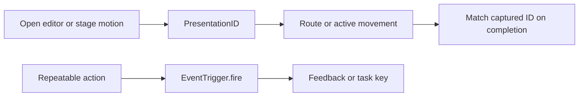

# Migrate presentation lifetimes and triggers

- Status: ready
- Depends on: none
- Shared requirements, exclusions and inventory: [overview](README.md)

## Design

Existing owners create the proposed values at the user action or model transition. SwiftUI observes a stored value. Delayed callbacks capture the run they started and check it at completion.



```swift
struct PresentationID<Owner>: Hashable, Sendable { /* private UUID */ }
struct EventTrigger: Hashable, Sendable { mutating func fire() { /* advance private generation */ } }
```

## Steps and acceptance

1. Introduce the two values and document the review convention in BroadwayCore. Verify fresh and copied IDs, successive firings and value semantics through BroadwayCoreTests.
2. Migrate the inventory on main, including callback signatures and composite task keys. Keep pending and released movement tied to one ID. Preserve the last released animator key when a year resets. Preserve independent retry inputs, one haptic per reconciliation, and silence on baseline changes. Check WhereUI, Flyover, Inspector and PeriscopeTools through ./test with focused suites and the architecture checks. Inspect each change for X-01.
3. Recheck the open branches, carry the applicable API into branch-only sites according to the user's branch delivery preference, and verify their consumers. Review the final diff and publish.

## Recovery and progress

Resume at the first unverified step after checking the branch against its base. Preserve current PR work and operate from the latest head for each branch. If an affected PR merges, locate its code on main and migrate there. Track code review, test commands, publication, and outstanding work here.

- November 27. Compared main and the 24 open PR diffs. Ready for authorized execution.
