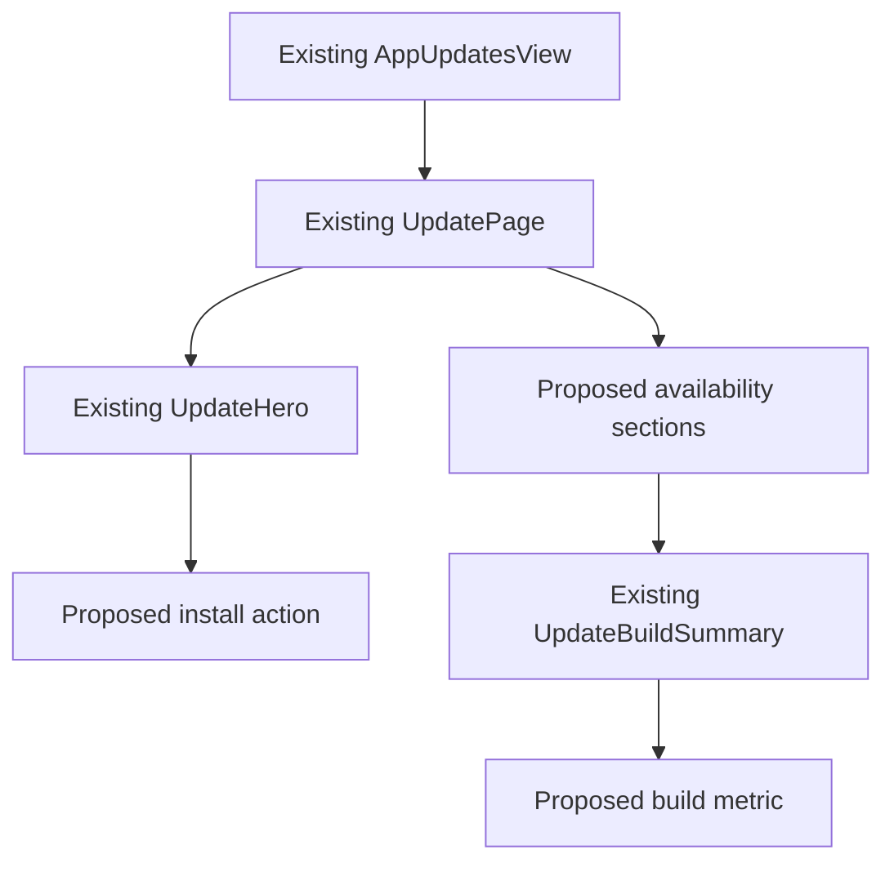

# 01 — Extract the InstallerKitUI update-page children

**Status** · ready

**Dependency** · none

**Scope** · [AppUpdatesView.swift](../../Shared/InstallerKitUI/Sources/AppUpdatesView.swift) and [UpdateBuildSummary.swift](../../Shared/InstallerKitUI/Sources/UpdateBuildSummary.swift), plus sibling Swift files required by their final sizes.

This pilot implements R-01 through R-03 under the [overview](README.md). The two files contain a method, computed properties, inline children and a named view with a body above the separate-file threshold. The update screen and build detail already have hosted or image coverage.

## Inputs and ownership

The host injects its existing model, branding and section decoration. The proposed metric accepts a localized title and an optional formatted value. The proposed install action accepts the current availability. The availability sections need the installed build and the host’s decoration for changes. Each child resolves the Installer stylesheet beneath the existing Broadway root. The refresh task, cancellation and browser sheet belong to the mounted page. See the [InstallerKitUI contract](../../Shared/InstallerKitUI/AGENTS.md).



The sketch omits other page sections and styling. Proposed names describe roles. Final file placement follows each formatted body.

```swift
// Inside UpdateBuildSummary's grid
UpdateBuildMetric(title: .installerVersion, value: release.buildDetails?.version)

// Inside the page, below the stylesheet root
UpdateHero(branding: branding, channelLabel: model.installed.source.channelLabel) {
    UpdateInstallAction(availability: model.state.snapshot?.availability)
}
UpdateAvailabilitySections(
    availability: model.state.snapshot?.availability,
    installed: model.installed,
    sectionDecoration: sectionDecoration
)
```

## Steps

1. From the implementation base, inspect the two files and their [inventory entries](audit.md). The baselines are `metric` (12), `installAction` (13), `availability` (34) and the already-named `UpdatePage.body` (30). The [small named view inventory](small-named-views.md) identifies the 18-line `UpdateBuildSummary`; both `UpdatePage` and `UpdateBuildView` consume it. Retain its shared source file. Inspect the inline Other Builds button with its modifiers (lines 57–65) and the branches inside availability. A multiline initializer for an existing view can remain a call to that view.
2. Start with the metric in the summary file. Retain the nil-value fallback, formatting, grid order and combined accessibility element. Review the update-page children from the leaves out. Give the Other Builds child an intent that opens the existing page-owned sheet. Pass availability values and decorations to their rendering children. Preserve the retired case with and without a main release, the unavailable and current cases, and the order of cards under `UpdatePageLayout`. Keep `.changes` on the changes section and `.check` on the installed build.
3. Apply `./swiftformat` to the changed Swift sources using the repository command. Count each resulting child body. Keep 5–19-line children in their final parent’s file. Place 20+-line children in sibling files in the same target. Recount `UpdatePage` after replacing its children. Move its small children with it if it needs its own file. Keep a preview with a moved child using the existing fixture under the [preview guidance](../../.agents/skills/building-ui/references/previews.md). Preserve the public screen, its snapshot registration and the generic section-decoration seam. Regenerate with `./ide --no-open` if project membership needs refreshing.
4. Verify with the following commands from the root. Use `--review` to inspect a difference. Fix unintended rendering changes before accepting a batch.

```sh
./swiftformat --lint
./test --only InstallerKitUITests/AppUpdatesViewTests --only InstallerKitUITests/UpdatePageRefreshTests
./test --snapshots --record never --only InstallerKitUISnapshotTests/AppUpdatesViewSnapshotTests --only InstallerKitUISnapshotTests/UpdateBuildViewSnapshotTests
```

## Acceptance and resume

Record final counts and source paths for the three helpers, the named page and each qualifying inline child. Confirm that section decoration still wraps the same sections, the metric exposes the same combined contents, update states have the same rendering, and navigation re-entry and refresh cancellation pass their hosted checks. Review any coverage gap at the production entry point and record the observed outcome. Capture suite counts, revision and implementation PR here. Use the pilot’s final measurements to refine the later batches.

**Progress.** The November 27 source audit and plan review are complete. Implementation awaits a request. Resume with step 1 on the current base. After an interrupted extraction, compare callers, current file placement and recorded checks before moving the next child. Re-run checks for any changed rendering or ownership boundary.
