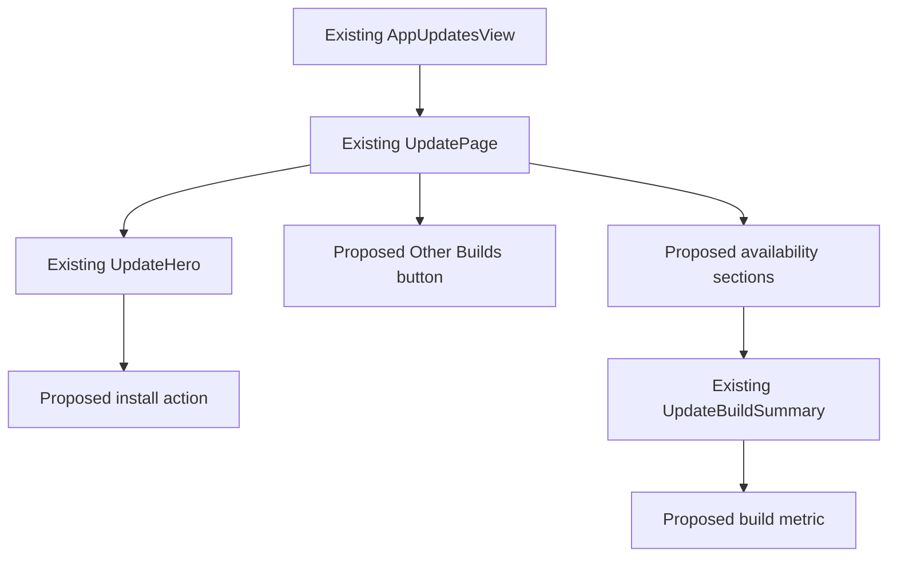

# 01 — Extract the InstallerKitUI update-page children

**Status** · complete

**Dependency** · none

**Scope** · [AppUpdatesView.swift](../../Shared/InstallerKitUI/Sources/AppUpdatesView.swift) and [UpdateBuildSummary.swift](../../Shared/InstallerKitUI/Sources/UpdateBuildSummary.swift), plus sibling Swift files required by their final sizes.

This pilot implements R-01 through R-03 under the [overview](README.md). The two files contain a method, computed properties, inline children and a named view with a body above the separate-file threshold. The update screen and build detail already have hosted or image coverage.

## Inputs and ownership

The host injects its existing model, branding and section decoration. The proposed metric accepts a localized title and an optional formatted value. The proposed install action accepts the current availability. The availability sections need the installed build and the host’s decoration for changes. Each child resolves the Installer stylesheet beneath the existing Broadway root. The refresh task, cancellation and browser sheet belong to the mounted page. See the [InstallerKitUI contract](../../Shared/InstallerKitUI/AGENTS.md).



The sketch omits other page sections and styling. Proposed names describe roles. Final file placement follows each formatted body.

```swift
// Inside UpdateBuildSummary's grid
UpdateBuildMetric(title: .installerVersion, value: release.buildDetails?.version)

// Inside the page, below the stylesheet root
UpdateHero(branding: branding, channelLabel: model.installed.source.channelLabel) {
    UpdateInstallAction(availability: model.state.snapshot?.availability)
}
OtherBuildsButton { isBrowsingBuilds = true }
UpdateAvailabilitySections(
    availability: model.state.snapshot?.availability,
    installed: model.installed,
    sectionDecoration: sectionDecoration
)
```

## Steps

1. From the implementation base, inspect the two files against the [source inventory](audit.md) and [complete buttons](buttons.md). The baselines are `metric` (12), `installAction` (13), `availability` (34) and the already-named `UpdatePage.body` (30). The [small named view inventory](small-named-views.md) identifies the 18-line `UpdateBuildSummary`, used by both `UpdatePage` and `UpdateBuildView`. Retain its shared source file. Inspect the branches inside availability. A multiline initializer for an existing view can remain a call to that view.
2. Extract the metric in the summary file. Retain the nil-value fallback, formatting, grid order and combined accessibility element. Extract the complete [Other Builds button](../../Shared/InstallerKitUI/Sources/AppUpdatesView.swift#L57). Its three-line label is part of a nine-line control. The named child owns the native `Button`, its action callback, localized label, font, frame, bordered style and capsule shape. `UpdatePage` supplies the callback that sets `isBrowsingBuilds` and keeps the sheet presenter. Pass availability values and decorations to their rendering children. Preserve the retired case with and without a main release, the unavailable and current cases, and the order of cards under `UpdatePageLayout`. Keep `.changes` on the changes section and `.check` on the installed build.
3. Apply `./swiftformat` to the changed Swift sources using the repository command. Count each resulting child body. Keep 5–19-line children in their final parent’s file. Place 20+-line children in sibling files in the same target. Recount `UpdatePage` after replacing its children. Move its small children with it if it needs its own file. Keep a preview with a moved child using the existing fixture under the [preview guidance](../../.agents/skills/building-ui/references/previews.md). Preserve the public screen, its snapshot registration and the generic section-decoration seam. Regenerate with `./ide --no-open` if project membership needs refreshing.
4. Verify with the following commands from the root. Use `--review` to inspect a difference. Fix unintended rendering changes before accepting a batch.

```sh
./swiftformat --lint
./test --only InstallerKitUITests/AppUpdatesViewTests --only InstallerKitUITests/UpdatePageRefreshTests
./test --snapshots --record never --only InstallerKitUISnapshotTests/AppUpdatesViewSnapshotTests --only InstallerKitUISnapshotTests/UpdateBuildViewSnapshotTests
```

## Acceptance and resume

Fix every confirmed placement or extraction issue in the two pilot files. Record the final counts and source paths for the three helpers, the named page and each qualifying inline child. Check that the page calls the named Other Builds control and that the child contains the complete button with its action and modifiers. On the mounted update page, activate Other Builds, dismiss the browser sheet and open it again. Confirm the accessible button name and role. The page snapshots cover its appearance. Verify that section decoration still wraps the same sections, the metric exposes the same combined contents, update states render correctly, and navigation re-entry and refresh cancellation pass their hosted checks. Capture suite counts, observed interaction, revision and implementation PR here. Use the pilot’s final measurements to refine the later batches.

**Progress.** The November 27 source audit and plan review are complete. The maintainer authorized implementation on November 27. Execution began at `dbc169471` with no outstanding plan PR review comments. After an interrupted extraction, compare callers, current file placement and recorded checks before moving the next child. Re-run checks for any changed rendering or ownership boundary.

## Pilot measurements

At the implementation base, the public screen’s body measured four lines. `UpdatePage` now owns 28 lines in its own file, including the original sheet, refresh, cancellation and check decoration. Its 13-line install action and seven-line Other Builds button share that file. The 31-line `UpdateAvailabilitySections` has its own file and renders the complete sections directly in the page layout. Its five-line notice card serves the retired and unpublished states. In the summary file, the 16-line metric grid contains 12-line named metrics. The three-line shared summary still serves the public update page and the build detail.

The hosted interaction uses `WhereCompatibilityModelTests.updateLockoutCanBrowseAppUpdatesWithoutOpeningHistory` to activate the accessible button on the production page, dismiss the browser, then open and dismiss it again. The pilot source and host test were reviewed against `dbc169471`. No review defects remained.

On an iPhone 17 simulator, the update-page, refresh and compatibility selections passed four behavior tests. Both snapshot suites passed with recording disabled. The combined run used the two InstallerKitUI selections above and the hosted compatibility test. SwiftFormat lint and the architecture checks passed. The reviewed implementation is published at `d1f20b068` in [PR #594](https://github.com/kyleve/Stuff/pull/594). The remaining plans can use its complete-control and state-ownership examples.
