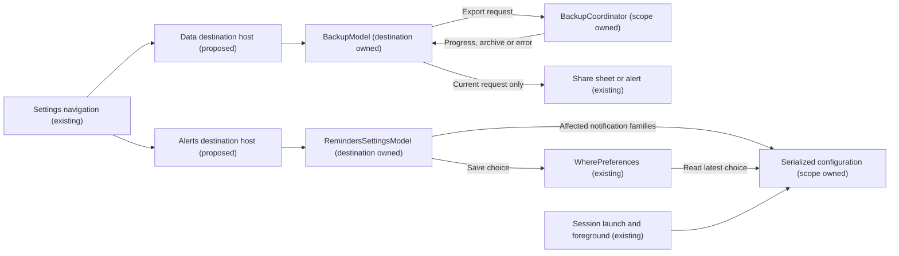

# 01 — Settings destinations

- Status: executing
- Dependencies: none
- Shared context: [Overview](README.md)

## Deliverable

Data Settings creates its backup presentation model, and Alerts Settings creates its reminder editing model. Leaving either surface releases its presentation state. Accepted exports and saved notification changes have explicit owners while the screen is gone.

| Story | Requirement | Behavior |
| --- | --- | --- |
| [US-01](README.md#user-stories) | [R-01](README.md#requirements), [R-02](README.md#requirements) | A new destination starts fresh. Accepted work finishes safely after dismissal. |
| [US-04](README.md#user-stories) | [R-07](README.md#requirements) | Compact, expanded, Flyover, and prepared captures use the same destination boundary. |

[X-01 through X-03](README.md#exclusions) apply. Keep the archive format, scheduling policy, and Settings navigation and presentation behavior.

## Context and constraints

[SettingsView](../../Where/WhereUI/Sources/Settings/SettingsView.swift) builds both models before routing. [DataSettingsView](../../Where/WhereUI/Sources/Settings/DataSettingsView.swift) owns the share sheet and [AlertsSettingsView](../../Where/WhereUI/Sources/Settings/AlertsSettingsView.swift) refreshes authorization on appearance. [WhereFlyoverWorld](../../Where/WhereUI/Sources/Developer/Flyover/WhereFlyoverWorld.swift) separately creates both models for those frames.

Follow the [Settings contracts](../../Where/WhereUI/Sources/Settings/AGENTS.md), [backup contracts](../../Where/WhereCore/Sources/Backup/AGENTS.md), and [Swift conventions](../../.agents/references/swift-conventions.md). Keep reset, erase, and alert scan behavior on their existing paths.

## Data flow



The plan omits form content and the scope teardown internals. A destination stops consuming export events when it leaves. Saved notification changes continue through the scope.

## Architecture sketch

```swift
// Proposed composition. Form content, task mechanics, and test injection are omitted.
switch route.destination {
case .data:
    ObservableHostingView({ BackupModel(services: report.services) }) { backup in
        DataSettingsView(report: report, backup: backup, focus: route.focus)
    }
case .alerts:
    ObservableHostingView({ makeRemindersModel(report: report, session: session) }) { reminders in
        AlertsSettingsView(report: report, reminders: reminders, focus: route.focus)
    }
}
```

The host uses the destination identity supplied by native navigation. The backup coordinator serializes archive generation for a scope across its awaits. The scope's notification configuration path accepts an affected family and reads current preferences when applying it. Models and presentation are main-actor isolated. A fixture can explicitly provide a prepared model to the destination content.

## Steps

1. Move Backup and Reminders construction to the typed destinations. Share the production wrappers with Flyover and normal navigation. Remove the eager properties from Settings and the Flyover world, and keep prepared capture injection where progress or errors are fixture inputs. Keep the native navigation and screen boundary modifiers at their existing levels.
2. Replace Data's fire-and-forget presentation task with a request tied to the mounted destination. Consume progress and completion for that request, detach the consumer on dismissal, and publish success or failure only to the current presenter. Let archive generation already accepted by Core finish. Keep the staging directory under coordinator ownership. The disappearing view must never call the generic discard operation on a newer export.
3. Serialize export starts through archive publication in `BackupCoordinator`, since its awaits permit another request to enter the actor. Queue a request submitted after reopening and skip a queued request whose presentation is cancelled before it starts. Preserve the coordinator's existing previous-archive cleanup policy. On failure, release the active slot and allow retry. Use a held operation and distinguish two destination identities when checking this path.
4. Persist reminder choices synchronously as today. Route the affected work to the active scope's serialized configuration path, reusing the session's existing apply methods and service schedulers. Launch, foreground, and edit requests must converge on the same current preferences. Keep the existing per-control mapping, including issue-alert changes that also affect the reminder badge. Route permission refresh results to the current destination and keep scheduler sequencing separate from UI tasks. Drain or cancel scope-owned work at session retirement so it cannot configure a replacement scope.
5. Update WhereUI's scope-tiered model documentation. Verify Data and Alerts on their regular Settings routes, through an applicable search result, and in Flyover. Review settled captures and exercise destination remounts on a mounted hierarchy.

## Acceptance and verification

Run commands from repository root. Extend an existing test suite where it can expose the regression.

| Requirements | Check | Expected result |
| --- | --- | --- |
| R-01 | `./test --only WhereUITests/BackupModelTests --only WhereCoreTests/BackupCoordinatorTests`. Exercise dismissal and reopening in mounted Settings with a held export. | The old presenter receives neither a share sheet nor an alert after dismissal. A second request can produce its own readable archive, a canceled queued request produces none, and failure releases the export slot. |
| R-02 | `./test --only WhereUITests/RemindersSettingsModelTests --only WhereUITests/AlertsSettingsViewTests --only WhereUITests/WhereSessionTests`. Verify the form on a mounted remount after holding an earlier configuration and saving a newer choice. | The newest choice is effective. The remounted form reads saved values and current authorization. Launch and foreground paths still apply the saved state. |
| R-01, R-02, R-07, X-03 | `./test --only WhereUISnapshotTests/DataSettingsViewSnapshotTests --only WhereUISnapshotTests/SettingsViewSnapshotTests` and exercise Data and Alerts in compact and expanded layouts, through Settings search, and in Flyover. | Existing presentation settles to the same UI, adaptive reflow preserves an active destination, and each normal remount receives one fresh model. A Settings mount alone creates neither model. |
| X-01, X-02 | `./test --architecture-only` if notification sequencing changes a documented concurrency boundary, and inspect the diff for persistence or launch policy changes. | The existing scope and permission policies hold. |

## Recovery

If export validation fails, hold the store or archive access before dismissing, then release it and inspect request ownership and the returned file. If notification validation fails, hold the older configuration at the scheduler and verify the final applied values after releasing it. Keep each deliverable step bisectable. If capture sees the host's clear initial frame, wait for mounted content using the existing readiness mechanism and recapture.

## Decisions and revisions

| Date | Decision | Source |
| --- | --- | --- |
| 2026-11-27 | Keep export presentation destination-local, let accepted archive work finish, and keep saved scheduling work scope-owned. | Ownership audit and source review |

## Progress

- [x] Move destination construction and update Flyover and fixtures.
- [x] Verify export dismissal and repeated requests.
- [x] Verify scheduling across Alerts presentations and session transitions.
- [ ] Review, document, and publish the implementation.

## Execution record

- 2026-11-27. Moved both destination hosts and ran the first focused simulator batch, which passed 51 tests across Phase 1. Independent review identified that an explicit issue-alert edit must reconcile the badge after the permission prompt. The implementation preserves that prerequisite while keeping launch families concurrent. Added mounted Data dismissal and queued-export coverage for the follow-up run.
- 2026-11-27. The focused iPhone 17 run passed the five Settings and backup suites, including the mounted route change, held export, canceled queued request, and newer notification choice. The architecture run passed 30 rule tests and found no violations. Data and Settings captures passed with recording disabled. The only failure in the combined unit run was the separate Elsewhere interaction test, tracked in Plan 02.

## Resume point

Publish the verified Settings changes and attach the implementation PR to the execution record. This step has simulator coverage. A full Flyover interaction run and physical-device sharing are unverified.

## Outcome

Pending implementation.
