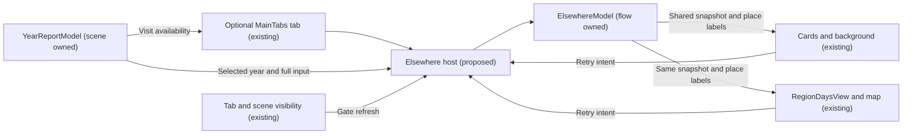

# 02 — Elsewhere flow

- Status: executing
- Dependencies: none
- Shared context: [Overview](README.md)

## Deliverable

One Elsewhere navigation flow owns its resolved presentation model. The list, pushed day detail, and map continue to use one projection, while the scene report decides when the tab exists.

| Story | Requirement | Behavior |
| --- | --- | --- |
| [US-02](README.md#user-stories) | [R-03](README.md#requirements) | One model serves the entire flow and rejects superseded input. |
| [US-04](README.md#user-stories) | [R-07](README.md#requirements) | Capture and preview use the same production flow with a prepared model or deterministic factory. |

[X-02 through X-04](README.md#exclusions) apply. Keep the optional tab, shared report and forecast, and present map and card appearance. Shared geocoder task cancellation remains in [STU-228](https://linear.app/kve/issue/STU-228/make-locationnamer-cancellation-aware).

## Context and constraints

[MainTabs](../../Where/WhereUI/Sources/MainTabs.swift) mounts Elsewhere conditionally based on [YearReportModel](../../Where/WhereUI/Sources/Model/YearReportModel.swift). The report also creates and invalidates the current model. [ElsewhereView](../../Where/WhereUI/Sources/Elsewhere/ElsewhereView.swift) and [RegionDaysView](../../Where/WhereUI/Sources/Elsewhere/RegionDaysView.swift) share the model, but both may initiate refresh and the detail can fall back to the report. MainTabs captures currently prepare and read that scene-owned model.

Follow the [Locations contracts](../../Where/WhereUI/Sources/Primary/AGENTS.md), [snapshot test contracts](../../Where/WhereUI/Tests/AGENTS.md), and [Swift conventions](../../.agents/references/swift-conventions.md). Use the full `ElsewhereInput`, including changes to evidence that leave counts unchanged. A tab may stay mounted when deselected.

## Data flow



The host owns one refresh request across list and detail. The existing Core resolver and place namer remain injected. The flow rejects late publication even if the underlying name lookup continues.

## Architecture sketch

```swift
// Proposed composition. Key the work by year, full input, visibility, and retry.
ObservableHostingView({ ElsewhereModel(resolver: report.services.elsewhere,
                                       namer: LocationNamer()) }) { model in
    ElsewhereNavigation(report: report, model: model, isSelected: isSelected)
}

// A pushed detail receives the same model and retry intent explicitly.
RegionDaysView(region: region, report: report, model: model, retry: retry)
```

The mounted flow is the stable owner. Changing year invalidates old content and requests without rebuilding the entire navigation stack. A new flow on tab removal and later reappearance receives new state. Capture can inject the exact prepared model whose resolved cards drive artwork preparation.

## Steps

1. Add the factory at the Elsewhere flow above its navigation stack. Make the region detail require the flow model and remove `YearReportModel.elsewhere` and the report's UI invalidation call. Keep `elsewhereInput` and `hasElsewhere` on the report.
2. Give the stable flow one refresh driver and a shared retry intent. Advance the model's request generation when the year actually changes, before any replacement read. Key work by complete input, selected year, visibility, and retry. Preserve the previous same-year projection during loading and error, and let either screen retry. Moving from list to detail must leave the flow's work and shared projection intact. Reject canceled or superseded resolution and naming results on publication. If a day row remains mounted outside the selected tab, gate its name request by visibility as well as coordinate.
3. Adapt MainTabs, direct Elsewhere and Region Days snapshots, and Flyover to the new owner. The Places & Your Year gallery also reads the scene's Elsewhere projection. Give its Locations example a local host and use the same prepared instance for artwork and rendering. Keep the existing preparation ordering so snapshots measure settled content.
4. Update WhereUI's report and Elsewhere ownership documentation. Verify that tab removal restores Locations and that a later Elsewhere visit creates the flow again.

## Acceptance and verification

Run commands from repository root.

| Requirements | Check | Expected result |
| --- | --- | --- |
| R-03 | `./test --only WhereUITests/ElsewhereModelTests --only WhereUITests/MainTabsTests` | Removal selects Locations and reappearance works. A held old-year or evidence request cannot replace newer content. Same-year failure retains content and retries successfully. |
| R-03, R-07 | Mount the shell with a counted factory and controllable resolver. Start without Elsewhere visits, add a visit, push into its details, change evidence without changing counts, then remove the final visit and add one again. Exercise a held request while switching year or leaving the tab. | No model is created while the tab is absent. List and detail share one instance and receive the matching map data. Reopening after removal creates a new instance. Canceled work cannot publish to the previous flow. |
| R-07, X-03 | `./test --snapshots --only WhereUISnapshotTests/ElsewhereViewSnapshotTests --only WhereUISnapshotTests/RegionDaysViewSnapshotTests --only WhereUISnapshotTests/MainTabsSnapshotTests --only WhereUISnapshotTests/PlacesYearFeaturesViewSnapshotTests` | Direct and shell captures settle with matching cards, artwork, and details. Check Standard and Flat where the existing fixtures provide both. |
| X-02, X-04 | Inspect the scene report, launch, and namer diff against the exclusions. | Report and forecast ownership and the shared geocoder's task contract are preserved. |

## Recovery

When a projection or snapshot is stale, compare the selected year, complete input, generation, and actual model instance used by the visible content. Hold resolution or naming at its suspension point to reproduce a late completion. If capture and render see different instances, fix fixture injection before updating a reference image.

## Decisions and revisions

| Date | Decision | Source |
| --- | --- | --- |
| 2026-11-27 | Use a shared Elsewhere flow host and leave visit availability in the scene report. | Ownership audit and current navigation source |
| 2026-11-27 | Move the gallery's Elsewhere projection into the gallery's Locations example. It is independent of tab navigation. | Execution traced the remaining scene model callers |

## Progress

- [x] Move ownership and preserve refresh and retry.
- [x] Adapt fixture and capture entry points.
- [x] Verify tab, detail, and cancellation behavior.
- [ ] Review, document, and publish the implementation.

## Execution record

- 2026-11-27. Moved Elsewhere resolution into the navigation host and passed the same model to its detail. The first focused Phase 1 run passed 51 tests. Independent review identified a read-only gallery that shared the report's model and a possible ordering dependency between year invalidation and refresh. The gallery now resolves only its own projection, and the navigation driver prepares the year before reading.
- 2026-11-27. The final mounted `MainTabsTests` rerun passed both tests. The expanded Elsewhere case exercises tab appearance, card navigation, updating the shared projection with the detail open, tab removal, and a new model on reappearance. The model cancellation and retry suite passed in the combined unit run. All seven Phase 1 snapshot tests passed with recording disabled, including the gallery and Regions Days cases. No image references changed.

## Resume point

Publish the verified Elsewhere changes, then advance to Phase 2.

## Outcome

Pending implementation.
