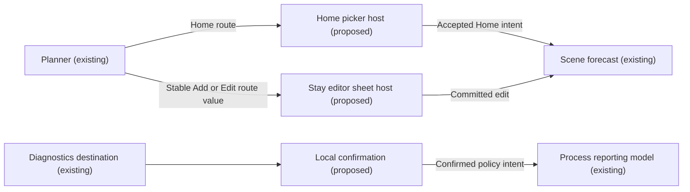

# 03 — Picker, editor, and confirmation

- Status: complete
- Dependencies: [Settings destinations](01-settings-destinations.md) established the destination and fixture conventions.
- Shared context: [Overview](README.md)

The three follow-ups are independent of the [withdrawn Elsewhere work](02-elsewhere-flow.md).

## Intended outcome

Home region selection starts with fresh picker state. Each planner sheet creates its own stay editor and preserves its active draft and save through layout changes. Privacy & Diagnostics owns its confirmation prompt while process-wide reporting still applies and discloses effective policy.

| Story | Requirement | Intended behavior |
| --- | --- | --- |
| [US-03](README.md#user-stories) | [R-04](README.md#requirements) | Home search and errors reset on a new visit. An accepted Home choice still reaches the scene forecast. |
| [US-03](README.md#user-stories) | [R-05](README.md#requirements) | Reopening starts a new presentation. Folding or pushing the nested picker preserves the current draft and save. |
| [US-03](README.md#user-stories) | [R-06](README.md#requirements) | Leaving with an unconfirmed diagnostics prompt discards it. Confirmation and disabling still use process policy intents. |
| [US-04](README.md#user-stories) | [R-07](README.md#requirements) | Production, adaptive navigation, and prepared fixtures use the correct host boundary. |

[X-01 through X-03](README.md#exclusions) apply. Keep forecast and reporting policy semantics and the binding conventions in the [building-ui skill](../../.agents/skills/building-ui/SKILL.md).

## Known design and assumptions

- **Home picker.** [PlannedStaysModel](../../Where/WhereUI/Sources/Forecasting/PlannedStaysModel.swift) owns and preloads a `PlanningRegionSelectionModel`. Move that instance into the Home navigation destination and load upon entry. The [stay editor](../../Where/WhereUI/Sources/Forecasting/PlannedStayEditor.swift) also needs tracked-region data in its parent form and after Manage Regions. Preserve that editor-owned data.
- **Stay editor.** The current planner stores the model as its sheet item. Use a value route describing Add or Edit plus an explicit ID that is fresh for each presentation and stable while the sheet is open. Construct the model in a host at the sheet's stable entrance. Keep the existing domain stay identity, and preserve the planned-stay entry points that already present an editor directly. Leave shared forecast reads on the scene.
- **Diagnostics.** [PrivacyDiagnosticsSettingsView](../../Where/WhereUI/Sources/Settings/PrivacyDiagnosticsSettingsView.swift) binds the DEBUG confirmation flag to [DiagnosticReportingSettingsModel](../../Where/WhereUI/Sources/Settings/DiagnosticReportingSettingsModel.swift). Use destination-owned presentation state and keep the actual grant, disable, retry, effective-state, and revision logic on the process model. Preserve the repository's model-backed derived binding convention when wiring the toggle and dismissing a prompt after it becomes ineligible.



```swift
// Proposed composition. Form controls and prepared fixture injection are omitted.
ObservableHostingView {
    PlanningRegionSelectionModel(report: report)
} content: { model in
    PlanningRegionPickerView(model: model, title: homeTitle, selectedRegion: home, onSelect: setHome)
}
.sheet(item: $editorRoute) { route in
    PlannedStayEditorDestination(report: report, mode: route.mode)
}

ObservableHostingView {
    DiagnosticPersonalDataConfirmation(reporting: reporting)
} content: { confirmation in
    DiagnosticPersonalDataSection(confirmation: confirmation)
}
```

## Questions and learning needed

Home opens through the planner's inline `NavigationLink`. The planner's sheet item currently holds a model, while Calendar and Locations route through `PlannedStaysDestinationView`. Both production paths can use a destination host with the same editor content. The DEBUG toggle asks for confirmation only when a remote level is selected and personal-data sharing is off. The process model already exposes grant and disable intents. Use a local bindable confirmation model with the requested remote policy attached to the dialog action, and recheck that policy before applying the grant.

## Refinement trigger

- The original trigger was completion of Phase 1 and review of its evidence.
- The Phase 1 review confirmed that native navigation should own the host identity and prepared captures should inject the instance their preparation reads. Apply both to the editor paths.
- Recheck the Phase 1 evidence, the existing editor fold behavior, and diagnostics policy guards before marking this phase ready.

## Steps

1. Remove the planner's picker instance and preload. Construct the Home picker model at the navigation destination using `ObservableHostingView`. Keep the selected Home value and accepted write on the shared forecast. Preserve the editor's existing tracked-region load and Manage Regions refresh.
2. Replace the planner's sheet model with a value route containing a per-presentation identity and Add or Edit mode. Use the new editor host in the planner sheet, direct planning destinations, and Flyover. Keep the editor content and prepared snapshots able to use an injected model. Leave the sheet and full editor stack above adaptive branches.
3. Move the DEBUG prompt and derived toggle into a destination-owned observable. Capture the remote policy shown when requesting confirmation and reject a grant if that policy changed or Remote Logging is off. The process model keeps persistence, revisioning, and effective disclosures. Update tests to cover fresh presentation, canceled confirmation, valid grants, and stale grants.
4. Update WhereUI's ownership documentation. Carry forward Phase 1's separation between mounted navigation checks and settled snapshots.

## Acceptance and verification

Run commands from repository root.

| Requirement | Check | Expected result |
| --- | --- | --- |
| R-04 | `./test --only WhereUITests/PlanningRegionSelectionModelTests --only WhereUITests/PlannedStaysModelTests` and exercise Home picker push, leave, and reopen in the mounted planner. | A fresh picker starts with no stale search or selection failure. Confirming Home updates the forecast through the existing path. |
| R-05, R-07 | `./test --only WhereUITests/PlannedStayEditorTests --only WhereUITests/MainTabsTestsDuo` | The planner uses a fresh presentation ID per Add or Edit. A held save and draft survive fold changes, and the nested picker returns to the original draft. |
| R-06 | `./test --only WhereUITests/DiagnosticReportingSettingsModelTests` | Leaving and remounting clears an unconfirmed choice. A changed policy invalidates confirmation, and a valid grant retains unrelated controls. |
| R-07, X-03 | `./test --snapshots --only WhereUISnapshotTests/PlannedStaysViewSnapshotTests --only WhereUISnapshotTests/PlannedStayEditorSnapshotTests --only WhereUISnapshotTests/PrivacyDiagnosticsSettingsViewSnapshotTests` | Existing captures settle with the same editor, navigation, and diagnostics appearance. |

## Recovery

When a draft is recreated during resize, inspect the sheet item ID and the host's position above layout-dependent branches. When diagnostics state survives reopening, inspect the prompt owner's identity and compare the captured policy with current process state. Keep prepared fixtures tied to the instance rendered by the screen.

## Decisions and revisions

| Date | Decision | Source |
| --- | --- | --- |
| 2026-11-27 | Deliver the three smaller audit recommendations together in Phase 2. | User request |
| 2026-11-27 | Require the Add and Edit callers to supply a fresh sheet ID. | [PR review](https://github.com/kyleve/Stuff/pull/578#discussion_r4724697629) |

## Progress

- [x] Move the Home picker and stay editor to their destinations.
- [x] Move diagnostics confirmation ownership to its destination.
- [x] Verify mounted behavior, settled snapshots, and policy.
- [x] Review and publish the implementation.

## Execution record

- 2026-11-27. Refined and reviewed the plan after Phase 1 passed mounted and settled snapshot checks. Traced the native Home push, planner and direct editor sheets, and the DEBUG diagnostics toggle against the source at `41de638f0`. The same destination and fixture conventions apply. No blocking questions remain.
- 2026-11-27. The initial Phase 2 simulator run passed 40 tests, including a fresh Home search after popping and reopening, held editor saves during fold changes, and rejection of superseded reporting policy. The four Phase 2 snapshot tests matched byte for byte with recording disabled. Independent review identified the accessibility parser import needed by hosted tests on fresh simulator processes. The changed traversal tests now import it explicitly.
- 2026-11-27. The final combined iPhone 17 and iOS 27.2 run passed 98 tests across 16 suites. That run includes mounted abandonment and reopening of the native diagnostics prompt and the Flyover data and demo-world checks. Both snapshot runs passed all 11 tests with recording disabled. Architecture checks, SF Symbol lint, SwiftFormat lint, and diff whitespace checks passed.
- 2026-11-27. The mounted Home test initially read the outgoing query during reopening. At `3a0fb707f` it waits for the reopened search field to settle, and passed with the four other focused suites after the Data test awaited share sheet dismissal.

## Resume point

Complete. Planner commit `42701203e` and diagnostics commit `54e4a6fa7` are published in [PR #578](https://github.com/kyleve/Stuff/pull/578).

## Outcome

Home selection and stay drafts start at their presentation boundaries. Diagnostics owns the confirmation prompt and forwards only a still-current consent decision to the process model.
