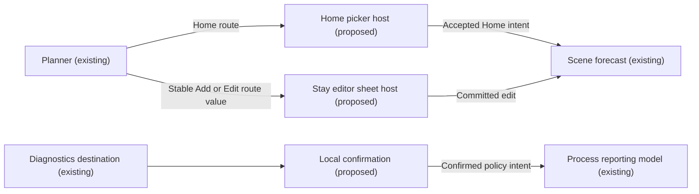

# 03 — Picker, editor, and confirmation

- Status: outline
- Dependencies: [Settings destinations](01-settings-destinations.md) and [Elsewhere flow](02-elsewhere-flow.md) complete the requested first phase. This is an execution order. The three follow-ups have no code dependency on the Elsewhere model.
- Shared context: [Overview](README.md)

## Intended outcome

Home region selection starts with fresh picker state. Each planner sheet creates its own stay editor and preserves its active draft and save through layout changes. Privacy & Diagnostics owns its confirmation prompt while process-wide reporting still applies and discloses effective policy.

| Story | Requirement | Intended behavior |
| --- | --- | --- |
| [US-03](README.md#user-stories) | [R-04](README.md#requirements) | Home search and errors reset on a new visit. An accepted Home choice still reaches the scene forecast. |
| [US-03](README.md#user-stories) | [R-05](README.md#requirements) | Reopening starts a new presentation. Folding or pushing the nested picker preserves the current draft and save. |
| [US-03](README.md#user-stories) | [R-06](README.md#requirements) | Leaving with an unconfirmed diagnostics prompt discards it. Confirmation and disabling still use process policy intents. |
| [US-04](README.md#user-stories) | [R-07](README.md#requirements) | Production, adaptive navigation, and prepared fixtures use the correct host boundary. |

[X-01 through X-03](README.md#exclusions) apply. Keep forecast and reporting policy semantics and the binding conventions in the [building-ui skill](../../.agents/skills/building-ui/SKILL.md).

## Known design and assumptions

- **Home picker.** [PlannedStaysModel](../../Where/WhereUI/Sources/Forecasting/PlannedStaysModel.swift) owns and preloads a `PlanningRegionSelectionModel`. Move that instance into the Home navigation destination and load upon entry. The [stay editor](../../Where/WhereUI/Sources/Forecasting/PlannedStayEditor.swift) also needs tracked-region data in its parent form and after Manage Regions. Preserve that editor-owned data.
- **Stay editor.** The current planner stores the model as its sheet item. Use a value route describing Add or Edit plus a stable presentation identity. Construct the model in a host at the sheet's stable entrance. Keep the existing domain stay identity, and preserve the planned-stay entry points that already present an editor directly. Leave shared forecast reads on the scene.
- **Diagnostics.** [PrivacyDiagnosticsSettingsView](../../Where/WhereUI/Sources/Settings/PrivacyDiagnosticsSettingsView.swift) binds the DEBUG confirmation flag to [DiagnosticReportingSettingsModel](../../Where/WhereUI/Sources/Settings/DiagnosticReportingSettingsModel.swift). Use destination-owned presentation state and keep the actual grant, disable, retry, effective-state, and revision logic on the process model. Preserve the repository's model-backed derived binding convention when wiring the toggle and dismissing a prompt after it becomes ineligible.



```swift
// Proposed ownership only. Binding, fixture, and identity details await refinement.
HomePickerHost(report: report) // Owns its picker model.
PlannedStayEditorHost(report: report, route: route) // Owns one draft per sheet.
DiagnosticsConfirmationState() // Owned by the destination, forwards confirmed intent.
```

## Questions and learning needed

No product questions block Phase 1. Before implementation, trace the real Home push identity, the direct and planner-sheet editor entries, and the DEBUG confirmation's binding and reset behavior. Use Phase 1 results to choose the appropriate host and fixture seams for each named boundary.

## Refinement trigger

- Trigger is completion of both Phase 1 deliverables and review of their evidence.
- Use the mounted identity checks to specify a fresh Home push, a stay draft retained through a fold and a held save, and separate diagnostics confirmation state after reopening. Start with [PlanningRegionSelectionModelTests](../../Where/WhereUI/Tests/PlanningRegionSelectionModelTests.swift), [PlannedStaysModelTests](../../Where/WhereUI/Tests/PlannedStaysModelTests.swift), [PlannedStayEditorTests](../../Where/WhereUI/Tests/PlannedStayEditorTests.swift), and [DiagnosticReportingSettingsModelTests](../../Where/WhereUI/Tests/DiagnosticReportingSettingsModelTests.swift).
- Expand this outline in place with executable steps, failure recovery, and exact mounted and capture checks. Recheck the existing editor fold behavior and diagnostics policy guards before marking the plan ready.

## Decisions and revisions

| Date | Decision | Source |
| --- | --- | --- |
| 2026-11-27 | Deliver the three smaller audit recommendations together in Phase 2. | User request |

## Resume point

After Phase 1, refine this outline using its verification results. Implementation awaits execution authorization.
