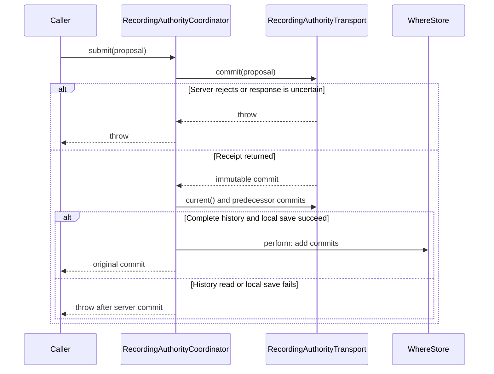

# Recording authority

The recording authority identifies the device that can record automatic location history for an account.
It also holds the minimum data version that devices must support.
One server record orders changes to both values.

CloudKit authority records decide who owns recording.
`SDRecordingAuthorityCommit` records what this device learned about those decisions.
The local records let readers use verified history without making another server request.
They cannot elect an owner or approve a transfer.

This guide covers the authority foundation introduced in PR #345.
That slice supplies the protocol, transports, and local commit store.
Later slices connect it to recording, recovery, and app startup.
The foundation alone does not start or stop GPS, change local recording consent, or block normal app use.

## The state in one example

Suppose phone A owns recording and phone B asks to take over.
The request leaves A as the owner.
After A stops capture and approves the request, B becomes the owner under a new **ownership period**.
`ownershipID` identifies one continuous grant, even if the same installation owns recording again later.

[`RecordingAuthority`](Sources/Coordination/RecordingAuthority.swift) holds four related values:

| Value | Meaning |
| --- | --- |
| `revision` | The sequence number and event ID of the last committed transition. Every transition advances the sequence. |
| `owner` | The installation ID and the event ID that began its current ownership period. Only claim, transfer, and recovery start an ownership period. |
| `pendingHandoff` | A request from another installation, its supported version, and the exact ownership grant it replaces. |
| `requiredVersion` | The shared data contract. Only an explicit upgrade by the current owner raises it. |

For a new account, `.initial` has no revision, owner, or request, and requires version 1.
Once ownership exists, each transition retains an owner.
Turning off local recording consent does not release ownership.
Installing a newer build or requesting a handoff does not raise the data version.

## Where each responsibility lives

| Component | Responsibility |
| --- | --- |
| `RecordingAuthorityProposal` | Validates an action and derives its result from the complete state the caller reviewed. It performs no I/O. |
| `RecordingAuthorityTransport` | Reads server state, finds immutable commits, and conditionally commits proposals. |
| `CloudKitRecordingAuthorityTransport` | Implements the transport in a dedicated private CloudKit zone. |
| `CloudKitRecordingAuthorityRecord` | Validates typed head/event identities and owns payload coding and server commit timestamps. |
| `LocalRecordingAuthorityTransport` | Supplies an in-memory authority for development, demos, and tests. Its lifetime is the transport instance. |
| `RecordingAuthorityCoordinator` | Fetches the complete commit chain and adds it to the existing `WhereStore`. It opens no store of its own. |

The CloudKit transport uses the custom zone `WhereRecordingAuthority`.
It never accesses the zones or records managed by SwiftData.
That separation gives the authority a server condition for each write without changing the app's normal data-sync mechanism.

The custom zone contains two record types:

- `WhereAuthorityHead`, named `head`, contains the latest proposal.
- `WhereAuthorityEvent`, named by the proposal's event UUID, contains an immutable copy of that proposal.

Both records store the proposal in a `payload` Bytes field.
The event's CloudKit `creationDate` supplies the commit's `committedAt` value.
Recovery consumers use that server time as the cutoff for the replaced ownership period.

## How a transition commits

The caller obtains state through `refresh()` and constructs a proposal from that state.
The proposal carries the complete `expected` state, its derived `result`, and a new event ID.
Construction checks the domain rules but does not reserve the server state.

The CloudKit transport then performs these steps:

1. Look for an event with the proposal's ID. If an identical proposal already committed, return its original commit.
2. Read the head and compare its complete state with `proposal.expected`. A mismatch rejects the proposal.
3. Save the updated head and immutable event together, with `atomically: true` and `.ifServerRecordUnchanged`.

The state comparison detects a decision based on old information.
The CloudKit change tag detects another writer between the head read and the save.
The atomic save prevents a losing proposal from leaving a commit that falsely reports success.
This transaction covers the two CloudKit records only.
The local store update happens afterward.



The CloudKit implementation performs the conditional save inside `commit`.
The local implementation supplies the same conflict and retry contract without a network.

### A retry answers a different question from a refresh

A commit answers: **Did this particular proposal commit?**
Current authority answers: **Who owns recording now?**
Another transition can occur between those answers.

For example, A's claim can commit, its response can be lost, and B can later recover ownership.
A retry of the original claim returns A's original commit without changing B's ownership.
`submit()` refreshes the local projection after it obtains the commit.
Consumers read that projection instead of treating the returned commit as the latest grant.

An error does not always mean that the server rejected the write.
The server can commit before a network error, or local reconciliation can fail after the server returns success.
The caller retains the exact proposal and retries with the same event ID until it resolves that outcome.
It must not generate another ID for the same uncertain command.

A confirmed conflict requires fresh state and a new review of the action.
The transport never changes `expected` to make an old decision fit the new head.

## Available transitions

Every action requires a build that supports the current data version.
The proposal initializer owns the complete rules and the resulting state.

| Action | Who can request it | Result |
| --- | --- | --- |
| `.claim` | An installation when no owner exists | Starts its first ownership period. |
| `.requestHandoff` | A different installation when no request is pending | Records a request against the current owner's ownership period. Ownership stays unchanged. |
| `.cancelHandoff` | The owner or requester, for the matching request ID | Removes the request. Ownership stays unchanged. |
| `.approveHandoff` | The current owner, for the matching request ID | Transfers ownership to the requester and starts a new ownership period. |
| `.recover` | A different installation | Replaces the owner, clears any request, and records the selected history treatment. |
| `.upgrade` | The current owner, with a higher supported version | Raises the data version and clears any handoff reviewed under the earlier contract. |

The approval API cannot prove that hardware stopped.
Its caller must durably prevent further capture before submission, including after a restart or an uncertain response.
The recording integration owns that step and the check of local consent before capture starts.

Forced recovery serves a different case: the old phone is lost or unreachable.
It cannot stop an offline old phone immediately.
The recovery proposal identifies the replaced ownership period and records whether its later samples remain visible.
The commit preserves that decision for history consumers.
The foundation stores the decision but does not apply history exclusions itself.

## How local state catches up

`observed()` reads the local commit projection without a network request.
It does not prove that the server state remains unchanged.
`refresh()` reads the server head, then follows each proposal's `expected.revision.eventID` back to the initial state.
Each predecessor's result must exactly match the next proposal's expected state.

The coordinator fetches the whole chain before it writes commits in one `WhereStore.perform` transaction.
[`WhereStore.recordingAuthority()`](Sources/Persistence/WhereStore.swift) then replays the commits in sequence order.
Each transition must continue the state produced by its predecessor.
Missing predecessors, conflicting commits, and invalid transitions throw instead of granting authority from a partial history.

The head alone is insufficient.
A device that missed a recovery must still receive that recovery's history choice, even if several later transitions changed the head.
Immutable event records keep those decisions available.
Receipts also accumulate locally, so a delayed response cannot replace newer local authority with an older head.

[`SDRecordingAuthorityCommit`](Sources/Persistence/SwiftDataStore.swift) has no user-history generation field.
History Reset and Replace retain these commits.
Backups omit them because restoring live ownership from an archive can revive an obsolete grant.
An empty local history resolves to `.initial`.
If the server head disappears after local authority exists, `refresh()` throws `authorityDisappeared`.

Push notifications only request another refresh.
Consumers still need launch and foreground refreshes, and must invalidate cached authority after a CloudKit account change.
Network and authentication failures remain errors. They do not mean that no owner exists.

## Calling example

This example assumes an existing store, transport, and installation context.
It shows the first claim only. Recording activation belongs to the later integration.

```swift
let authority = RecordingAuthorityCoordinator(store: store, transport: transport)
let state = try await authority.refresh()
let proposal = try RecordingAuthorityProposal(
    state: state,
    action: .claim,
    deviceID: installation.currentDevice.id,
    buildVersion: .current,
    eventID: .init(rawValue: UUID())
)

// The caller retains this proposal across an uncertain response.
let commit = try await authority.submit(proposal)
let currentAuthority = try await authority.observed()
```

`commit` identifies this claim's outcome.
`currentAuthority` includes any later transitions observed during reconciliation.
Neither value changes local consent or starts hardware.

## Review and verification

The useful reading order is:

1. [`RecordingAuthority.swift`](Sources/Coordination/RecordingAuthority.swift): state, transition rules, and decoded-proposal validation.
2. [`CloudKitRecordingAuthorityTransport.swift`](Sources/Coordination/CloudKitRecordingAuthorityTransport.swift): commit lookup, conditional save, and server timestamps.
3. [`RecordingAuthorityCoordinator.swift`](Sources/Coordination/RecordingAuthorityCoordinator.swift): complete-history reconciliation and the server/local transaction boundary.
4. [`RecordingAuthorityCoordinatorTests.swift`](Tests/RecordingAuthorityCoordinatorTests.swift) and [`RecordingAuthorityTransportTests.swift`](Tests/RecordingAuthorityTransportTests.swift): missing history, competing claims, and retry after a later transition.

The [bounded authority model](../Specifications/RecordingAuthority/README.md) documents its invariants and modeling limits.
The foundation's tests use the local transport and synthetic CloudKit records.
They cover transition rules and decoding without accessing a real CloudKit account.
They do not establish production schema deployment or live multi-device delivery.

Before distributing the completed stack, deploy the two custom record types and their fields to the production CloudKit environment.
